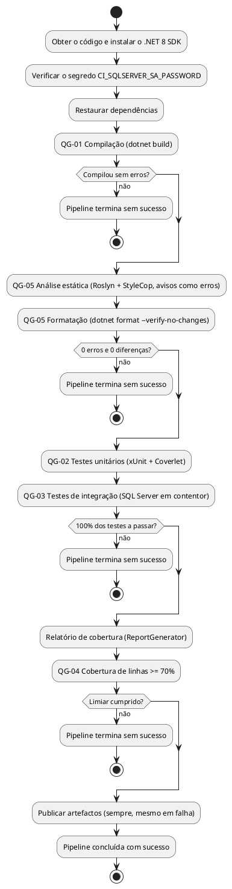

# DESCRIÇÃO DA PIPELINE CI/CD DO BACKEND

| Campo | Valor |
|---|---|
| Grupo | G07 |
| Projeto | DoseCerta |
| Milestone de Entrega | m3 |
| Versão | v01 |
| Issue | I031 (Sprint 03) |
| Configuração arquivada | `/projeto/04-artefactos-tecnicos/04.16-ci-cd/m3-v01` |

## 1. Finalidade e âmbito

Este documento descreve a pipeline de integração contínua do backend do DoseCerta: etapas, gatilhos, ambiente, execução automática dos testes e da análise estática, quality gates, artefactos produzidos, bloqueios, tratamento de falhas e gestão de credenciais. Cumpre a secção 11.6 do Regulamento Interno do Grupo (quality gates QG-01 a QG-05) e a secção 17 do Regulamento de Funcionamento da UC. A pipeline dos frontends (QG-06 a QG-11) é acrescentada em m4, numa nova versão deste documento e da configuração (`m4-v02`).

## 2. Tecnologia e ficheiros

| Elemento | Valor |
|---|---|
| Plataforma | GitHub Actions, repositório único `DoseCerta` |
| Workflow | `.github/workflows/backend-ci.yml` (job `qualidade-backend`) |
| Ambiente de execução | `ubuntu-latest`, .NET 8 SDK (`actions/setup-dotnet@v4`, versão `8.0.x`) |
| Base de dados dos testes | Contentor de serviço `mcr.microsoft.com/mssql/server:2022-latest` (SQL Server 2022), criado e destruído em cada execução |
| Ferramentas | `dotnet build` (Roslyn Analyzers, AnalysisMode Recommended, e StyleCop.Analyzers 1.2.0-beta.556), `dotnet format`, xUnit 2.9.3, Coverlet 6.0.4, ReportGenerator 5.5.11, `jq` |
| Configuração versionada usada pela pipeline | `backend/Directory.Build.props`, `backend/Directory.Packages.props`, `backend/.editorconfig`, `backend/stylecop.json`, `backend/coverage.runsettings` |

## 3. Gatilhos

| Gatilho | Condição | Finalidade |
|---|---|---|
| `pull_request` para `main` | Alterações em `backend/**` ou no próprio workflow | Verificar cada Pull Request antes da revisão e do merge (US-I031-01) |
| `push` para `main` | Alterações em `backend/**` ou no próprio workflow | Confirmar a versão integrada depois do squash merge |
| `workflow_dispatch` | Execução manual | Repetir a verificação, por exemplo para recolher evidências |

A pipeline só é ativada por alterações na pasta do backend, como define a secção 10.1 do Regulamento Interno do Grupo. Execuções sobrepostas da mesma referência são canceladas (`concurrency`), ficando só a mais recente.

## 4. Etapas e quality gates

| Código | Etapa do workflow | Verificação | Ferramenta ou regra | Critério | Efeito do incumprimento | Evidência |
|---|---|---|---|---|---|---|
| QG-01 | `QG-01 Compilação` | Construção | `dotnet build` (Release, sem analisadores) | Compilação sem erros | O passo termina com código diferente de 0; a pipeline termina sem sucesso e o merge fica bloqueado | `artefactos/logs/qg01-compilacao.log` |
| QG-02 | `QG-02 Testes unitários` | Testes unitários | `dotnet test` (xUnit) | 100% dos testes unitários a passar | Idem | `testes-unitarios.trx` |
| QG-03 | `QG-03 Testes de integração` | Testes de integração | `dotnet test` (xUnit, `WebApplicationFactory`, SQL Server em contentor de serviço) | 100% dos testes de integração a passar | Idem | `testes-integracao.trx` |
| QG-04 | `QG-04 Cobertura de linhas mínima` | Cobertura | Coverlet + ReportGenerator, limiar lido de `Summary.json` com `jq` | Cobertura de linhas igual ou superior a 70%, medida sobre os testes unitários e de integração em conjunto, excluindo `Migrations/` e `Program.cs` | Idem | `artefactos/cobertura` (HTML, Cobertura XML, JSON e resumo no separador Summary da execução) |
| QG-05 | `QG-05 Análise estática` e `QG-05 Formatação` | Análise estática, linter e formatação | Roslyn Analyzers (Recommended) + StyleCop com `TreatWarningsAsErrors` e `-warnaserror`; `dotnet format --verify-no-changes` | 0 ocorrências de severidade erro e 0 diferenças de formatação | Idem | `qg05-analise-estatica.log`, `qg05-formatacao.log` |

Ordem e independência: a compilação (QG-01) é feita sem analisadores, para distinguir um erro de compilação de uma violação de análise estática. A compilação do QG-05 é completa (`--no-incremental`) e é a que os testes usam (`--no-build`). Os testes só correm depois de a análise estática passar. Os passos que guardam o log com `tee` terminam com o código de saída do comando principal (`exit "${PIPESTATUS[0]}"`), para que o `tee` não esconda uma falha.

Exclusões: as únicas exclusões são as definidas na secção 11.4 e 11.5 do Regulamento Interno do Grupo: a pasta `Migrations/` (código gerado pelo EF Core) na análise estática e na cobertura, e `Program.cs` na cobertura. As migrações do EF Core existem desde a Issue I030 (migração inicial `Inicial`, em `src/DoseCerta.Infrastructure/Persistence/Migrations`) e são excluídas pelo `.editorconfig` e pelo `coverage.runsettings`. Na cobertura, o `coverage.runsettings` mede apenas os projetos `DoseCerta.Api`, `DoseCerta.Application`, `DoseCerta.Domain` e `DoseCerta.Infrastructure` (os projetos de teste não entram na medição) e ignora o código marcado pelo compilador como gerado (`GeneratedCodeAttribute`, `CompilerGeneratedAttribute`). Não há outras exclusões de regras.

## 5. Artefactos produzidos

O passo `Publicar relatórios de testes, cobertura e análise` corre sempre (`if: always()`), mesmo quando um gate falha, e guarda durante 90 dias o artefacto `relatorios-backend-<n.º da execução>` com:

- os logs da compilação, da análise estática e da formatação;
- os relatórios de testes em formato TRX (unitários e integração);
- o relatório de cobertura em HTML, Cobertura XML e JSON.

Como os artefactos e os logs do GitHub Actions têm prazo de retenção, as evidências usadas na m3 são descarregadas e guardadas em PDF na pasta oficial (Regulamento Interno do Grupo, secção 15.2).

## 6. Bloqueio da integração

O merge na `main` só é possível com a pipeline concluída com sucesso. As regras de proteção da branch `main` (Regulamento Interno do Grupo, secção 10.4) configuram-se em *Settings > Branches > Branch protection rules* para `main`:

- *Require a pull request before merging*, com pelo menos 1 aprovação;
- *Require status checks to pass before merging*, com o check `qualidade-backend` marcado como obrigatório e *Require branches to be up to date before merging*;
- *Do not allow bypassing the above settings* (as regras aplicam-se também aos administradores);
- sem push direto para a `main`.

Limitação conhecida: um check obrigatório que não corre fica pendente. Como a pipeline do backend só é ativada por alterações em `backend/**`, um Pull Request que não altere o backend não executa o check `qualidade-backend`. O grupo decide, em reunião formal, a solução a adotar para esses Pull Requests, por exemplo um workflow complementar com o mesmo nome de check que corre quando os caminhos do backend não são alterados (solução descrita na documentação do GitHub para checks obrigatórios ignorados).

## 7. Tratamento de falhas

| Situação | Comportamento | Ação |
|---|---|---|
| Erro de compilação | Termina no QG-01 | O Executor corrige na sua branch; a pipeline volta a correr no novo commit |
| Aviso dos analisadores ou diferença de formatação | Termina no QG-05 | Corrigir o código ou correr `dotnet format` localmente |
| Teste falhado | Termina no QG-02 ou QG-03; o TRX identifica o teste | Corrigir o código ou o teste; nunca desativar o teste |
| Cobertura abaixo de 70% | Termina no QG-04, com a percentagem no log | Acrescentar testes |
| SQL Server indisponível ou segredo em falta | O contentor não fica saudável ou o passo de verificação do segredo falha | Confirmar o GitHub Secret; repetir a execução |

## 8. Credenciais e segredos

- `CI_SQLSERVER_SA_PASSWORD`: GitHub Secret do repositório (*Settings > Secrets and variables > Actions*), usado só como palavra-passe do contentor temporário do SQL Server e da connection string dos testes. Deve ter pelo menos 8 caracteres com maiúsculas, minúsculas, algarismos e símbolos (política do SQL Server) e não deve conter aspas.
- A chave JWT dos testes é uma constante de teste dentro de `FabricaApi` e não é usada em nenhum ambiente real.
- Nenhum segredo é escrito nos logs: o GitHub Actions mascara os valores dos secrets e a API não regista corpos nem cabeçalhos dos pedidos.
- O workflow tem apenas a permissão `contents: read`.

## 9. Demonstração do bloqueio

Para a evidência da US-I031-02, o Executor abre um Pull Request de demonstração com uma falha deliberada (por exemplo, um teste unitário com `Assert.True(false)`), confirma que a execução termina sem sucesso no QG-02 e que o botão de merge fica bloqueado, guarda a ligação da execução e a captura, e fecha o Pull Request sem merge. A execução bem-sucedida sobre o código da `main` serve de evidência do caminho de sucesso.

## 10. Rastreabilidade

| Critério de aceitação da I031 | Onde é cumprido |
|---|---|
| Executada automaticamente em cada Pull Request e em cada integração na `main` | Secção 3 |
| Implementa QG-01 a QG-05 com os critérios do Regulamento Interno do Grupo | Secção 4 |
| Termina sem sucesso e bloqueia o merge quando falha a compilação, um teste, a cobertura de 70% ou a análise estática | Secções 4, 6 e 7 |
| Produz o relatório de testes e o relatório de cobertura | Secção 5 |
| Branch `main` protegida e a exigir a pipeline com sucesso | Secção 6 |
| Explica etapas, gatilhos, bloqueios e gestão de segredos | Secções 3, 4, 6 e 8 |
