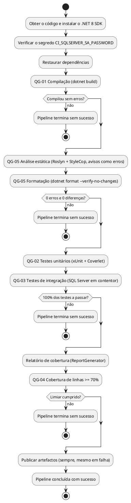
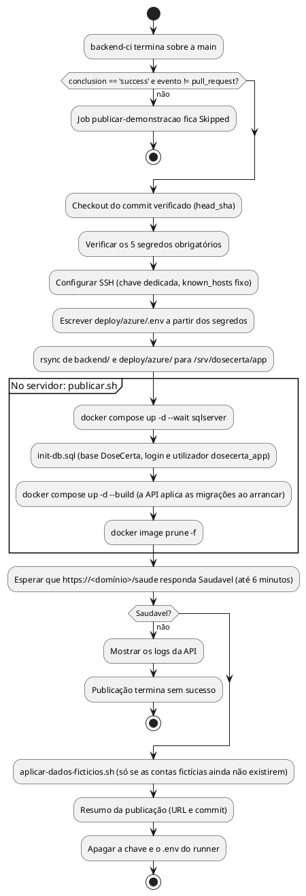

# DESCRIÇÃO DA PIPELINE CI/CD DO BACKEND

| Campo | Valor |
|---|---|
| Grupo | G07 |
| Projeto | DoseCerta |
| Milestone de Entrega | m3 |
| Versão | v02 |
| Issue | I031 (Sprint 03); I040 (Sprint 04) |
| Configuração arquivada | `/projeto/04-artefactos-tecnicos/04.16-ci-cd/m3-v02` |

| Versão | Alterações |
|---|---|
| v01 | Integração contínua do backend: gatilhos, quality gates QG-01 a QG-05, artefactos, bloqueio do merge e segredos (Issue I031) |
| v02 | Publicação contínua no ambiente de demonstração (Issue I040): URL público, workflow `backend-cd`, processo de publicação, base de dados, dados e credenciais fictícias de demonstração e segredos da publicação (secções 1, 2, 3, 8, 10 e 11). As secções 4 a 7 e 9 mantêm o conteúdo da v01; a secção 7 ganha só a remissão para a secção 10.6 |

## 1. Finalidade e âmbito

Este documento descreve a pipeline CI/CD do backend do DoseCerta. A parte de integração contínua (Issue I031) cobre etapas, gatilhos, ambiente, execução automática dos testes e da análise estática, quality gates, artefactos produzidos, bloqueios, tratamento de falhas e gestão de credenciais. Cumpre a secção 11.6 do Regulamento Interno do Grupo (quality gates QG-01 a QG-05) e a secção 17 do Regulamento de Funcionamento da UC. A parte de publicação contínua (Issue I040, secção 10) descreve como cada versão integrada na `main` e verificada pela integração contínua é publicada automaticamente no ambiente de demonstração, com URL público. A pipeline dos frontends (QG-06 a QG-11) é acrescentada em m4, numa nova versão deste documento e da configuração (`m4-v03`).

## 2. Tecnologia e ficheiros

| Elemento | Valor |
|---|---|
| Plataforma | GitHub Actions, repositório único `DoseCerta` |
| Workflow de integração contínua | `.github/workflows/backend-ci.yml` (job `qualidade-backend`) |
| Workflow de publicação contínua | `.github/workflows/backend-cd.yml` (job `publicar-demonstracao`, environment `demonstracao`) |
| Ambiente de execução | `ubuntu-latest`, .NET 8 SDK (`actions/setup-dotnet@v4`, versão `8.0.x`) |
| Base de dados dos testes | Contentor de serviço `mcr.microsoft.com/mssql/server:2022-latest` (SQL Server 2022), criado e destruído em cada execução |
| Ferramentas | `dotnet build` (Roslyn Analyzers, AnalysisMode Recommended, e StyleCop.Analyzers 1.2.0-beta.556), `dotnet format`, xUnit 2.9.3, Coverlet 6.0.4, ReportGenerator 5.5.11, `jq`; na publicação, `ssh`, `rsync`, `curl`, Docker e Docker Compose |
| Configuração versionada usada pela pipeline | `backend/Directory.Build.props`, `backend/Directory.Packages.props`, `backend/.editorconfig`, `backend/stylecop.json`, `backend/coverage.runsettings` |
| Configuração versionada usada pela publicação | `backend/Dockerfile`, `backend/.dockerignore`, `deploy/azure/docker-compose.yml`, `deploy/azure/Caddyfile`, `deploy/azure/.env.example`, `deploy/azure/init-db.sql`, `deploy/azure/publicar.sh`, `deploy/azure/aplicar-dados-ficticios.sh` e, só de leitura, `backend/scripts-base-dados/02-dados-iniciais-ficticios.sql` (Issue I030) |

## 3. Gatilhos

Integração contínua (`backend-ci`):

| Gatilho | Condição | Finalidade |
|---|---|---|
| `pull_request` para `main` | Alterações em `backend/**` ou no próprio workflow | Verificar cada Pull Request antes da revisão e do merge (US-I031-01) |
| `push` para `main` | Alterações em `backend/**` ou no próprio workflow | Confirmar a versão integrada depois do squash merge |
| `workflow_dispatch` | Execução manual | Repetir a verificação, por exemplo para recolher evidências |

A pipeline só é ativada por alterações na pasta do backend, como define a secção 10.1 do Regulamento Interno do Grupo. Execuções sobrepostas da mesma referência são canceladas (`concurrency`), ficando só a mais recente.

Publicação contínua (`backend-cd`):

| Gatilho | Condição | Finalidade |
|---|---|---|
| `workflow_run` da `backend-ci` (`types: completed`, `branches: main`) | A execução da `backend-ci` terminou com `conclusion == 'success'`, sobre a `main` e não originada por um Pull Request | Publicar automaticamente cada versão integrada e verificada |
| `workflow_dispatch` | Execução manual, aceite só sobre a `main` | Publicar de novo sem alterar o backend, por exemplo depois de alterar só `deploy/azure/` ou um segredo |

O detalhe da publicação está na secção 10.

## 4. Etapas e quality gates



| Código | Etapa do workflow | Verificação | Ferramenta ou regra | Critério | Efeito do incumprimento | Evidência |
|---|---|---|---|---|---|---|
| QG-01 | `QG-01 Compilação` | Construção | `dotnet build` (Release, sem analisadores) | Compilação sem erros | O passo termina com código diferente de 0; a pipeline termina sem sucesso e o merge fica bloqueado | `artefactos/logs/qg01-compilacao.log` |
| QG-02 | `QG-02 Testes unitários` | Testes unitários | `dotnet test` (xUnit) | 100% dos testes unitários a passar | Idem | `testes-unitarios.trx` |
| QG-03 | `QG-03 Testes de integração` | Testes de integração | `dotnet test` (xUnit, `WebApplicationFactory`, SQL Server em contentor de serviço) | 100% dos testes de integração a passar | Idem | `testes-integracao.trx` |
| QG-04 | `QG-04 Cobertura de linhas mínima` | Cobertura | Coverlet + ReportGenerator, limiar lido de `Summary.json` com `jq` | Cobertura de linhas igual ou superior a 70%, medida sobre os testes unitários e de integração em conjunto, excluindo `Migrations/` e `Program.cs` | Idem | `artefactos/cobertura` (HTML, Cobertura XML, JSON e resumo no separador Summary da execução) |
| QG-05 | `QG-05 Análise estática` e `QG-05 Formatação` | Análise estática, linter e formatação | Roslyn Analyzers (Recommended) + StyleCop com `TreatWarningsAsErrors` e `-warnaserror`; `dotnet format --verify-no-changes` | 0 ocorrências de severidade erro e 0 diferenças de formatação | Idem | `qg05-analise-estatica.log`, `qg05-formatacao.log` |

Ordem e independência: a compilação (QG-01) é feita sem analisadores, para distinguir um erro de compilação de uma violação de análise estática. A compilação do QG-05 é completa (`--no-incremental`) e é a que os testes usam (`--no-build`). Os testes só correm depois de a análise estática passar. Os passos que guardam o log com `tee` terminam com o código de saída do comando principal (`exit "${PIPESTATUS[0]}"`), para que o `tee` não esconda uma falha.

Exclusões: as únicas exclusões são as definidas na secção 11.4 e 11.5 do Regulamento Interno do Grupo: a pasta `Migrations/` (código gerado pelo EF Core) na análise estática e na cobertura, e `Program.cs` na cobertura. As migrações do EF Core existem desde a Issue I030 (migração inicial `Inicial`, em `src/DoseCerta.Infrastructure/Persistence/Migrations`) e são excluídas pelo `.editorconfig` e pelo `coverage.runsettings`. Na cobertura, o `coverage.runsettings` mede apenas os projetos `DoseCerta.Api`, `DoseCerta.Application`, `DoseCerta.Domain` e `DoseCerta.Infrastructure` (os projetos de teste não entram na medição) e ignora o código marcado pelo compilador como gerado (`GeneratedCodeAttribute`, `CompilerGeneratedAttribute`). Não há outras exclusões de regras.

## 5. Artefactos produzidos

O passo `Publicar relatórios de testes, cobertura e análise` corre sempre (`if: always()`), mesmo quando um gate falha, e guarda durante 90 dias o artefacto `relatorios-backend-<n.º da execução>` com:

- os logs da compilação, da análise estática e da formatação;
- os relatórios de testes em formato TRX (unitários e integração);
- o relatório de cobertura em HTML, Cobertura XML e JSON.

Como os artefactos e os logs do GitHub Actions têm prazo de retenção, as evidências usadas na m3 são descarregadas e guardadas em PDF na pasta oficial (Regulamento Interno do Grupo, secção 15.2).

## 6. Bloqueio da integração

O merge na `main` só é possível com a pipeline concluída com sucesso. As regras de proteção da branch `main` (Regulamento Interno do Grupo, secção 10.4) configuram-se em *Settings > Branches > Branch protection rules* para `main`:

- *Require a pull request before merging*, com pelo menos 1 aprovação;
- *Require status checks to pass before merging*, com o check `qualidade-backend` marcado como obrigatório e *Require branches to be up to date before merging*;
- *Do not allow bypassing the above settings* (as regras aplicam-se também aos administradores);
- sem push direto para a `main`.

Limitação conhecida: um check obrigatório que não corre fica pendente. Como a pipeline do backend só é ativada por alterações em `backend/**`, um Pull Request que não altere o backend não executa o check `qualidade-backend`. O grupo decide, em reunião formal, a solução a adotar para esses Pull Requests, por exemplo um workflow complementar com o mesmo nome de check que corre quando os caminhos do backend não são alterados (solução descrita na documentação do GitHub para checks obrigatórios ignorados).

## 7. Tratamento de falhas

| Situação | Comportamento | Ação |
|---|---|---|
| Erro de compilação | Termina no QG-01 | O Executor corrige na sua branch; a pipeline volta a correr no novo commit |
| Aviso dos analisadores ou diferença de formatação | Termina no QG-05 | Corrigir o código ou correr `dotnet format` localmente |
| Teste falhado | Termina no QG-02 ou QG-03; o TRX identifica o teste | Corrigir o código ou o teste; nunca desativar o teste |
| Cobertura abaixo de 70% | Termina no QG-04, com a percentagem no log | Acrescentar testes |
| SQL Server indisponível ou segredo em falta | O contentor não fica saudável ou o passo de verificação do segredo falha | Confirmar o GitHub Secret; repetir a execução |

As falhas da publicação estão na secção 10.6.

## 8. Credenciais e segredos

Integração contínua:

- `CI_SQLSERVER_SA_PASSWORD`: GitHub Secret do repositório (*Settings > Secrets and variables > Actions*), usado só como palavra-passe do contentor temporário do SQL Server e da connection string dos testes. Deve ter pelo menos 8 caracteres com maiúsculas, minúsculas, algarismos e símbolos (política do SQL Server) e não deve conter aspas.
- A chave JWT dos testes é uma constante de teste dentro de `FabricaApi` e não é usada em nenhum ambiente real.

Publicação contínua: GitHub Secrets do environment `demonstracao` (*Settings > Environments > demonstracao*). O environment só aceita a branch `main` (*Deployment branches*), por isso um job de outra branch não recebe estes segredos.

| Segredo | Obrigatório | Uso |
|---|---|---|
| `SSH_CHAVE_PRIVADA` | Sim | Chave ed25519 dedicada à publicação, sem frase-passe, instalada em `authorized_keys` do utilizador `dosecerta` da VM com `no-port-forwarding,no-agent-forwarding,no-X11-forwarding,no-pty`. Não é a chave pessoal de nenhum elemento (Regulamento Interno do Grupo, secção 14.1) |
| `SSH_KNOWN_HOSTS` | Sim | Linha `ssh-keyscan -t ed25519` da VM, com a impressão digital confirmada na própria VM; a ligação usa `StrictHostKeyChecking yes` |
| `MSSQL_SA_PASSWORD` | Sim | Palavra-passe do `sa` do SQL Server, usada só para administração (init-db.sql e dados fictícios) |
| `DOSECERTA_APP_PASSWORD` | Sim | Palavra-passe do login `dosecerta_app`, com que a API se liga à base de dados |
| `JWT_CHAVE` | Sim | Chave de assinatura dos tokens JWT da API (pelo menos 32 carateres) |
| `EMAIL_SERVIDOR`, `EMAIL_PORTA`, `EMAIL_UTILIZADOR`, `EMAIL_PALAVRA_PASSE`, `EMAIL_REMETENTE` | Não | Servidor SMTP. Em m3 não estão definidos: a API arranca sem enviar e-mails e os convites são criados na mesma |

Não são segredos e estão no próprio workflow: o domínio, o utilizador SSH `dosecerta` e a pasta `/srv/dosecerta/app`. A edição do SQL Server vem da variável opcional `MSSQL_PID` do environment; sem ela, é `Developer` (Regulamento Interno do Grupo, secção 11.2).

Regras comuns:

- Nenhum segredo está no repositório. O `.gitignore` ignora `.env` e aceita só `deploy/azure/.env.example`, com marcadores `<...>`. O `.env` da VM é escrito pelo workflow em cada publicação, com permissões 600, e o do runner é apagado no fim do job.
- As palavras-passe e a chave JWT da demonstração têm só letras e algarismos: um `'` partiria o T-SQL do `init-db.sql` e um `$` seria interpretado pelo Docker Compose.
- Nenhum segredo é escrito nos logs: o GitHub Actions mascara os valores dos secrets, a API não regista corpos nem cabeçalhos dos pedidos e as palavras-passe chegam ao `sqlcmd` por variáveis de ambiente, nunca pelos argumentos.
- Os dois workflows têm apenas a permissão `contents: read`; o checkout da publicação não guarda o token (`persist-credentials: false`).
- Rotação (Regulamento Interno do Grupo, secção 14.2): `DOSECERTA_APP_PASSWORD` e `JWT_CHAVE` mudam-se no secret e entram em vigor na publicação seguinte (o `init-db.sql` acerta a palavra-passe do login; uma nova `JWT_CHAVE` termina as sessões abertas). A `MSSQL_SA_PASSWORD` só tem efeito na primeira criação do volume do SQL Server: para a mudar, executar primeiro `ALTER LOGIN sa WITH PASSWORD = ...` na VM (secção 10.8) e só depois atualizar o secret. A chave SSH muda-se gerando um novo par, substituindo a linha em `authorized_keys` e o secret.

## 9. Demonstração do bloqueio

Para a evidência da US-I031-02, o Executor abre um Pull Request de demonstração com uma falha deliberada (por exemplo, um teste unitário com `Assert.True(false)`), confirma que a execução termina sem sucesso no QG-02 e que o botão de merge fica bloqueado, guarda a ligação da execução e a captura, e fecha o Pull Request sem merge. A execução bem-sucedida sobre o código da `main` serve de evidência do caminho de sucesso.

## 10. Publicação contínua no ambiente de demonstração

### 10.1 Ambiente

| Elemento | Valor |
|---|---|
| URL público | **https://dosecerta.spaincentral.cloudapp.azure.com** |
| Verificação do estado | https://dosecerta.spaincentral.cloudapp.azure.com/saude (resposta `{"estado":"Saudavel","verificacoes":{"baseDados":"Saudavel"}}`) |
| Prefixo da API | `/api/v1` |
| Servidor | Máquina virtual Azure, Ubuntu 24.04, região Spain Central, 2 vCPU e 8 GB, sempre ativa (RNF-030) |
| Firewall do Azure | Portas 22 (SSH), 80 e 443 abertas; a porta 1433 não está aberta |
| Contentores (Docker Compose, projeto `dosecerta-demo`) | `caddy` (HTTPS com certificado automático; HTTP redirecionado para HTTPS com 308, RNF-002); `api` (ASP.NET Core 8, porta 8080 só na rede interna do Docker); `sqlserver` (SQL Server 2022, edição `Developer`, porta 1433 só em `127.0.0.1` da VM) |
| Dados persistentes | Volume `sql-dados` (ficheiros do SQL Server), volume `caddy-dados` (certificados) e pasta `/srv/dosecerta/documentos` (documentos carregados, fora do conteúdo servido pela API, RNF-007) |
| Pasta da aplicação na VM | `/srv/dosecerta/app` (cópia de `backend/` e `deploy/azure/` do commit publicado e o `.env`) |

A API usa o login próprio `dosecerta_app`, membro de `db_owner` só na base `DoseCerta` (precisa de criar as tabelas pelas migrações) e sem poderes sobre o servidor. O `sa` é usado só pelos scripts de administração, dentro do contentor. A API corre com `ASPNETCORE_ENVIRONMENT=Production` e `ASPNETCORE_FORWARDEDHEADERS_ENABLED=true`, para reconhecer que o pedido original chegou por HTTPS ao Caddy.

### 10.2 Quando há publicação

A publicação é automática depois de cada integração na `main` cuja `backend-ci` termine com sucesso. O job `publicar-demonstracao` só corre quando esta condição é verdadeira:

```yaml
(github.event_name == 'workflow_run'
  && github.event.workflow_run.conclusion == 'success'
  && github.event.workflow_run.head_branch == 'main'
  && github.event.workflow_run.event != 'pull_request')
|| (github.event_name == 'workflow_dispatch' && github.ref == 'refs/heads/main')
```

- **A publicação não acontece quando a CI falha.** O `workflow_run` é desencadeado sempre que a `backend-ci` termina, qualquer que seja o resultado, mas só o resultado `success` satisfaz a condição. Os restantes (`failure`, quando falha um quality gate; `cancelled`; `timed_out`; `action_required`; `startup_failure`; `skipped`; `neutral`; `stale`) deixam o job no estado *Skipped*, sem executar nenhum passo: nada é enviado para o servidor e a versão anterior continua publicada.
- As execuções da `backend-ci` originadas por Pull Requests nunca publicam, mesmo que a branch de origem se chame `main` (por exemplo, num fork).
- É publicado exatamente o commit que a `backend-ci` verificou (`github.event.workflow_run.head_sha`), mesmo que entretanto tenha entrado outro commit na `main`.
- A `backend-ci` só corre com alterações em `backend/**` (secção 3). Um merge que altere só `deploy/azure/` ou a documentação não desencadeia a publicação; nesse caso, um elemento do grupo lança a `backend-cd` à mão (*Actions > backend-cd > Run workflow*, branch `main`). A `main` só recebe código através de Pull Requests com o check `qualidade-backend` obrigatório (secção 6).
- Publicações sobrepostas não se interrompem (`concurrency: backend-cd`, `cancel-in-progress: false`): uma nova espera que a anterior termine.

### 10.3 Processo de publicação



| N.º | Passo do workflow | O que faz |
|---|---|---|
| 1 | `Obter o código verificado pela backend-ci` | `actions/checkout@v4` do `head_sha` verificado (ou da `main`, na execução manual), sem guardar o token |
| 2 | `Verificar os segredos` | Termina sem sucesso, com o nome do segredo em falta, se algum dos 5 obrigatórios estiver vazio |
| 3 | `Configurar o acesso SSH ao servidor` | Escreve a chave dedicada e o `known_hosts`; o servidor é aceite só se a chave do anfitrião coincidir |
| 4 | `Escrever o .env a partir dos segredos` | Cria `deploy/azure/.env` com `umask 077` (domínio, `MSSQL_PID`, palavras-passe, chave JWT e SMTP) |
| 5 | `Enviar backend/ e deploy/azure/ para o servidor` | `rsync -az --delete --relative`, sem `bin/`, `obj/` nem `artefactos/`; os ficheiros que deixaram de existir no repositório são apagados no servidor |
| 6 | `Publicar no servidor` | Executa `deploy/azure/publicar.sh` por SSH (ver a seguir) |
| 7 | `Esperar que /saude responda Saudavel` | Pede `https://<domínio>/saude` de fora, a cada 10 segundos, até 36 vezes; termina sem sucesso se o `estado` não for `Saudavel` |
| 8 | `Aplicar os dados iniciais fictícios` | Executa `deploy/azure/aplicar-dados-ficticios.sh` por SSH (secção 10.4) |
| 9 | `Resumo da publicação` | Escreve o URL, o commit e o gatilho no separador Summary da execução |
| 10 | `Mostrar os logs da API` | Só em caso de falha: `docker compose ps` e as últimas 100 linhas do log da API |
| 11 | `Apagar a chave e o .env do runner` | Sempre, mesmo em caso de falha |

O `publicar.sh` executa no servidor, por esta ordem: arranca o SQL Server e espera que fique saudável (`docker compose up -d --wait sqlserver`); executa o `init-db.sql` com o `sqlcmd` dentro do contentor; constrói a imagem da API a partir de `backend/Dockerfile` e arranca a API e o Caddy (`docker compose up -d --build --remove-orphans`); remove as imagens antigas (`docker image prune -f`). A imagem nova é construída antes de o contentor antigo parar: se a construção falhar, o script termina sem sucesso e a versão anterior continua a responder. O mesmo script pode ser executado à mão na VM (`bash /srv/dosecerta/app/deploy/azure/publicar.sh`).

### 10.4 Base de dados e dados fictícios

- O `init-db.sql` é idempotente e corre em todas as publicações, antes de a API arrancar: cria a base `DoseCerta`, o login e o utilizador `dosecerta_app` só se ainda não existirem, acerta a palavra-passe do login com o segredo atual e garante o papel `db_owner`.
- As tabelas, as restrições, os índices, os gatilhos e os valores das listas fechadas (condições de saúde, alergias e graus de autonomia) são criados pelas migrações do EF Core, que a API aplica ao arrancar (`BaseDados__AplicarMigracoesNoArranque=true`). O `01-criar-base-dados.sql` não é usado na demonstração. As migrações novas de cada versão aplicam-se sozinhas na publicação.
- Os dados iniciais vêm do `02-dados-iniciais-ficticios.sql` (Issue I030), que não foi alterado. Esse script só tem `INSERT` com identificadores fixos, numa única transação: numa segunda execução falharia. Por isso, o `aplicar-dados-ficticios.sh` conta as 4 contas fictícias (pelo identificador e pelo e-mail) e só executa o script quando nenhuma existe. Se existir pelo menos uma, não faz nada, porque os dados já foram aplicados e podem ter sido alterados pela utilização da demonstração. Como o script é tudo ou nada, uma aplicação falhada não deixa dados parciais e é repetida na publicação seguinte.
- A base de dados de demonstração tem apenas dados fictícios (RNF-050; Regulamento Interno do Grupo, secção 14.3): os do script 02 e os criados durante a utilização da demonstração e os testes.

### 10.5 Credenciais fictícias de demonstração

As contas seguintes são criadas pelo `02-dados-iniciais-ficticios.sql`. Todos os nomes, e-mails e dados são inventados. A palavra-passe é a mesma para as quatro contas e é fictícia, sem relação com nenhuma conta pessoal (Regulamento Interno do Grupo, secção 14.1).

| Conta | E-mail | Palavra-passe | Situação inicial |
|---|---|---|---|
| Ana Fictícia | `ana@exemplo.pt` | `Demo2026x` | Cuidadora principal da ficha de Maria Fictícia Santos (terceiro) e titular da sua ficha própria |
| Rui Fictício | `rui@exemplo.pt` | `Demo2026x` | Familiar na ficha de Maria Fictícia Santos (convite aceite) |
| Joana Fictícia | `joana@exemplo.pt` | `Demo2026x` | Cuidadora principal provisória da ficha de Alberto Fictício Costa |
| Carlos Fictício | `carlos@exemplo.pt` | `Demo2026x` | Com um convite pendente para ser Cuidador principal da ficha de Alberto Fictício Costa |

Há também um convite pendente para `joao@exemplo.pt`, endereço ainda sem conta (RF-044). Para iniciar sessão: `POST https://dosecerta.spaincentral.cloudapp.azure.com/api/v1/auth/login` com `{"email":"ana@exemplo.pt","palavraPasse":"Demo2026x"}`. As contas podem ser alteradas por quem usa a demonstração; a situação inicial só é reposta se a base de dados for recriada.

### 10.6 Tratamento de falhas

| Situação | Comportamento | Ação |
|---|---|---|
| A `backend-ci` não termina com sucesso | O job `publicar-demonstracao` fica *Skipped*; nada muda no servidor | Corrigir na `main` através de um novo Pull Request |
| Segredo em falta | Termina no passo `Verificar os segredos`, com o nome do segredo | Criar o segredo no environment `demonstracao` e lançar a `backend-cd` à mão |
| Chave do anfitrião diferente do `SSH_KNOWN_HOSTS` | O SSH recusa a ligação (`Host key verification failed`) | Confirmar a impressão digital na VM antes de atualizar o secret; nunca desligar a verificação |
| A imagem da API não compila | O `publicar.sh` termina sem sucesso; o contentor anterior continua a responder | Corrigir o código |
| A API nova não arranca ou o `/saude` não responde `Saudavel` em 6 minutos | O passo de espera termina sem sucesso e o passo seguinte mostra os logs da API | Corrigir e integrar de novo; não há reposição automática da versão anterior |
| Falha a aplicar os dados fictícios | O passo termina sem sucesso e a transação do 02 é desfeita | Ver o log; a aplicação é repetida na publicação seguinte |

### 10.7 Evidências

- A execução da `backend-cd` com sucesso, com o separador Summary (URL e commit) e o Deployment do environment `demonstracao`.
- A resposta de `https://dosecerta.spaincentral.cloudapp.azure.com/saude` e o redirecionamento 308 do HTTP.
- A publicação ignorada quando a CI não termina com sucesso: lançar a `backend-ci` na `main` com `workflow_dispatch` e cancelá-la; a `backend-cd` desencadeada fica com o job *Skipped*. O resultado `failure` é tratado da mesma forma, porque a condição só aceita `success` (secção 10.2).
- A porta 1433 fechada para fora (`Test-NetConnection dosecerta.spaincentral.cloudapp.azure.com -Port 1433` com `TcpTestSucceeded : False`).
- A execução da collection Postman contra o URL público (Issue I036), com o relatório do `newman`.

### 10.8 Administração

Só os elementos do grupo administram a VM, cada um com a sua chave pessoal; a chave da publicação é usada apenas pelo workflow.

- Estado e logs: `cd /srv/dosecerta/app/deploy/azure && docker compose ps && docker compose logs --tail 100 api`.
- Publicação manual na VM: `bash /srv/dosecerta/app/deploy/azure/publicar.sh` (usa o `.env` da última publicação).
- SQL Server Management Studio por túnel SSH, sem abrir a porta 1433: no PC, `ssh -N -L 14330:127.0.0.1:1433 <utilizador>@dosecerta.spaincentral.cloudapp.azure.com` e, no SSMS, `localhost,14330`, autenticação SQL Server com o `sa`, *Encryption* obrigatória e *Trust server certificate* marcado.

## 11. Rastreabilidade

| Critério de aceitação da I031 | Onde é cumprido |
|---|---|
| Executada automaticamente em cada Pull Request e em cada integração na `main` | Secção 3 |
| Implementa QG-01 a QG-05 com os critérios do Regulamento Interno do Grupo | Secção 4 |
| Termina sem sucesso e bloqueia o merge quando falha a compilação, um teste, a cobertura de 70% ou a análise estática | Secções 4, 6 e 7 |
| Produz o relatório de testes e o relatório de cobertura | Secção 5 |
| Branch `main` protegida e a exigir a pipeline com sucesso | Secção 6 |
| Explica etapas, gatilhos, bloqueios e gestão de segredos | Secções 3, 4, 6 e 8 |

| Critério de aceitação da I040 | Onde é cumprido |
|---|---|
| O backend responde em https://dosecerta.spaincentral.cloudapp.azure.com, incluindo o `/saude` | Secções 10.1 e 10.3 (passo 7); evidência na secção 10.7 |
| A base de dados de demonstração é criada pelas migrações e tem só dados fictícios | Secção 10.4 |
| A publicação é automática depois de cada integração na `main` com a `backend-ci` terminada com sucesso, e não acontece quando a CI falha | Secções 3 e 10.2; evidência na secção 10.7 |
| Nenhum segredo fica no repositório; os segredos ficam em GitHub Secrets | Secção 8 |
| A descrição da pipeline indica o URL, o processo de publicação e as credenciais fictícias de demonstração | Secções 10.1, 10.3 e 10.5 |
| A collection Postman corre com sucesso contra o URL público | Secção 10.7 (depois da entrega da I036) |
