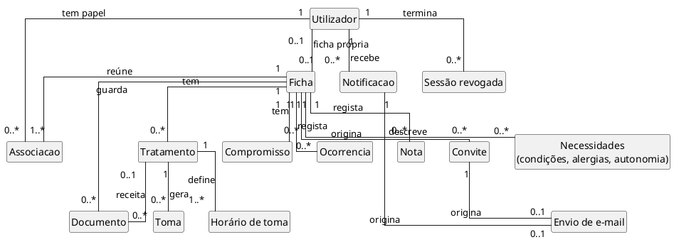

# MODELO DE DADOS DOSECERTA

| Campo | Valor |
|---|---|
| Grupo | G07 |
| Projeto | DoseCerta |
| Milestone de Entrega | m3 |
| Versão | v03 |
| Base de dados | DoseCerta |

## 1. Finalidade e tecnologia

Este documento descreve a base de dados do DoseCerta: os modelos conceptual, lógico e físico e o dicionário de dados. Define a persistência que suporta as funcionalidades F001 a F006 e F008 a F011 e serviu de base à implementação com Entity Framework Core code-first em m3.

Nesta versão (v03) o modelo foi confrontado com o esquema criado pelas migrações do EF Core na branch `main`, no commit `7bf212c` (2026-10-30 12:25 UTC). As tabelas, os campos, os tipos, as chaves, as restrições `CHECK`, os índices e os gatilhos coincidem com o script da secção 13.2: a comparação dos catálogos feita na Issue I054 (Pull Request #64) encontrou os mesmos 240 elementos nas bases criadas pelas migrações, por este script e por `scripts-base-dados/01`, e só as diferenças de forma da divergência D24. A v03 documenta essas diferenças (D24, secção 13.3) e a forma de gerar o script das migrações (D25, secção 13.4), e assinala o índice que serve uma funcionalidade ainda por implementar no código (secção 11). As alterações face à v02 estão na secção 16.

Alteração de âmbito: a funcionalidade F007 (tarefas de cuidados recorrentes) é retirada do âmbito através do pedido de alteração autorizada de âmbito de 2026-10-19 (Regulamento da UC, secção 7.5), que só produz efeitos depois da autorização do docente. Nesta versão saem as tabelas `TarefaRecorrente`, `HorarioTarefa`, `TarefaDiaSemana` e `ExecucaoTarefa`, o gatilho `TR_ExecucaoTarefa_Historico` e o tipo de notificação `TarefaNaoConfirmada`; as restantes tabelas, campos, chaves e restrições não mudam. A base de dados passa de 23 para 19 tabelas e de 4 para 3 gatilhos. A migração do EF Core que remove estes elementos é descrita na secção 15.

O sistema tem uma única base de dados, chamada `DoseCerta`, em **Microsoft SQL Server 2022** (RNF-057), acedida pelo backend (ASP.NET Core 8) com **Entity Framework Core 8** em modo code-first (RNF-053; decisão AD-04 da `m3-documentacao-arquitetura-v02.md`). Os documentos carregados não são guardados na base de dados, mas no sistema de ficheiros do servidor (RNF-006; AD-06); a base de dados guarda apenas os metadados e o caminho relativo. Por isso existe um único ficheiro de modelo de dados.

## 2. Referências

| Referência | Utilização |
|---|---|
| Proposta de Sistema `m3-proposta-sistema-v05.pdf` | Funcionalidades F001 a F006 e F008 a F011 e regras de negócio |
| Declaração de Âmbito `m3-declaracao-ambito-v05.pdf` | Limites do sistema e elementos fora do âmbito |
| Especificação de Requisitos `m3-especificacao-requisitos-v02.md` | Requisitos RF-010 a RF-142 e RNF-001 a RNF-057 (96 requisitos funcionais ativos e 52 não funcionais) |
| Documentação de Arquitetura `m3-documentacao-arquitetura-v02.md` | Decisões AD-04, AD-06 e AD-09 e camadas do backend |
| Modelo de Classes do Backend `m3-modelo-classes-backend-v03.md` | Entidades do domínio, configurações do EF Core e migrações |
| Código do backend, branch `main`, commit `7bf212c` | Migrações `20261014232229_Inicial` e `20261020175938_RetirarTarefasRecorrentes` e `DoseCertaDbContextModelSnapshot` |
| Issue I054 (#68) e Pull Request #64 | Divergências D24 e D25 e comparação dos catálogos do esquema |
| Regulamento Interno do Grupo `m1-regulamento-grupo-v01.pdf`, secção 11 | Tecnologias e versões |
| Regulamento de Funcionamento da UC v19, secção 19 | Conteúdo mínimo do artefacto |

## 3. Convenções

- **Nomes:** tabelas e campos em português, em `PascalCase` e no singular, sem acentos, para coincidirem com as entidades do domínio e com o modelo de classes do backend (`m3-modelo-classes-backend-v03.md`). O termo «ocorrência» fica reservado para a F009 (`Ocorrencia`).
- **Identificadores:** todas as tabelas de negócio usam `uniqueidentifier` como chave primária, gerado por `NEWSEQUENTIALID()` na base de dados. As três listas fechadas usam `smallint` fixo.
- **Datas e horas:** guardadas em UTC (RNF-047), em `datetime2(0)`, com o sufixo `Utc` no nome do campo. A conversão para a hora de Portugal continental (Europe/Lisbon) e o cálculo do dia são feitos no backend, nunca na base de dados. As horas fixas de toma são guardadas como hora de Lisboa (`time(0)`) e convertidas para UTC na geração das tomas, para a mudança de hora não alterar a hora local (RNF-047). Nos casos-limite, a hora repetida (por exemplo, 01:30 de 2026-10-25) usa a primeira ocorrência e a hora inexistente (por exemplo, 01:30 de 2027-03-28) avança para 02:30 de Lisboa. O formato de apresentação (dd/mm/aaaa e hh:mm, RNF-029) é responsabilidade das camadas de apresentação e dos e-mails. Os instantes são truncados ao segundo antes de gravar e as comparações de tolerância usam o valor gravado.
- **Estados e papéis:** guardados em `nvarchar` com restrição `CHECK` sobre os valores permitidos, sem tabelas de domínio, porque os valores são fixos e fazem parte das regras de negócio. Os valores gravados são identificadores estáveis, sem acentos; o texto apresentado ao Utilizador, em português europeu (RNF-020), e a distinção por texto ou ícone além da cor (RNF-027) pertencem às camadas de apresentação.
- **Histórico:** a toma confirmada ou não confirmada, a ocorrência e a nota nunca são alteradas nem eliminadas depois de gravadas (RNF-049). As restrições e os gatilhos que o garantem estão na secção 7.
- **Obrigatoriedade:** todos os campos são obrigatórios, exceto quando indicado «Não» na coluna Obrigatório.
- **Sensível:** assinala dados pessoais ou de saúde (todos fictícios, RNF-050).

## 4. Modelo conceptual

O modelo conceptual mostra as entidades do domínio e as relações, sem atributos. A **ficha** é o centro do modelo: reúne os dados do utente, as pessoas associadas, a medicação, os compromissos, as ocorrências, as notas e os documentos. A pessoa cuidada não tem conta: é a própria ficha. O Cuidador principal não é uma entidade, mas uma marca na associação de um Cuidador a uma ficha. A toma é gerada antecipadamente e nasce sempre por confirmar; as notificações de atraso são registos próprios e não alteram o estado da toma.



## 5. Modelo lógico

```plantuml
@startuml
hide circle
skinparam linetype ortho
skinparam entity {
  BackgroundColor White
}
entity Utilizador {
  *Id : uniqueidentifier <<PK>>
  --
  *Nome : nvarchar(120)
  *Email : nvarchar(254)
  *PalavraPasseHash : nvarchar(255)
  *CriadoEmUtc : datetime2(0)
}
entity SessaoRevogada {
  *Jti : uniqueidentifier <<PK>>
  --
  *UtilizadorId : uniqueidentifier <<FK>>
  *RevogadaEmUtc : datetime2(0)
  *ExpiraEmUtc : datetime2(0)
}
entity CondicaoSaude {
  *Id : smallint <<PK>>
  --
  *Designacao : nvarchar(80)
}
entity Alergia {
  *Id : smallint <<PK>>
  --
  *Designacao : nvarchar(80)
}
entity GrauAutonomia {
  *Id : smallint <<PK>>
  --
  *Designacao : nvarchar(80)
  *Ordem : tinyint
}
entity Ficha {
  *Id : uniqueidentifier <<PK>>
  --
  *NomeCompleto : nvarchar(150)
  *DataNascimento : date
  *ContactoEmergencia : nvarchar(30)
  GrauAutonomiaId : smallint <<FK>>
  *Tipo : nvarchar(10)
  UtilizadorProprioId : uniqueidentifier <<FK>>
  *Estado : nvarchar(10)
  *CriadaPorId : uniqueidentifier <<FK>>
  *CriadaEmUtc : datetime2(0)
  *AtivaDesdeUtc : datetime2(0)
  ArquivadaEmUtc : datetime2(0)
}
entity FichaCondicaoSaude {
  *FichaId : uniqueidentifier <<PK>> <<FK>>
  *CondicaoSaudeId : smallint <<PK>> <<FK>>
  --
}
entity FichaAlergia {
  *FichaId : uniqueidentifier <<PK>> <<FK>>
  *AlergiaId : smallint <<PK>> <<FK>>
  --
}
entity Associacao {
  *Id : uniqueidentifier <<PK>>
  --
  *FichaId : uniqueidentifier <<FK>>
  *UtilizadorId : uniqueidentifier <<FK>>
  *Papel : nvarchar(10)
  *EPrincipal : bit
  *EProvisorio : bit
  *CriadaEmUtc : datetime2(0)
}
entity Convite {
  *Id : uniqueidentifier <<PK>>
  --
  *FichaId : uniqueidentifier <<FK>>
  *EmailConvidado : nvarchar(254)
  *PapelOferecido : nvarchar(10)
  *ParaPrincipal : bit
  *ConvidadoPorId : uniqueidentifier <<FK>>
  *Estado : nvarchar(10)
  UtilizadorConvidadoId : uniqueidentifier <<FK>>
  *CriadoEmUtc : datetime2(0)
  RespondidoEmUtc : datetime2(0)
}
entity Tratamento {
  *Id : uniqueidentifier <<PK>>
  --
  *FichaId : uniqueidentifier <<FK>>
  *Medicamento : nvarchar(120)
  *Dose : nvarchar(60)
  *GrauImportancia : nvarchar(10)
  *DataInicio : date
  DataFim : date
  *Estado : nvarchar(10)
  TerminadoEmUtc : datetime2(0)
  *CriadoPorId : uniqueidentifier <<FK>>
  *CriadoEmUtc : datetime2(0)
}
entity HorarioToma {
  *Id : uniqueidentifier <<PK>>
  --
  *TratamentoId : uniqueidentifier <<FK>>
  *HoraLocal : time(0)
}
entity Documento {
  *Id : uniqueidentifier <<PK>>
  --
  *FichaId : uniqueidentifier <<FK>>
  TratamentoId : uniqueidentifier <<FK>>
  *Categoria : nvarchar(25)
  *NomeOriginal : nvarchar(255)
  *CaminhoRelativo : nvarchar(400)
  *Formato : nvarchar(3)
  *TamanhoBytes : int
  *CarregadoPorId : uniqueidentifier <<FK>>
  *CarregadoEmUtc : datetime2(0)
}
entity Toma {
  *Id : uniqueidentifier <<PK>>
  --
  *TratamentoId : uniqueidentifier <<FK>>
  *PrevistaEmUtc : datetime2(0)
  *Medicamento : nvarchar(120)
  *Dose : nvarchar(60)
  *GrauImportancia : nvarchar(10)
  *Estado : nvarchar(20)
  ConfirmadaPorId : uniqueidentifier <<FK>>
  ConfirmadaEmUtc : datetime2(0)
  NaoConfirmadaDetetadaEmUtc : datetime2(0)
  CuidadoresNotificadosEmUtc : datetime2(0)
  FamiliaresNotificadosEmUtc : datetime2(0)
  *Versao : rowversion
}
entity Compromisso {
  *Id : uniqueidentifier <<PK>>
  --
  *FichaId : uniqueidentifier <<FK>>
  *DataHoraUtc : datetime2(0)
  *Local : nvarchar(150)
  *Motivo : nvarchar(250)
  *AntecedenciaAvisoMin : int
  AvisoEnviadoEmUtc : datetime2(0)
  *CriadoPorId : uniqueidentifier <<FK>>
  *CriadoEmUtc : datetime2(0)
}
entity Ocorrencia {
  *Id : uniqueidentifier <<PK>>
  --
  *FichaId : uniqueidentifier <<FK>>
  *Descricao : nvarchar(2000)
  *OcorreuEmUtc : datetime2(0)
  *AutorId : uniqueidentifier <<FK>>
  *RegistadaEmUtc : datetime2(0)
}
entity Nota {
  *Id : uniqueidentifier <<PK>>
  --
  *FichaId : uniqueidentifier <<FK>>
  *Texto : nvarchar(2000)
  *AutorId : uniqueidentifier <<FK>>
  *RegistadaEmUtc : datetime2(0)
}
entity Notificacao {
  *Id : uniqueidentifier <<PK>>
  --
  *DestinatarioId : uniqueidentifier <<FK>>
  *FichaId : uniqueidentifier <<FK>>
  *Tipo : nvarchar(25)
  *Mensagem : nvarchar(400)
  *ReferenciaTipo : nvarchar(20)
  *ReferenciaId : uniqueidentifier
  *InstanteLimiteUtc : datetime2(0)
  *CriadaEmUtc : datetime2(0)
}
entity EnvioEmail {
  *Id : uniqueidentifier <<PK>>
  --
  NotificacaoId : uniqueidentifier <<FK>>
  ConviteId : uniqueidentifier <<FK>>
  *EnderecoDestino : nvarchar(254)
  *Assunto : nvarchar(150)
  *Estado : nvarchar(12)
  *Reenvios : tinyint
  *CriadoEmUtc : datetime2(0)
  PrimeiraTentativaEmUtc : datetime2(0)
  UltimaTentativaEmUtc : datetime2(0)
  ProximaTentativaEmUtc : datetime2(0)
}
Utilizador ||--o{ SessaoRevogada
GrauAutonomia |o--o{ Ficha
Utilizador |o--o{ Ficha
Utilizador ||--o{ Ficha
Ficha ||--o{ FichaCondicaoSaude
CondicaoSaude ||--o{ FichaCondicaoSaude
Ficha ||--o{ FichaAlergia
Alergia ||--o{ FichaAlergia
Ficha ||--o{ Associacao
Utilizador ||--o{ Associacao
Ficha ||--o{ Convite
Utilizador ||--o{ Convite
Utilizador |o--o{ Convite
Ficha ||--o{ Tratamento
Utilizador ||--o{ Tratamento
Tratamento ||--o{ HorarioToma
Ficha ||--o{ Documento
Tratamento |o--o{ Documento
Utilizador ||--o{ Documento
Tratamento ||--o{ Toma
Utilizador |o--o{ Toma
Ficha ||--o{ Compromisso
Utilizador ||--o{ Compromisso
Ficha ||--o{ Ocorrencia
Utilizador ||--o{ Ocorrencia
Ficha ||--o{ Nota
Utilizador ||--o{ Nota
Utilizador ||--o{ Notificacao
Ficha ||--o{ Notificacao
Notificacao |o--o| EnvioEmail
Convite |o--o| EnvioEmail
@enduml
```

O modelo lógico apresenta as 19 tabelas, os campos, as chaves e as relações. Os campos assinalados com `*` são obrigatórios, `<<PK>>` é a chave primária e `<<FK>>` a chave estrangeira.



### 5.1 Relações e cardinalidades

| Tabela filha | Campo | Tabela pai | Cardinalidade (pai : filha) | Obrigatória | Ao eliminar o pai |
|---|---|---|:---:|:---:|---|
| SessaoRevogada | UtilizadorId | Utilizador | 1 : 0..N | Sim | CASCADE |
| Ficha | GrauAutonomiaId | GrauAutonomia | 0..1 : 0..N | Não | NO ACTION |
| Ficha | UtilizadorProprioId | Utilizador | 0..1 : 0..1 | Não | NO ACTION |
| Ficha | CriadaPorId | Utilizador | 1 : 0..N | Sim | NO ACTION |
| FichaCondicaoSaude | FichaId | Ficha | 1 : 0..N | Sim | CASCADE |
| FichaCondicaoSaude | CondicaoSaudeId | CondicaoSaude | 1 : 0..N | Sim | NO ACTION |
| FichaAlergia | FichaId | Ficha | 1 : 0..N | Sim | CASCADE |
| FichaAlergia | AlergiaId | Alergia | 1 : 0..N | Sim | NO ACTION |
| Associacao | FichaId | Ficha | 1 : 0..N | Sim | CASCADE |
| Associacao | UtilizadorId | Utilizador | 1 : 0..N | Sim | NO ACTION |
| Convite | FichaId | Ficha | 1 : 0..N | Sim | CASCADE |
| Convite | ConvidadoPorId | Utilizador | 1 : 0..N | Sim | NO ACTION |
| Convite | UtilizadorConvidadoId | Utilizador | 0..1 : 0..N | Não | NO ACTION |
| Tratamento | FichaId | Ficha | 1 : 0..N | Sim | NO ACTION |
| Tratamento | CriadoPorId | Utilizador | 1 : 0..N | Sim | NO ACTION |
| HorarioToma | TratamentoId | Tratamento | 1 : 1..N | Sim | CASCADE |
| Documento | FichaId | Ficha | 1 : 0..N | Sim | CASCADE |
| Documento | TratamentoId | Tratamento | 0..1 : 0..N | Não | NO ACTION |
| Documento | CarregadoPorId | Utilizador | 1 : 0..N | Sim | NO ACTION |
| Toma | TratamentoId | Tratamento | 1 : 0..N | Sim | NO ACTION |
| Toma | ConfirmadaPorId | Utilizador | 0..1 : 0..N | Não | NO ACTION |
| Compromisso | FichaId | Ficha | 1 : 0..N | Sim | CASCADE |
| Compromisso | CriadoPorId | Utilizador | 1 : 0..N | Sim | NO ACTION |
| Ocorrencia | FichaId | Ficha | 1 : 0..N | Sim | NO ACTION |
| Ocorrencia | AutorId | Utilizador | 1 : 0..N | Sim | NO ACTION |
| Nota | FichaId | Ficha | 1 : 0..N | Sim | NO ACTION |
| Nota | AutorId | Utilizador | 1 : 0..N | Sim | NO ACTION |
| Notificacao | DestinatarioId | Utilizador | 1 : 0..N | Sim | NO ACTION |
| Notificacao | FichaId | Ficha | 1 : 0..N | Sim | NO ACTION |
| EnvioEmail | NotificacaoId | Notificacao | 0..1 : 0..1 | Não | CASCADE |
| EnvioEmail | ConviteId | Convite | 0..1 : 0..1 | Não | CASCADE |

A cardinalidade `1 : 0..N` indica que cada linha da tabela filha tem exatamente um pai e cada pai pode ter zero ou mais filhas. A cardinalidade `0..1 : 0..N` indica pai facultativo. Os valores `1..N` e `0..1` do lado da filha são regras de aplicação ou índices únicos filtrados (uma ficha própria por Utilizador, um e-mail por notificação ou convite, pelo menos uma hora por tratamento). As restantes regras de cardinalidade, que não cabem numa chave estrangeira, estão na secção 7. A eliminação de uma ficha não propaga às notificações (a cascata a partir de `Convite` e de `Notificacao` para `EnvioEmail` criaria caminhos de cascata múltiplos no SQL Server): o serviço apaga primeiro, na mesma transação, as notificações da ficha (secção 7).

## 6. Dicionário de dados

#### 6.1 Utilizador

Conta de uma pessoa registada. O mesmo Utilizador pode ter papéis diferentes em fichas diferentes. Requisitos: RF-010, RF-011, RF-012, RF-013, RF-014, RF-015, RNF-001, RNF-003, RNF-013.

| Campo | Tipo | Obrigatório | Chave | Predefinido | Domínio e validação | Sensível | Notas |
|---|---|:---:|---|---|---|:---:|---|
| Id | `uniqueidentifier` | Sim | PK | `NEWSEQUENTIALID()` | - | Não | Identificador interno. |
| Nome | `nvarchar(120)` | Sim | - | - | 1 a 120 caracteres, não só espaços | Não | Atualizável (RF-014). |
| Email | `nvarchar(254)` | Sim | - | - | Formato de e-mail; único sem distinção de maiúsculas (RF-011) | Sim | Atualizável (RF-014); a unicidade aplica-se também à alteração. |
| PalavraPasseHash | `nvarchar(255)` | Sim | - | - | Hash com salt (PBKDF2 do ASP.NET Core Identity PasswordHasher); nunca texto legível (RNF-001) | Sim | O salt fica incorporado no valor guardado. Nunca é devolvido pela API (RF-013). A regra de formato (8 caracteres, 1 letra e 1 algarismo, RNF-003) é validada antes do hash. A alteração exige a palavra-passe atual (RF-015). |
| CriadoEmUtc | `datetime2(0)` | Sim | - | `SYSUTCDATETIME()` | - | Não | - |

- Unicidade: `UQ_Utilizador_Email` sobre (Email). O índice serve também a pesquisa por e-mail no início de sessão (RNF-013).

#### 6.2 SessaoRevogada

Credencial de sessão (JWT) terminada antes de expirar. Uma credencial aqui listada deixa de ser aceite (RF-016, RF-017). A sessão válida não é guardada: o JWT é verificado pela assinatura e pela data de expiração. Requisitos: RF-016, RF-017, RNF-009, RNF-054.

| Campo | Tipo | Obrigatório | Chave | Predefinido | Domínio e validação | Sensível | Notas |
|---|---|:---:|---|---|---|:---:|---|
| Jti | `uniqueidentifier` | Sim | PK | - | - | Não | Identificador da credencial (claim jti). |
| UtilizadorId | `uniqueidentifier` | Sim | FK -> Utilizador | - | - | Não | - |
| RevogadaEmUtc | `datetime2(0)` | Sim | - | `SYSUTCDATETIME()` | - | Não | - |
| ExpiraEmUtc | `datetime2(0)` | Sim | - | - | No máximo 8 horas depois de emitida (RNF-009) | Não | Permite eliminar o registo depois de a credencial expirar. |

- Índice: `IX_SessaoRevogada_ExpiraEmUtc` sobre (ExpiraEmUtc).
- Regra de integridade: `CK_SessaoRevogada_Validade: ExpiraEmUtc <= DATEADD(HOUR, 8, RevogadaEmUtc)`.

#### 6.3 CondicaoSaude

Lista fechada de condições de saúde relevantes (necessidades específicas da ficha). Requisitos: RF-021.

| Campo | Tipo | Obrigatório | Chave | Predefinido | Domínio e validação | Sensível | Notas |
|---|---|:---:|---|---|---|:---:|---|
| Id | `smallint` | Sim | PK | - | - | Não | Fixo; sem identity. |
| Designacao | `nvarchar(80)` | Sim | - | - | Valores da lista inicial (secção 8) | Não | - |

- Unicidade: `UQ_CondicaoSaude_Designacao` sobre (Designacao).

#### 6.4 Alergia

Lista fechada de alergias (necessidades específicas da ficha). Requisitos: RF-021.

| Campo | Tipo | Obrigatório | Chave | Predefinido | Domínio e validação | Sensível | Notas |
|---|---|:---:|---|---|---|:---:|---|
| Id | `smallint` | Sim | PK | - | - | Não | - |
| Designacao | `nvarchar(80)` | Sim | - | - | Valores da lista inicial (secção 8) | Não | - |

- Unicidade: `UQ_Alergia_Designacao` sobre (Designacao).

#### 6.5 GrauAutonomia

Lista fechada de graus de autonomia ou mobilidade. Requisitos: RF-021.

| Campo | Tipo | Obrigatório | Chave | Predefinido | Domínio e validação | Sensível | Notas |
|---|---|:---:|---|---|---|:---:|---|
| Id | `smallint` | Sim | PK | - | - | Não | - |
| Designacao | `nvarchar(80)` | Sim | - | - | Valores da lista inicial (secção 8) | Não | - |
| Ordem | `tinyint` | Sim | - | - | 1 a 255 | Não | Ordem de apresentação. |

- Unicidade: `UQ_GrauAutonomia_Designacao` sobre (Designacao).

#### 6.6 Ficha

Ficha de um utente (pessoa cuidada). A ficha própria tem a mesma estrutura das restantes (RF-032) e distingue-se pelo tipo. Requisitos: RF-020, RF-021, RF-028, RF-029, RF-030, RF-031, RF-069, RF-120, RF-121, RF-122, RF-123, RF-142.

| Campo | Tipo | Obrigatório | Chave | Predefinido | Domínio e validação | Sensível | Notas |
|---|---|:---:|---|---|---|:---:|---|
| Id | `uniqueidentifier` | Sim | PK | `NEWSEQUENTIALID()` | - | Não | Identificador interno. |
| NomeCompleto | `nvarchar(150)` | Sim | - | - | 1 a 150 caracteres | Sim | Apresentado em cada item da agenda e da lista diária (RF-089, RF-101). |
| DataNascimento | `date` | Sim | - | - | Entre 1900-01-01 e a data atual | Sim | A data futura é recusada pelo serviço (RF-020), porque a data atual não é constante. |
| ContactoEmergencia | `nvarchar(30)` | Sim | - | - | Telefone (algarismos, espaços e +) | Sim | - |
| GrauAutonomiaId | `smallint` | Não | FK -> GrauAutonomia | - | - | Não | Opcional: o registo de necessidades é facultativo. |
| Tipo | `nvarchar(10)` | Sim | - | - | 'Propria' ou 'Terceira' | Não | 'Propria' só com UtilizadorProprioId preenchido. |
| UtilizadorProprioId | `uniqueidentifier` | Não | FK -> Utilizador | - | - | Não | Preenchido só na ficha própria; identifica o titular (RF-033, RF-034). |
| Estado | `nvarchar(10)` | Sim | - | `'Ativa'` | 'Ativa' ou 'Arquivada' | Não | Uma ficha arquivada não gera tomas, avisos nem notificações (RF-122). |
| CriadaPorId | `uniqueidentifier` | Sim | FK -> Utilizador | - | - | Não | - |
| CriadaEmUtc | `datetime2(0)` | Sim | - | `SYSUTCDATETIME()` | - | Não | - |
| AtivaDesdeUtc | `datetime2(0)` | Sim | - | `SYSUTCDATETIME()` | - | Não | Instante da criação ou da última reativação. A geração de tomas e a criação de notificações só consideram instantes iguais ou posteriores (RF-069, RF-122, RF-142). |
| ArquivadaEmUtc | `datetime2(0)` | Não | - | - | Preenchido só quando Estado = 'Arquivada' | Não | Volta a nulo na reativação (RF-121). |

- Unicidade: `UQ_Ficha_UtilizadorProprio (filtrado: UtilizadorProprioId IS NOT NULL)` sobre (UtilizadorProprioId).
- Índice: `IX_Ficha_Estado` sobre (Estado).
- Regra de integridade: `CK_Ficha_Estado: Estado IN ('Ativa','Arquivada')`.
- Regra de integridade: `CK_Ficha_Tipo: (Tipo = 'Propria' AND UtilizadorProprioId IS NOT NULL) OR (Tipo = 'Terceira' AND UtilizadorProprioId IS NULL)`.
- Regra de integridade: `CK_Ficha_Nascimento: DataNascimento >= '1900-01-01'`.
- Regra de integridade: `CK_Ficha_Arquivo: (Estado = 'Arquivada' AND ArquivadaEmUtc IS NOT NULL AND ArquivadaEmUtc >= AtivaDesdeUtc) OR (Estado = 'Ativa' AND ArquivadaEmUtc IS NULL)`.

#### 6.7 FichaCondicaoSaude

Associação N:M entre ficha e condições de saúde. Requisitos: RF-021.

| Campo | Tipo | Obrigatório | Chave | Predefinido | Domínio e validação | Sensível | Notas |
|---|---|:---:|---|---|---|:---:|---|
| FichaId | `uniqueidentifier` | Sim | PK, FK -> Ficha | - | - | Não | - |
| CondicaoSaudeId | `smallint` | Sim | PK, FK -> CondicaoSaude | - | Só valores da lista fechada | Não | Um valor fora da lista é recusado pela chave estrangeira (RF-021). |

#### 6.8 FichaAlergia

Associação N:M entre ficha e alergias. Requisitos: RF-021.

| Campo | Tipo | Obrigatório | Chave | Predefinido | Domínio e validação | Sensível | Notas |
|---|---|:---:|---|---|---|:---:|---|
| FichaId | `uniqueidentifier` | Sim | PK, FK -> Ficha | - | - | Não | - |
| AlergiaId | `smallint` | Sim | PK, FK -> Alergia | - | Só valores da lista fechada | Não | Um valor fora da lista é recusado pela chave estrangeira (RF-021). |

#### 6.9 Associacao

Ligação de um Utilizador a uma ficha com um papel. O Cuidador principal é um Cuidador marcado como principal. Na ficha própria, o titular (Ficha.UtilizadorProprioId) é sempre o Cuidador principal. Requisitos: RF-024, RF-025, RF-026, RF-027, RF-033, RF-034, RF-045, RF-047, RF-048, RF-049, RF-130, RF-131, RF-132, RF-133, RF-134, RNF-004, RNF-005.

| Campo | Tipo | Obrigatório | Chave | Predefinido | Domínio e validação | Sensível | Notas |
|---|---|:---:|---|---|---|:---:|---|
| Id | `uniqueidentifier` | Sim | PK | `NEWSEQUENTIALID()` | - | Não | Identificador interno. |
| FichaId | `uniqueidentifier` | Sim | FK -> Ficha | - | - | Não | - |
| UtilizadorId | `uniqueidentifier` | Sim | FK -> Utilizador | - | - | Não | - |
| Papel | `nvarchar(10)` | Sim | - | - | 'Cuidador' ou 'Familiar' | Não | O papel é lido em cada pedido (RNF-004): o Cuidador tem permissão de escrita completa (RF-047) e o Familiar só consulta (RF-048). |
| EPrincipal | `bit` | Sim | - | `0` | 1 só se Papel = Cuidador | Não | Exatamente um por ficha (RF-132). |
| EProvisorio | `bit` | Sim | - | `0` | 1 só se EPrincipal = 1; Cuidador principal provisório enquanto o convite para Cuidador principal está pendente | Não | Volta a 0 se o convite é recusado (RF-027). Se é aceite, esta associação é eliminada (RF-026). |
| CriadaEmUtc | `datetime2(0)` | Sim | - | `SYSUTCDATETIME()` | - | Não | - |

- Unicidade: `UQ_Associacao_FichaUtilizador` sobre (FichaId, UtilizadorId).
- Unicidade: `UQ_Associacao_Principal (filtrado: EPrincipal = 1)` sobre (FichaId).
- Índice: `IX_Associacao_Utilizador` sobre (UtilizadorId, FichaId), com o campo Papel incluído.
- Regra de integridade: `CK_Associacao_Papel: Papel IN ('Cuidador','Familiar')`.
- Regra de integridade: `CK_Associacao_Principal: EPrincipal = 0 OR Papel = 'Cuidador'`.
- Regra de integridade: `CK_Associacao_Provisorio: EProvisorio = 0 OR EPrincipal = 1`.

#### 6.10 Convite

Convite para uma ficha dirigido a um e-mail, com o papel oferecido. Um convite para um e-mail sem conta fica pendente até alguém se registar com esse e-mail. Requisitos: RF-025, RF-040, RF-041, RF-042, RF-043, RF-044, RF-045, RF-046, RF-135.

| Campo | Tipo | Obrigatório | Chave | Predefinido | Domínio e validação | Sensível | Notas |
|---|---|:---:|---|---|---|:---:|---|
| Id | `uniqueidentifier` | Sim | PK | `NEWSEQUENTIALID()` | - | Não | Identificador interno. |
| FichaId | `uniqueidentifier` | Sim | FK -> Ficha | - | - | Não | - |
| EmailConvidado | `nvarchar(254)` | Sim | - | - | Formato de e-mail | Sim | Liga o convite à conta pelo e-mail, mesmo que a conta só seja criada depois (RF-044). |
| PapelOferecido | `nvarchar(10)` | Sim | - | - | 'Cuidador' ou 'Familiar' | Não | - |
| ParaPrincipal | `bit` | Sim | - | `0` | 1 só se PapelOferecido = Cuidador | Não | Convite para Cuidador principal da ficha (RF-025). |
| ConvidadoPorId | `uniqueidentifier` | Sim | FK -> Utilizador | - | - | Não | - |
| Estado | `nvarchar(10)` | Sim | - | `'Pendente'` | 'Pendente', 'Aceite' ou 'Recusado' | Não | Não depende do estado do e-mail: o convite sobrevive à falha de envio (RF-135). |
| UtilizadorConvidadoId | `uniqueidentifier` | Não | FK -> Utilizador | - | - | Não | Preenchido quando o convite é respondido (aceite ou recusado). |
| CriadoEmUtc | `datetime2(0)` | Sim | - | `SYSUTCDATETIME()` | - | Não | - |
| RespondidoEmUtc | `datetime2(0)` | Não | - | - | - | Não | - |

- Unicidade: `UQ_Convite_Pendente (filtrado: Estado = 'Pendente')` sobre (FichaId, EmailConvidado). Depois de recusado, o mesmo e-mail pode voltar a ser convidado (RF-043).
- Índice: `IX_Convite_EmailEstado` sobre (EmailConvidado, Estado).
- Regra de integridade: `CK_Convite_Papel: PapelOferecido IN ('Cuidador','Familiar')`.
- Regra de integridade: `CK_Convite_Principal: ParaPrincipal = 0 OR PapelOferecido = 'Cuidador'`.
- Regra de integridade: `CK_Convite_Estado: Estado IN ('Pendente','Aceite','Recusado')`.
- Regra de integridade: `CK_Convite_Resposta: (Estado = 'Pendente' AND RespondidoEmUtc IS NULL AND UtilizadorConvidadoId IS NULL) OR (Estado <> 'Pendente' AND RespondidoEmUtc IS NOT NULL AND UtilizadorConvidadoId IS NOT NULL)`.

#### 6.11 Tratamento

Medicação prescrita a uma ficha, com horários, datas e grau de importância. Sem data de fim, o tratamento é contínuo e as tomas são geradas numa janela móvel de 30 dias (RF-060). Requisitos: RF-050, RF-051, RF-052, RF-054, RF-055, RF-056, RF-057, RF-060.

| Campo | Tipo | Obrigatório | Chave | Predefinido | Domínio e validação | Sensível | Notas |
|---|---|:---:|---|---|---|:---:|---|
| Id | `uniqueidentifier` | Sim | PK | `NEWSEQUENTIALID()` | - | Não | Identificador interno. |
| FichaId | `uniqueidentifier` | Sim | FK -> Ficha | - | - | Não | - |
| Medicamento | `nvarchar(120)` | Sim | - | - | 1 a 120 caracteres | Sim | - |
| Dose | `nvarchar(60)` | Sim | - | - | 1 a 60 caracteres (por exemplo, 500 mg) | Sim | - |
| GrauImportancia | `nvarchar(10)` | Sim | - | - | 'Leve', 'Moderado' ou 'Grave' | Não | Obrigatório (RF-051); define a tolerância das tomas e as notificações de atraso. |
| DataInicio | `date` | Sim | - | - | - | Não | - |
| DataFim | `date` | Não | - | - | Igual ou posterior a DataInicio | Não | Opcional (RF-050). Nulo: tratamento contínuo. |
| Estado | `nvarchar(10)` | Sim | - | `'EmCurso'` | 'EmCurso' ou 'Terminado' | Não | A consulta mostra os dois estados (RF-054). |
| TerminadoEmUtc | `datetime2(0)` | Não | - | - | - | Não | Instante em que o tratamento passou a Terminado: ao ser terminado pelo Cuidador (RF-056) ou quando a DataFim já passou. |
| CriadoPorId | `uniqueidentifier` | Sim | FK -> Utilizador | - | - | Não | - |
| CriadoEmUtc | `datetime2(0)` | Sim | - | `SYSUTCDATETIME()` | - | Não | - |

- Índice: `IX_Tratamento_FichaEstado` sobre (FichaId, Estado).
- Regra de integridade: `CK_Tratamento_Grau: GrauImportancia IN ('Leve','Moderado','Grave')`.
- Regra de integridade: `CK_Tratamento_Datas: DataFim IS NULL OR DataFim >= DataInicio`.
- Regra de integridade: `CK_Tratamento_Estado: Estado IN ('EmCurso','Terminado')`.
- Regra de integridade: `CK_Tratamento_Termino: (Estado = 'Terminado' AND TerminadoEmUtc IS NOT NULL) OR (Estado = 'EmCurso' AND TerminadoEmUtc IS NULL)`.

#### 6.12 HorarioToma

Hora fixa do dia (hora de Lisboa) em que o tratamento deve ser tomado; um tratamento tem uma ou mais horas por dia. Requisitos: RF-050, RF-055, RF-060, RNF-047.

| Campo | Tipo | Obrigatório | Chave | Predefinido | Domínio e validação | Sensível | Notas |
|---|---|:---:|---|---|---|:---:|---|
| Id | `uniqueidentifier` | Sim | PK | `NEWSEQUENTIALID()` | - | Não | Identificador interno. |
| TratamentoId | `uniqueidentifier` | Sim | FK -> Tratamento | - | - | Não | Pelo menos uma hora por tratamento (serviço). |
| HoraLocal | `time(0)` | Sim | - | - | 00:00 a 23:59, hora de Lisboa (Europe/Lisbon) | Não | - |

- Unicidade: `UQ_HorarioToma_TratamentoHora` sobre (TratamentoId, HoraLocal).

#### 6.13 Documento

Metadados de um documento guardado no sistema de ficheiros do servidor. O ficheiro vive fora da base de dados. Requisitos: RF-022, RF-023, RF-052, RF-053, RF-124, RNF-006, RNF-007, RNF-008, RNF-014, RNF-046.

| Campo | Tipo | Obrigatório | Chave | Predefinido | Domínio e validação | Sensível | Notas |
|---|---|:---:|---|---|---|:---:|---|
| Id | `uniqueidentifier` | Sim | PK | `NEWSEQUENTIALID()` | - | Não | Identificador interno. |
| FichaId | `uniqueidentifier` | Sim | FK -> Ficha | - | - | Não | O acesso ao ficheiro exige associação a esta ficha (RNF-007). |
| TratamentoId | `uniqueidentifier` | Não | FK -> Tratamento | - | - | Não | Preenchido só quando o documento é a receita de um tratamento (RF-052). |
| Categoria | `nvarchar(25)` | Sim | - | - | 'ReceitaMedica', 'RelatorioClinico' ou 'DocumentoIdentificacao' | Não | - |
| NomeOriginal | `nvarchar(255)` | Sim | - | - | Nome do ficheiro carregado | Sim | - |
| CaminhoRelativo | `nvarchar(400)` | Sim | - | - | Caminho relativo à pasta de documentos; único | Sim | Nome interno gerado pelo servidor (GUID), nunca o nome original. |
| Formato | `nvarchar(3)` | Sim | - | - | 'PDF', 'JPG' ou 'PNG' | Não | - |
| TamanhoBytes | `int` | Sim | - | - | 1 a 10 485 760 (10 MB) | Não | - |
| CarregadoPorId | `uniqueidentifier` | Sim | FK -> Utilizador | - | - | Não | - |
| CarregadoEmUtc | `datetime2(0)` | Sim | - | `SYSUTCDATETIME()` | - | Não | - |

- Unicidade: `UQ_Documento_Caminho` sobre (CaminhoRelativo).
- Índice: `IX_Documento_Ficha` sobre (FichaId, Categoria).
- Regra de integridade: `CK_Documento_Categoria: Categoria IN ('ReceitaMedica','RelatorioClinico','DocumentoIdentificacao')`.
- Regra de integridade: `CK_Documento_Formato: Formato IN ('PDF','JPG','PNG')`.
- Regra de integridade: `CK_Documento_Tamanho: TamanhoBytes BETWEEN 1 AND 10485760`.
- Regra de integridade: `CK_Documento_Receita: TratamentoId IS NULL OR Categoria = 'ReceitaMedica'`.

#### 6.14 Toma

Toma prevista de um tratamento num instante concreto, gerada antecipadamente (RF-060). Nasce sempre Pendente e mantém-se Pendente mesmo depois da tolerância; as notificações de atraso não alteram o estado (RF-066). Pode ser confirmada desde as 00:00 do dia previsto (hora de Lisboa) até passar a NaoConfirmada (RF-064). Requisitos: RF-060, RF-061, RF-063, RF-064, RF-065, RF-066, RF-067, RF-068, RF-102, RF-105, RF-110, RF-111, RF-112, RF-113, RNF-044, RNF-047, RNF-049.

| Campo | Tipo | Obrigatório | Chave | Predefinido | Domínio e validação | Sensível | Notas |
|---|---|:---:|---|---|---|:---:|---|
| Id | `uniqueidentifier` | Sim | PK | `NEWSEQUENTIALID()` | - | Não | Identificador interno. |
| TratamentoId | `uniqueidentifier` | Sim | FK -> Tratamento | - | - | Não | - |
| PrevistaEmUtc | `datetime2(0)` | Sim | - | - | - | Não | Instante previsto em UTC, calculado a partir de HorarioToma.HoraLocal (RNF-047). |
| Medicamento | `nvarchar(120)` | Sim | - | - | Cópia de Tratamento.Medicamento na geração | Sim | A cópia preserva o histórico quando o tratamento é alterado (RNF-049). |
| Dose | `nvarchar(60)` | Sim | - | - | Cópia de Tratamento.Dose na geração | Sim | Idem. |
| GrauImportancia | `nvarchar(10)` | Sim | - | - | 'Leve', 'Moderado' ou 'Grave'; cópia de Tratamento.GrauImportancia na geração | Não | Fixa a tolerância desta toma. |
| Estado | `nvarchar(20)` | Sim | - | `'Pendente'` | 'Pendente', 'Confirmada', 'ConfirmadaComAtraso' ou 'NaoConfirmada' | Não | NaoConfirmada é final e já não pode ser confirmada (RF-068). |
| ConfirmadaPorId | `uniqueidentifier` | Não | FK -> Utilizador | - | Só Cuidador da ficha (serviço) | Não | Autor da confirmação (RF-065). |
| ConfirmadaEmUtc | `datetime2(0)` | Não | - | - | Antes de PrevistaEmUtc mais 24 horas | Não | Momento da confirmação (RF-065). |
| NaoConfirmadaDetetadaEmUtc | `datetime2(0)` | Não | - | - | Igual ou posterior a PrevistaEmUtc mais 24 horas | Não | Instante em que o processo periódico passou a toma a NaoConfirmada (RF-068). |
| CuidadoresNotificadosEmUtc | `datetime2(0)` | Não | - | - | - | Não | Instante em que foram criadas as notificações de atraso aos Cuidadores (RF-110 a RF-112). Não altera o Estado. |
| FamiliaresNotificadosEmUtc | `datetime2(0)` | Não | - | - | Só no grau Grave | Não | Instante em que foram criadas as notificações aos Familiares, 60 minutos depois da hora prevista (RF-113). |
| Versao | `rowversion` | Sim | - | gerado | - | Não | Token de concorrência otimista do EF Core (RNF-044). |

- Unicidade: `UQ_Toma_TratamentoInstante` sobre (TratamentoId, PrevistaEmUtc). Torna a geração idempotente.
- Índice: `IX_Toma_PendentePrevista (filtrado: Estado = 'Pendente')` sobre (PrevistaEmUtc). Serve a deteção de atrasos e da passagem a NaoConfirmada.
- Regra de integridade: `CK_Toma_Estado: Estado IN ('Pendente','Confirmada','ConfirmadaComAtraso','NaoConfirmada')`.
- Regra de integridade: `CK_Toma_Grau: GrauImportancia IN ('Leve','Moderado','Grave')`.
- Regra de integridade: `CK_Toma_Confirmacao: (Estado IN ('Confirmada','ConfirmadaComAtraso') AND ConfirmadaPorId IS NOT NULL AND ConfirmadaEmUtc IS NOT NULL AND NaoConfirmadaDetetadaEmUtc IS NULL) OR (Estado = 'Pendente' AND ConfirmadaPorId IS NULL AND ConfirmadaEmUtc IS NULL AND NaoConfirmadaDetetadaEmUtc IS NULL) OR (Estado = 'NaoConfirmada' AND ConfirmadaPorId IS NULL AND ConfirmadaEmUtc IS NULL AND NaoConfirmadaDetetadaEmUtc IS NOT NULL)`.
- Regra de integridade: `CK_Toma_Limite24h: (ConfirmadaEmUtc IS NULL OR ConfirmadaEmUtc < DATEADD(HOUR, 24, PrevistaEmUtc)) AND (NaoConfirmadaDetetadaEmUtc IS NULL OR NaoConfirmadaDetetadaEmUtc >= DATEADD(HOUR, 24, PrevistaEmUtc))`.
- Regra de integridade: `CK_Toma_Tolerancia: (Estado <> 'Confirmada' OR ConfirmadaEmUtc <= DATEADD(MINUTE, CASE GrauImportancia WHEN 'Leve' THEN 120 WHEN 'Moderado' THEN 60 ELSE 30 END, PrevistaEmUtc)) AND (Estado <> 'ConfirmadaComAtraso' OR ConfirmadaEmUtc > DATEADD(MINUTE, CASE GrauImportancia WHEN 'Leve' THEN 120 WHEN 'Moderado' THEN 60 ELSE 30 END, PrevistaEmUtc))`.
- Regra de integridade: `CK_Toma_Familiares: FamiliaresNotificadosEmUtc IS NULL OR GrauImportancia = 'Grave'`.
- Gatilho: `TR_Toma_Historico` (AFTER UPDATE, DELETE) recusa alterar ou eliminar uma toma que já não está Pendente (RF-068, RNF-044, RNF-049).

#### 6.15 Compromisso

Consulta médica ou outro compromisso de saúde, apenas para consulta: não tem estado de realização e não é confirmável (RF-087). Requisitos: RF-080, RF-081, RF-082, RF-083, RF-116, RF-117.

| Campo | Tipo | Obrigatório | Chave | Predefinido | Domínio e validação | Sensível | Notas |
|---|---|:---:|---|---|---|:---:|---|
| Id | `uniqueidentifier` | Sim | PK | `NEWSEQUENTIALID()` | - | Não | Identificador interno. |
| FichaId | `uniqueidentifier` | Sim | FK -> Ficha | - | - | Não | - |
| DataHoraUtc | `datetime2(0)` | Sim | - | - | - | Não | Data e hora do compromisso em UTC. |
| Local | `nvarchar(150)` | Sim | - | - | 1 a 150 caracteres | Não | - |
| Motivo | `nvarchar(250)` | Sim | - | - | 1 a 250 caracteres | Não | - |
| AntecedenciaAvisoMin | `int` | Sim | - | `1440` | 30, 60, 120, 1440 ou 2880 minutos (30 min, 1 h, 2 h, 24 h ou 48 h); definido pelo Cuidador por compromisso | Não | Por omissão 24 h (RF-080, RF-116). |
| AvisoEnviadoEmUtc | `datetime2(0)` | Não | - | - | - | Não | Controlo da notificação de antecedência: instante em que foi criada (RF-117). O serviço volta a pô-lo a nulo se a data, a hora ou a antecedência forem alteradas (RF-081). |
| CriadoPorId | `uniqueidentifier` | Sim | FK -> Utilizador | - | - | Não | - |
| CriadoEmUtc | `datetime2(0)` | Sim | - | `SYSUTCDATETIME()` | - | Não | - |

- Índice: `IX_Compromisso_FichaData` sobre (FichaId, DataHoraUtc).
- Índice: `IX_Compromisso_AvisoPendente (filtrado: AvisoEnviadoEmUtc IS NULL)` sobre (DataHoraUtc). Serve a deteção dos avisos por criar.
- Regra de integridade: `CK_Compromisso_Antecedencia: AntecedenciaAvisoMin IN (30, 60, 120, 1440, 2880)`.

#### 6.16 Ocorrencia

Ocorrência relevante do dia a dia da pessoa cuidada, registada por um Cuidador. Depois de registada não pode ser alterada nem eliminada. Visível a Cuidadores e Familiares (RF-094). Requisitos: RF-090, RF-092, RF-093, RF-094, RF-115, RNF-049.

| Campo | Tipo | Obrigatório | Chave | Predefinido | Domínio e validação | Sensível | Notas |
|---|---|:---:|---|---|---|:---:|---|
| Id | `uniqueidentifier` | Sim | PK | `NEWSEQUENTIALID()` | - | Não | Identificador interno. |
| FichaId | `uniqueidentifier` | Sim | FK -> Ficha | - | - | Não | - |
| Descricao | `nvarchar(2000)` | Sim | - | - | 1 a 2000 caracteres, não só espaços | Sim | - |
| OcorreuEmUtc | `datetime2(0)` | Sim | - | - | - | Não | Data e hora em que a ocorrência aconteceu, indicadas pelo Cuidador (RF-090). |
| AutorId | `uniqueidentifier` | Sim | FK -> Utilizador | - | - | Não | Cuidador que a registou (RF-092). |
| RegistadaEmUtc | `datetime2(0)` | Sim | - | `SYSUTCDATETIME()` | - | Não | Momento do registo (RF-092). |

- Índice: `IX_Ocorrencia_FichaRegisto` sobre (FichaId, RegistadaEmUtc DESC).
- Gatilho: `TR_Ocorrencia_Imutavel` (INSTEAD OF UPDATE, DELETE) recusa qualquer alteração ou eliminação (RF-090, RNF-049).

#### 6.17 Nota

Nota dirigida aos restantes Cuidadores da ficha. Depois de registada não pode ser alterada nem eliminada. Visível só aos Cuidadores (RF-095) e não gera notificação (RF-115). Requisitos: RF-091, RF-092, RF-093, RF-095, RNF-049.

| Campo | Tipo | Obrigatório | Chave | Predefinido | Domínio e validação | Sensível | Notas |
|---|---|:---:|---|---|---|:---:|---|
| Id | `uniqueidentifier` | Sim | PK | `NEWSEQUENTIALID()` | - | Não | Identificador interno. |
| FichaId | `uniqueidentifier` | Sim | FK -> Ficha | - | - | Não | - |
| Texto | `nvarchar(2000)` | Sim | - | - | 1 a 2000 caracteres, não só espaços | Sim | - |
| AutorId | `uniqueidentifier` | Sim | FK -> Utilizador | - | - | Não | Cuidador que a registou (RF-092). |
| RegistadaEmUtc | `datetime2(0)` | Sim | - | `SYSUTCDATETIME()` | - | Não | Momento do registo (RF-092). |

- Índice: `IX_Nota_FichaRegisto` sobre (FichaId, RegistadaEmUtc DESC).
- Gatilho: `TR_Nota_Imutavel` (INSTEAD OF UPDATE, DELETE) recusa qualquer alteração ou eliminação (RF-091, RNF-049).

#### 6.18 Notificacao

Notificação dentro da aplicação, uma linha por destinatário e por evento. É criada sempre, mesmo que o e-mail falhe (RF-141). As notificações de atraso de toma ficam aqui registadas sem alterar o estado da toma. Requisitos: RF-041, RF-110, RF-111, RF-112, RF-113, RF-115, RF-117, RF-140, RF-141, RF-142, RNF-040, RNF-042, RNF-043.

| Campo | Tipo | Obrigatório | Chave | Predefinido | Domínio e validação | Sensível | Notas |
|---|---|:---:|---|---|---|:---:|---|
| Id | `uniqueidentifier` | Sim | PK | `NEWSEQUENTIALID()` | - | Não | Identificador interno. |
| DestinatarioId | `uniqueidentifier` | Sim | FK -> Utilizador | - | - | Não | O histórico é por destinatário (RF-140). |
| FichaId | `uniqueidentifier` | Sim | FK -> Ficha | - | - | Não | - |
| Tipo | `nvarchar(25)` | Sim | - | - | 'TomaEmAtraso', 'TomaGraveFamiliares', 'NovaOcorrencia', 'ProximoCompromisso' ou 'ConviteRecebido' | Não | 'TomaEmAtraso' cobre os três graus (RF-110 a RF-112) e é dirigida aos Cuidadores. |
| Mensagem | `nvarchar(400)` | Sim | - | - | Texto em português europeu, com ficha, medicamento ou compromisso e hora prevista já formatados | Sim | Mantém o texto original, mesmo que a toma ou o compromisso mudem (RF-140). |
| ReferenciaTipo | `nvarchar(20)` | Sim | - | - | 'Toma', 'Ocorrencia', 'Compromisso' ou 'Convite' | Não | Coerente com o Tipo. |
| ReferenciaId | `uniqueidentifier` | Sim | - | - | - | Não | Identificador do elemento que originou a notificação (sem chave estrangeira, para sobreviver à remoção do elemento). |
| InstanteLimiteUtc | `datetime2(0)` | Sim | - | - | - | Não | Instante-limite do evento: hora prevista mais a tolerância (ou mais 60 minutos, nos Familiares), hora do compromisso menos a antecedência, ou o instante do registo (ocorrência e convite). Mede a precisão de RNF-040 e identifica o evento. |
| CriadaEmUtc | `datetime2(0)` | Sim | - | `SYSUTCDATETIME()` | - | Não | - |

- Unicidade: `UQ_Notificacao_Origem` sobre (DestinatarioId, Tipo, ReferenciaId, InstanteLimiteUtc). Evita duplicados quando o processo periódico repete a execução ou recupera depois de um reinício (RNF-042, RNF-043).
- Índice: `IX_Notificacao_DestinatarioData` sobre (DestinatarioId, CriadaEmUtc DESC).
- Regra de integridade: `CK_Notificacao_Tipo: Tipo IN ('TomaEmAtraso','TomaGraveFamiliares','NovaOcorrencia','ProximoCompromisso','ConviteRecebido')`.
- Regra de integridade: `CK_Notificacao_Referencia: (Tipo IN ('TomaEmAtraso','TomaGraveFamiliares') AND ReferenciaTipo = 'Toma') OR (Tipo = 'NovaOcorrencia' AND ReferenciaTipo = 'Ocorrencia') OR (Tipo = 'ProximoCompromisso' AND ReferenciaTipo = 'Compromisso') OR (Tipo = 'ConviteRecebido' AND ReferenciaTipo = 'Convite')`.

#### 6.19 EnvioEmail

E-mail a enviar e respetivo estado, incluindo os reenvios: até três, com 5 minutos de intervalo (RF-118, RF-136). Depois de três reenvios falhados fica NaoEntregue, o que aparece no histórico de notificações como «e-mail não entregue» (RF-119). Requisitos: RF-041, RF-118, RF-119, RF-135, RF-136, RF-141, RNF-018, RNF-048.

| Campo | Tipo | Obrigatório | Chave | Predefinido | Domínio e validação | Sensível | Notas |
|---|---|:---:|---|---|---|:---:|---|
| Id | `uniqueidentifier` | Sim | PK | `NEWSEQUENTIALID()` | - | Não | Identificador interno. |
| NotificacaoId | `uniqueidentifier` | Não | FK -> Notificacao | - | - | Não | Identifica a notificação a que o e-mail pertence, para marcar o «e-mail não entregue» no histórico (RF-119). |
| ConviteId | `uniqueidentifier` | Não | FK -> Convite | - | - | Não | Convites a e-mails sem conta não têm notificação associada. |
| EnderecoDestino | `nvarchar(254)` | Sim | - | - | Formato de e-mail | Sim | - |
| Assunto | `nvarchar(150)` | Sim | - | - | - | Não | - |
| Estado | `nvarchar(12)` | Sim | - | `'Pendente'` | 'Pendente', 'Enviado' ou 'NaoEntregue' | Não | A falha do e-mail nunca altera a notificação nem o convite (RF-135, RF-141). |
| Reenvios | `tinyint` | Sim | - | `0` | 0 a 3 | Não | Reenvios já feitos depois da primeira tentativa falhada. |
| CriadoEmUtc | `datetime2(0)` | Sim | - | `SYSUTCDATETIME()` | - | Não | - |
| PrimeiraTentativaEmUtc | `datetime2(0)` | Não | - | - | - | Não | Momento da primeira submissão ao serviço de envio; mede RNF-018 (até 2 minutos depois de criada a notificação). |
| UltimaTentativaEmUtc | `datetime2(0)` | Não | - | - | - | Não | - |
| ProximaTentativaEmUtc | `datetime2(0)` | Não | - | - | Obrigatório enquanto Pendente; nulo quando o envio terminou | Não | Persistido, para os reenvios sobreviverem a um reinício do servidor (RNF-042). |

- Unicidade: `UQ_EnvioEmail_Notificacao (filtrado: NotificacaoId IS NOT NULL)` sobre (NotificacaoId).
- Unicidade: `UQ_EnvioEmail_Convite (filtrado: ConviteId IS NOT NULL)` sobre (ConviteId).
- Índice: `IX_EnvioEmail_PendenteProxima (filtrado: Estado = 'Pendente')` sobre (ProximaTentativaEmUtc).
- Regra de integridade: `CK_EnvioEmail_Estado: Estado IN ('Pendente','Enviado','NaoEntregue')`.
- Regra de integridade: `CK_EnvioEmail_Reenvios: Reenvios BETWEEN 0 AND 3`.
- Regra de integridade: `CK_EnvioEmail_Origem: NotificacaoId IS NOT NULL OR ConviteId IS NOT NULL`.
- Regra de integridade: `CK_EnvioEmail_Coerencia: (Estado = 'Pendente' AND ProximaTentativaEmUtc IS NOT NULL) OR (Estado = 'Enviado' AND ProximaTentativaEmUtc IS NULL AND UltimaTentativaEmUtc IS NOT NULL) OR (Estado = 'NaoEntregue' AND ProximaTentativaEmUtc IS NULL AND Reenvios = 3)`.

## 7. Integridade e regras que a base de dados garante

| Regra | Como é garantida | Requisito |
|---|---|---|
| E-mail único por conta, sem distinção de maiúsculas, também ao atualizar o e-mail | `UQ_Utilizador_Email` com `COLLATE Latin1_General_100_CI_AI` | RF-011, RF-014 |
| Palavra-passe nunca em texto legível | `PalavraPasseHash` guarda só o hash com salt | RNF-001 |
| Sessão terminada deixa de ser aceite; validade máxima de 8 horas | `SessaoRevogada` e `CK_SessaoRevogada_Validade` | RF-016, RNF-009 |
| No máximo uma ficha própria por Utilizador, com tipo coerente com o titular | Índice único filtrado `UQ_Ficha_UtilizadorProprio` e `CK_Ficha_Tipo` | RF-030, RF-031 |
| Estado da ficha coerente com o instante de arquivo | `CK_Ficha_Estado` e `CK_Ficha_Arquivo` | RF-120, RF-121 |
| Só valores das listas fechadas de necessidades | Chaves estrangeiras de `FichaCondicaoSaude`, `FichaAlergia` e `Ficha.GrauAutonomiaId` | RF-021 |
| No máximo um Cuidador principal por ficha, sempre Cuidador | Índice único filtrado `UQ_Associacao_Principal` e `CK_Associacao_Principal` | RF-132 |
| Um Utilizador tem uma só associação por ficha | `UQ_Associacao_FichaUtilizador` | RF-045 |
| Um só convite pendente por e-mail e ficha, com novo convite possível depois de recusado | Índice único filtrado `UQ_Convite_Pendente` | RF-043 |
| Convite respondido tem data e Utilizador; convite pendente não tem | `CK_Convite_Resposta` | RF-045, RF-046 |
| O convite sobrevive à falha do e-mail | O estado do e-mail está em `EnvioEmail`, separado de `Convite` | RF-135 |
| Só os três formatos e o limite de 10 MB | `CK_Documento_Formato` e `CK_Documento_Tamanho` | RNF-008 |
| Só as três categorias de documento; a receita é um documento ReceitaMedica | `CK_Documento_Categoria` e `CK_Documento_Receita` | RF-022, RF-052 |
| Graus Leve, Moderado e Grave; data de fim não anterior à de início | `CK_Tratamento_Grau` e `CK_Tratamento_Datas` | RF-051, RF-050 |
| Quatro estados da toma e coerência com a confirmação | `CK_Toma_Estado` e `CK_Toma_Confirmacao` | RF-064, RF-065, RF-066 |
| Confirmada até ao fim da tolerância (inclusive) e confirmada com atraso depois dela | `CK_Toma_Tolerancia` (Leve 120, Moderado 60, Grave 30 minutos) | RF-067 |
| Confirmação antes das 24 horas; NaoConfirmada só 24 horas ou mais depois da hora prevista | `CK_Toma_Limite24h` | RF-064, RF-068 |
| A toma que saiu de Pendente é final e não pode ser alterada nem eliminada | `TR_Toma_Historico` | RF-068, RNF-044, RNF-049 |
| Uma só toma por tratamento e instante (geração idempotente) | `UQ_Toma_TratamentoInstante` | RF-060 |
| Antecedência de aviso entre os cinco valores permitidos | `CK_Compromisso_Antecedencia` | RF-116 |
| O compromisso não é confirmável | A tabela `Compromisso` não tem estado de realização | RF-087 |
| Ocorrências e notas não se alteram nem eliminam | `TR_Ocorrencia_Imutavel` e `TR_Nota_Imutavel` | RF-090, RF-091, RNF-049 |
| Uma só notificação por destinatário e por evento | `UQ_Notificacao_Origem` (evita duplicados quando o processo periódico repete a execução ou recupera depois de um reinício) | RNF-043, RNF-042 |
| Tipo e referência da notificação coerentes | `CK_Notificacao_Tipo` e `CK_Notificacao_Referencia` | RF-110, RF-115, RF-117 |
| Um e-mail por notificação e por convite; no máximo 3 reenvios; estado coerente com a próxima tentativa | `UQ_EnvioEmail_Notificacao`, `UQ_EnvioEmail_Convite`, `CK_EnvioEmail_Reenvios` e `CK_EnvioEmail_Coerencia` | RF-118, RF-136 |

As regras seguintes dependem de várias linhas, de ficheiros ou de transações e são garantidas pelos serviços de aplicação, cada operação de escrita dentro de uma única transação (RNF-046):

- a ficha tem sempre pelo menos um Cuidador (RF-134), o Cuidador principal só é despromovido ou removido depois de outro Cuidador assumir esse papel (RF-133, RF-130, RF-131) e a transferência do papel (RF-132) retira a marca ao anterior antes de a dar ao novo, por causa do índice único filtrado;
- o Cuidador principal é sempre um Cuidador (garantido também por `CK_Associacao_Principal`);
- na ficha própria, a associação do titular (`Ficha.UtilizadorProprioId`) mantém Papel 'Cuidador' e EPrincipal 1, e outro Cuidador não a despromove, remove nem recebe esse papel por transferência (RF-033, RF-034);
- convite para Cuidador principal: o criador fica com EPrincipal e EProvisorio a 1; se o convite é aceite, a associação do criador é eliminada e o convidado fica com EPrincipal (RF-026); se é recusado, EProvisorio volta a 0 (RF-027);
- a eliminação de uma ficha só é possível sem medicação, tomas, ocorrências nem notas (RF-123), o que as chaves NO ACTION fazem cumprir; com a ficha são removidos, na mesma operação, as condições de saúde e as alergias, as associações, os convites (com os respetivos `EnvioEmail`), os compromissos e os documentos, por cascata (CASCADE); o serviço apaga antes, na mesma transação, as notificações da ficha, porque não existe cascata a partir de `Ficha` para `Notificacao`, e remove do servidor os ficheiros dos documentos depois de a transação ser confirmada (repetindo a remoção se falhar), para não ficarem ficheiros órfãos (RNF-046);
- o ficheiro é escrito antes de gravar os metadados e é apagado se a transação falhar, para não ficarem referências a ficheiros inexistentes nem ficheiros órfãos (RF-023, RF-053, RNF-046);
- a confirmação de uma toma é uma única escrita sobre a linha, com o token `Versao`: se dois Cuidadores confirmam em simultâneo, só uma escrita é aceite e a outra é recusada com a indicação de quem confirmou e quando (RF-105, RNF-044);
- só um Cuidador da ficha confirma a toma (RF-064), desde as 00:00 do dia previsto em Lisboa; a data local é calculada no backend.

### 7.1 Estados da toma e notificações de atraso

Uma toma passa por quatro estados e as notificações de atraso não os alteram (RF-066). O processo periódico do backend corre com um período que cumpra RNF-040 e, ao recomeçar depois de um reinício, trata os instantes-limite já passados (RNF-042).

| Momento (a partir da hora prevista) | Estado da toma | Notificação criada | Registo |
|---|---|---|---|
| Geração | Pendente | Nenhuma | `Toma.Estado` com valor predefinido 'Pendente' |
| Confirmação até ao fim da tolerância, inclusive (Leve 2 h, Moderado 1 h, Grave 30 min) | Confirmada | Nenhuma | `ConfirmadaPorId`, `ConfirmadaEmUtc` |
| Fim da tolerância sem confirmação | Continua Pendente | `TomaEmAtraso` para cada Cuidador (RF-110 a RF-112) | `CuidadoresNotificadosEmUtc`; `UQ_Notificacao_Origem` |
| 60 minutos sem confirmação (só Grave) | Continua Pendente | `TomaGraveFamiliares` para cada Familiar (RF-113) | `FamiliaresNotificadosEmUtc`; `UQ_Notificacao_Origem` |
| Confirmação depois da tolerância e antes das 24 h | ConfirmadaComAtraso | Nenhuma | `CK_Toma_Tolerancia` |
| 24 horas sem confirmação | NaoConfirmada (final) | Nenhuma | `NaoConfirmadaDetetadaEmUtc` |

O processo periódico trata assim cada evento, na mesma transação:

- lê as tomas Pendente com o instante-limite passado, sem marca de notificação, de fichas ativas e com instante-limite igual ou posterior a `Ficha.AtivaDesdeUtc` (RF-122, RF-142);
- marca a toma (`UPDATE ... WHERE Estado = 'Pendente' AND CuidadoresNotificadosEmUtc IS NULL`) e só se a marca for aplicada insere as notificações e os respetivos `EnvioEmail`; se um Cuidador confirmou entretanto, a marca não é aplicada e nenhuma notificação é criada (RF-110, CA2);
- cria a notificação na aplicação independentemente do e-mail, que é enviado depois e tem a sua própria vida em `EnvioEmail` (RF-141);
- cria as notificações em falta antes de passar a NaoConfirmada as tomas com 24 horas ou mais (RNF-042);
- aplica o mesmo padrão aos compromissos cujo momento de aviso chegou (RF-117, `Compromisso.AvisoEnviadoEmUtc`) e, no registo, às ocorrências (RF-115) e aos convites (RF-041). Se o momento do aviso de um compromisso já passou quando é registado, a notificação cria-se nesse momento (RF-117, CA3);
- trata os `EnvioEmail` Pendente cuja `ProximaTentativaEmUtc` chegou: sucesso passa a Enviado; falha incrementa `Reenvios` e agenda a tentativa seguinte 5 minutos depois, até 3 reenvios, a partir dos quais fica NaoEntregue (RF-118, RF-136).

### 7.2 Geração, alteração e término

- **Registo** (RF-060): geram-se as tomas de cada dia entre a data de início e a data de fim; sem data de fim, só da janela móvel de 30 dias, que o processo periódico prolonga. A geração é idempotente graças às chaves únicas por instante. Cada toma copia os dados que o histórico tem de preservar (RNF-049).
- **Alterar tratamento** (RF-055): apagam-se as tomas Pendente com instante posterior à alteração e geram-se de novo com os valores novos; as anteriores mantêm hora, estado e dados copiados (RF-060, CA3).
- **Terminar tratamento** (RF-056): apagam-se as tomas futuras ainda por confirmar, preservam-se as restantes.
- **Arquivar e reativar ficha** (RF-120, RF-121): ao arquivar, apagam-se as tomas futuras ainda por confirmar e o processo periódico deixa de gerar e de notificar; ao reativar, `AtivaDesdeUtc` passa ao instante da reativação e a geração retoma a partir dele, sem tomas para o período arquivado (RF-069, RF-122).

## 8. Dados predefinidos

As três listas fechadas são preenchidas por uma migração de dados iniciais. Os valores abaixo são a lista inicial proposta (RF-021) e podem ser ajustados por nova migração sem alterar o esquema.

| Lista | Valores iniciais |
|---|---|
| CondicaoSaude | Diabetes; Hipertensão arterial; Doença cardíaca; Doença respiratória crónica; Demência ou doença de Alzheimer; Doença de Parkinson; Epilepsia; Insuficiência renal; Outra condição relevante |
| Alergia | Medicamentos; Alimentos; Látex; Picadas de insetos; Pólen ou ácaros; Outra alergia |
| GrauAutonomia | Autónomo (1); Autonomia parcial (2); Dependente (3); Acamado (4) |

Os valores predefinidos de cada campo (identificadores, estados iniciais, datas de criação) estão na coluna Predefinido do dicionário. O ambiente de demonstração é inicializado com dados fictícios preparados para a avaliação (RNF-050).

## 9. Dados sensíveis

| Dado | Tabela e campo | Tratamento |
|---|---|---|
| Palavra-passe | Utilizador.PalavraPasseHash | Só o hash com salt é guardado; nunca é devolvido pela API (RF-013) nem escrito nos logs (RNF-001) |
| E-mail | Utilizador.Email, Convite.EmailConvidado, EnvioEmail.EnderecoDestino | Devolvido apenas ao próprio Utilizador e às pessoas associadas à ficha |
| Identificação e contacto do utente | Ficha.NomeCompleto, DataNascimento, ContactoEmergencia | Acessível só às pessoas associadas à ficha (RNF-005) |
| Dados de saúde | Tratamento.Medicamento e Dose, Toma.Medicamento e Dose, Ocorrencia.Descricao, Nota.Texto, necessidades da ficha | Acessível só às pessoas associadas à ficha, de acordo com o papel (RNF-004); as notas só aos Cuidadores (RF-095) |
| Documentos | Documento.NomeOriginal e CaminhoRelativo | O nome interno do ficheiro é um GUID, nunca o nome original; o acesso é feito só pela API e só a pessoas associadas à ficha (RNF-007) |
| Notificações | Notificacao.Mensagem | Visível apenas ao destinatário (RF-140) |

Todos os dados de saúde e de identificação do sistema são fictícios durante o desenvolvimento e a demonstração (RNF-050). A comunicação com a base de dados usa ligação cifrada e a conta de acesso do backend tem apenas as permissões necessárias.

## 10. Decisões de modelação

| ID | Decisão | Justificação |
|---|---|---|
| DM-01 | Chaves `uniqueidentifier` nas tabelas de negócio | Identificadores não sequenciais expostos na API não permitem enumerar fichas (RNF-005); `NEWSEQUENTIALID()` evita a fragmentação do índice |
| DM-02 | Cuidador principal como marca (`EPrincipal`) na Associacao | A DA F004 exclui papéis além de Cuidador e Familiar; o Cuidador principal é um Cuidador com uma responsabilidade adicional (RF-132) |
| DM-03 | Cuidador principal provisório como marca (`EProvisorio`) | Representa o criador até o convite ser respondido, sem criar um terceiro papel (RF-025) |
| DM-04 | Convite com `ParaPrincipal` | Distingue o convite para Cuidador principal dos restantes convites, que só oferecem Cuidador ou Familiar (RF-025, RF-040) |
| DM-05 | O convite não cria associação até ser aceite | O Utilizador com convite pendente não tem papel na ficha e não vê os seus dados (RF-042, RF-045, RNF-005) |
| DM-06 | Estados em `nvarchar` com `CHECK` | Os valores são fixos e estão nos requisitos; evita junções e tabelas de domínio sem utilidade |
| DM-07 | Toma gerada com antecedência e guardada como linha | Permite estado, quem confirmou e quando (RF-064, RF-065), a lista diária (RF-100) e a deteção de atrasos por consulta indexada (RNF-010, RNF-040) |
| DM-08 | Estado da toma independente da notificação de atraso | A toma nasce Pendente e continua Pendente depois da tolerância (RF-066); a notificação é um registo em `Notificacao`, controlado por `CuidadoresNotificadosEmUtc` e `FamiliaresNotificadosEmUtc` (RF-110 a RF-113). Só a confirmação ou as 24 horas mudam o estado (RF-067, RF-068) |
| DM-09 | Tolerância por grau fixa, reproduzida em `CK_Toma_Tolerancia` | Os valores 2 h, 1 h e 30 min são fixos e não configuráveis (RF-067), pelo que o esquema garante a distinção entre Confirmada e ConfirmadaComAtraso |
| DM-10 | Documentos fora da base de dados, com metadados em `Documento` | Cumpre a DA e RNF-006; a ordem «ficheiro primeiro, metadados depois, ficheiro apagado se a transação falhar» garante RF-023, RF-053 e RNF-046 |
| DM-11 | `Ocorrencia` e `Nota` em tabelas separadas | Têm campos diferentes (a ocorrência tem a data e hora em que aconteceu), visibilidade diferente (RF-094, RF-095) e são ambas imutáveis (RF-090, RF-091) |
| DM-12 | `Notificacao` por destinatário, com chave de origem única que inclui o instante-limite | Torna o processo periódico idempotente (RNF-043, RNF-042), dá o histórico por Utilizador (RF-140) e permite nova notificação quando um compromisso é reagendado |
| DM-13 | `EnvioEmail` separado de `Notificacao` e de `Convite` | Guarda o estado, as tentativas e o não entregue sem alterar a notificação nem o convite, que nunca dependem do e-mail (RF-135, RF-141) |
| DM-14 | Descontinuada com a retirada de F007 (tarefa inativa em vez de apagada) | Não aplicável |
| DM-15 | Datas em UTC e horas de toma em hora de Lisboa | Evita erros na mudança de hora (RNF-047) |
| DM-16 | Sem entidades fora do âmbito | Não existem tabelas de stock, sinais vitais, escalas e turnos, pagamentos nem pesquisa de fichas por nome (DA, secção 3) |
| DM-17 | Cópia dos dados na toma | `Toma` copia medicamento, dose e grau, para que alterar ou terminar o tratamento não mude o histórico (RF-055, RNF-049) |
| DM-18 | Gatilhos de imutabilidade e token de concorrência | O estado final da toma, as ocorrências e as notas ficam protegidos na própria base de dados (RNF-049); `Versao` e `TR_Toma_Historico` impedem a segunda confirmação (RF-105, RNF-044). Em EF Core declaram-se com `HasTrigger` |
| DM-19 | `Ficha.AtivaDesdeUtc` | Permite não gerar nem notificar o que cai no período arquivado, sem guardar cada período (RF-069, RF-122, RF-142) |
| DM-20 | `Notificacao.InstanteLimiteUtc` | Dá a referência para medir os 60 s de RNF-040 e para recuperar eventos em falta (RNF-042) |
| DM-21 | Descontinuada com a retirada de F007 (periodicidade das tarefas) | Não aplicável |
| DM-22 | `Ficha.Tipo` explícito, coerente com `UtilizadorProprioId` | Torna a ficha própria identificável sem inferir do campo opcional (RF-030, RF-031) |

## 11. Limitações

- A obrigação de uma ficha ter sempre pelo menos um Cuidador e exatamente um Cuidador principal, e a proteção do titular da ficha própria, não podem ser expressas por restrições simples numa só tabela. A base de dados impede mais do que um principal; os serviços de aplicação garantem que existe sempre um, em transação (RF-133, RF-134, RF-033, RF-034).
- A unicidade do convite pendente por e-mail compara o texto do e-mail com a collation indicada; e-mails equivalentes com formatos diferentes (por exemplo, com alias `+`) são tratados como diferentes.
- Os valores das listas fechadas, as cinco antecedências de aviso são decisões do grupo para o ambiente académico e podem ser ajustados por migração.
- Para tratamentos sem fim, só existem tomas na janela móvel de 30 dias; nos períodos mais distantes a agenda só mostra compromissos, que aparecem na data registada, sem limite (RF-083).
- O esquema não guarda o histórico de alterações dos dados das fichas e dos tratamentos, nem os períodos de arquivo anteriores; guarda apenas o autor e o instante de criação, de confirmação e de término, e as cópias da toma.
- A mudança de hora é tratada no backend. Duas horas locais do mesmo tratamento que resultem no mesmo instante UTC (hora inexistente) dão uma só toma, por causa da chave única por instante.
- Os gatilhos exigem `HasTrigger` no EF Core e uma migração com SQL explícito; sem eles o resultado não coincide com o script da secção 13.
- O EF Core 8 não dá nome às restrições `DEFAULT` e cria as unicidades como índices únicos; o esquema das migrações difere do script da secção 13.2 só nesses nomes e nessa forma (D24, secção 13.3).
- O script idempotente das migrações (`dotnet ef migrations script --idempotent`) não serve para criar a base de dados, por causa dos gatilhos (D25, secção 13.4).
- O índice `IX_Compromisso_AvisoPendente` e o campo `Compromisso.AvisoEnviadoEmUtc` existem para o aviso antes de um compromisso (RF-117), mas no código confrontado nenhum processo os usa, porque esse aviso ainda não está implementado (`m3-modelo-classes-backend-v03.md`, secção 14.3). O esquema não precisa de mudar quando for implementado.

## 12. Cobertura das funcionalidades

| Funcionalidade | Título | Tabelas |
|---|---|---|
| F001 | Autenticação e gestão de conta | Utilizador, SessaoRevogada |
| F002 | Criação e gestão de fichas de utentes | Ficha, CondicaoSaude, Alergia, GrauAutonomia, FichaCondicaoSaude, FichaAlergia, Documento, Associacao, Convite |
| F003 | Gestão da ficha própria | Ficha (Tipo, UtilizadorProprioId), Associacao |
| F004 | Associação de cuidadores e Familiares a uma ficha | Associacao, Convite, EnvioEmail, Notificacao |
| F005 | Registo de medicação | Tratamento, HorarioToma, Documento (receita) |
| F006 | Sistema de horários e alarmes com confirmação de toma | Toma, HorarioToma |
| F007 | Registo e agenda de tarefas de cuidados recorrentes | Retirada do âmbito: sem tabelas |
| F008 | Agenda de consultas e calendário de cuidados | Compromisso (a agenda agrega Toma por consulta) |
| F009 | Registo de ocorrências diárias e notas partilhadas | Ocorrencia, Nota |
| F010 | Lista de tarefas diária consolidada | Toma, Compromisso (consulta agregada, sem tabela própria) |
| F011 | Notificações | Notificacao, EnvioEmail, Toma, Compromisso, Ocorrencia |

### 12.1 Requisitos com impacto nos dados

| Requisitos | Elementos do modelo que os suportam |
|---|---|
| RF-010, RF-011, RF-014 | `Utilizador` (Nome, Email); `UQ_Utilizador_Email` recusa e-mail repetido ao registar e ao atualizar |
| RF-012, RF-013, RF-015, RNF-001, RNF-003 | `Utilizador.PalavraPasseHash` (hash com salt, nunca devolvido); a regra de formato valida-se antes do hash |
| RF-016, RF-017, RNF-009, RNF-054 | `SessaoRevogada` (Jti, ExpiraEmUtc) e `CK_SessaoRevogada_Validade` (8 horas) |
| RNF-013 | Índice único do e-mail em `Utilizador` |
| RF-020, RF-030, RF-031, RF-032 | `Ficha` (Tipo, UtilizadorProprioId, `UQ_Ficha_UtilizadorProprio`, `CK_Ficha_Tipo`) e `Associacao`, com a mesma estrutura em todas as fichas |
| RF-021 | `CondicaoSaude`, `Alergia`, `GrauAutonomia`, `FichaCondicaoSaude`, `FichaAlergia` (listas fechadas por chave estrangeira) |
| RF-022, RF-023, RF-052, RF-053, RF-124, RNF-006, RNF-007, RNF-008 | `Documento` (Categoria, Formato, TamanhoBytes, CaminhoRelativo, TratamentoId) e sistema de ficheiros do servidor |
| RNF-014 | `Documento.TamanhoBytes` limita o tamanho; o tempo de carregamento é medido sobre o ficheiro e a gravação dos metadados |
| RF-024, RF-025, RF-026, RF-027 | `Associacao` (EPrincipal, EProvisorio) e `Convite` (ParaPrincipal) |
| RF-028, RF-029, RNF-004, RNF-005 | `Associacao.Papel` lido em cada pedido; as consultas filtram sempre por `FichaId` associado ao Utilizador |
| RF-033, RF-034 | `Ficha.UtilizadorProprioId` e a associação do titular (Papel 'Cuidador', EPrincipal 1), protegida pelos serviços |
| RF-040, RF-041, RF-042, RF-043, RF-044, RF-045, RF-046 | `Convite` (EmailConvidado, PapelOferecido, Estado, `UQ_Convite_Pendente`, `IX_Convite_EmailEstado`), `Notificacao` 'ConviteRecebido' e `EnvioEmail.ConviteId` |
| RF-047, RF-048, RF-049, RF-130, RF-131, RF-132, RF-133, RF-134 | `Associacao` (Papel, EPrincipal, `UQ_Associacao_Principal`) e regras de serviço em transação |
| RF-135, RF-136, RF-118, RF-119, RF-141 | `EnvioEmail` (Estado, Reenvios, ProximaTentativaEmUtc), separado de `Convite` e de `Notificacao` |
| RNF-018, RNF-048 | `EnvioEmail` (CriadoEmUtc, PrimeiraTentativaEmUtc, Estado) |
| RF-050, RF-051, RF-054, RF-055, RF-056, RF-057 | `Tratamento` (DataInicio, DataFim opcional, GrauImportancia, Estado, TerminadoEmUtc) e `HorarioToma` |
| RF-060, RF-061, RF-063, RF-069 | `Toma` (PrevistaEmUtc, `UQ_Toma_TratamentoInstante`); `Ficha.AtivaDesdeUtc`; o calendário e as 48 horas sincronizadas são consultas sobre `Toma` e `Associacao.Papel` |
| RF-064, RF-065, RF-066, RF-067, RF-068 | `Toma` (Estado, ConfirmadaPorId, ConfirmadaEmUtc, NaoConfirmadaDetetadaEmUtc) e `CK_Toma_*` |
| RF-080, RF-081, RF-082, RF-116 | `Compromisso` (DataHoraUtc, Local, Motivo, AntecedenciaAvisoMin) |
| RF-083, RF-084, RF-085, RF-086, RF-089, RNF-012 | Consulta agregada de `Compromisso` e `Toma` pelas fichas ativas do Utilizador; índices por data; `Ficha.NomeCompleto` |
| RF-087 | `Compromisso` não tem estado nem campos de confirmação |
| RF-090, RF-091, RF-092, RF-093, RF-094, RF-095 | `Ocorrencia` (OcorreuEmUtc, AutorId, RegistadaEmUtc) e `Nota`, imutáveis por gatilho |
| RF-100, RF-101, RF-102, RF-104, RNF-010, RNF-011 | Consulta agregada de `Toma` e `Compromisso` das fichas ativas em que o Utilizador é Cuidador, com o dia em Europe/Lisbon convertido para um intervalo UTC; inclui a toma Pendente do dia anterior (RF-100, CA4) através de `IX_Toma_PendentePrevista`; `Ficha.NomeCompleto`; confirmações gravadas na própria linha |
| RF-105, RNF-044 | `Versao` e `TR_Toma_Historico` impedem a segunda confirmação |
| RNF-015 | Índices dos acessos mais frequentes (`UQ_Toma_TratamentoInstante`, `IX_Associacao_Utilizador`) |
| RNF-017 | `Toma` sincronizada por intervalo de `PrevistaEmUtc` e tratamentos das fichas em que o Utilizador é Cuidador |
| RF-110, RF-111, RF-112, RF-113 | `Notificacao` ('TomaEmAtraso', 'TomaGraveFamiliares') e `Toma.CuidadoresNotificadosEmUtc`, `Toma.FamiliaresNotificadosEmUtc`, sem alterar `Toma.Estado` |
| RF-115 | `Notificacao` 'NovaOcorrencia' para todos os associados exceto o autor; a `Nota` não gera notificação |
| RF-117 | `Notificacao` 'ProximoCompromisso' e `Compromisso.AvisoEnviadoEmUtc` |
| RF-140 | `Notificacao` por destinatário, ordenada por `IX_Notificacao_DestinatarioData`, com o estado do e-mail em `EnvioEmail` |
| RF-120, RF-121, RF-122, RF-142 | `Ficha` (Estado, ArquivadaEmUtc, AtivaDesdeUtc); o processo periódico e as consultas ignoram as fichas arquivadas |
| RF-123 | Chaves NO ACTION de `Tratamento`, `Ocorrencia` e `Nota` (e, por estas, de `Toma`); chaves CASCADE de `Associacao`, `Convite`, `Compromisso` e `Documento`; o serviço apaga antes as notificações e os ficheiros |
| RNF-040, RNF-042, RNF-043 | `Notificacao.InstanteLimiteUtc`, `UQ_Notificacao_Origem`, `EnvioEmail.ProximaTentativaEmUtc` e as marcas de notificação |
| RNF-046 | Transação única por operação; `Documento` gravado depois do ficheiro, com compensação |
| RNF-047, RNF-029 | Instantes em UTC e horas fixas em hora de Lisboa (`HorarioToma`); apresentação no formato dd/mm/aaaa e hh:mm nas camadas de apresentação |
| RNF-049 | Cópias em `Toma`, estados finais protegidos e `Ocorrencia` e `Nota` imutáveis |
| RNF-020, RNF-027 | Valores de estado estáveis em texto; `Notificacao.Mensagem` e as listas fechadas em português europeu |
| RNF-002, RNF-050, RNF-053, RNF-057 | Secções 1, 8 e 9: SQL Server 2022 com EF Core code-first, dados fictícios e ligação cifrada |
| RNF-034, RNF-045 | A cópia diária inclui a base de dados e a pasta de documentos, porque `Documento.CaminhoRelativo` aponta para ficheiros |

### 12.2 Requisitos sem impacto no esquema

Cumprem-se fora do modelo de dados (apresentação, dispositivo, infraestrutura ou processo): RF-062 (aviso local no dispositivo), RF-088 (apresentação da agenda), RNF-016, RNF-019, RNF-021, RNF-022, RNF-023, RNF-024, RNF-025, RNF-026, RNF-028, RNF-030, RNF-031, RNF-032, RNF-033, RNF-041, RNF-051, RNF-052, RNF-055 e RNF-056.

Os requisitos não funcionais com impacto em dados estão na tabela 12.1, suportados pelas decisões DM-01, DM-10, DM-15, DM-17 e DM-18, pelos índices da secção 6 e pelas restrições da secção 7.

## 13. Script de criação (modelo físico)

O modelo físico é apresentado em duas formas: o diagrama físico da secção 13.1, com os tipos do SQL Server, as restrições nomeadas (`PK_`, `FK_`, `UQ_`, `IX_`, `CK_`, `TR_`) e os valores predefinidos, e o script T-SQL da secção 13.2, para SQL Server 2022. Servem de referência à implementação: em m3 o esquema é criado pelas migrações do Entity Framework Core (RNF-057) e o resultado deve coincidir com este script. Os gatilhos entram numa migração com SQL explícito e declaram-se no modelo com `HasTrigger`.

### 13.1 Diagrama físico

```plantuml
@startuml
hide circle
skinparam linetype ortho
skinparam entity {
  BackgroundColor White
}
entity dbo.Utilizador {
  *Id uniqueidentifier NOT NULL DEFAULT NEWSEQUENTIALID()
  PK_Utilizador
  --
  Nome nvarchar(120) NOT NULL
  Email nvarchar(254) NOT NULL
  PalavraPasseHash nvarchar(255) NOT NULL
  CriadoEmUtc datetime2(0) NOT NULL DEFAULT SYSUTCDATETIME()
  ..
  UQ_Utilizador_Email (UQ)
}
entity dbo.SessaoRevogada {
  *Jti uniqueidentifier NOT NULL
  PK_SessaoRevogada
  --
  UtilizadorId uniqueidentifier NOT NULL
  RevogadaEmUtc datetime2(0) NOT NULL DEFAULT SYSUTCDATETIME()
  ExpiraEmUtc datetime2(0) NOT NULL
  ..
  FK_SessaoRevogada_UtilizadorId
  IX_SessaoRevogada_ExpiraEmUtc (IX)
  CK_SessaoRevogada_Validade (CK)
}
entity dbo.CondicaoSaude {
  *Id smallint NOT NULL
  PK_CondicaoSaude
  --
  Designacao nvarchar(80) NOT NULL
  ..
  UQ_CondicaoSaude_Designacao (UQ)
}
entity dbo.Alergia {
  *Id smallint NOT NULL
  PK_Alergia
  --
  Designacao nvarchar(80) NOT NULL
  ..
  UQ_Alergia_Designacao (UQ)
}
entity dbo.GrauAutonomia {
  *Id smallint NOT NULL
  PK_GrauAutonomia
  --
  Designacao nvarchar(80) NOT NULL
  Ordem tinyint NOT NULL
  ..
  UQ_GrauAutonomia_Designacao (UQ)
}
entity dbo.Ficha {
  *Id uniqueidentifier NOT NULL DEFAULT NEWSEQUENTIALID()
  PK_Ficha
  --
  NomeCompleto nvarchar(150) NOT NULL
  DataNascimento date NOT NULL
  ContactoEmergencia nvarchar(30) NOT NULL
  GrauAutonomiaId smallint NULL
  Tipo nvarchar(10) NOT NULL
  UtilizadorProprioId uniqueidentifier NULL
  Estado nvarchar(10) NOT NULL DEFAULT 'Ativa'
  CriadaPorId uniqueidentifier NOT NULL
  CriadaEmUtc datetime2(0) NOT NULL DEFAULT SYSUTCDATETIME()
  AtivaDesdeUtc datetime2(0) NOT NULL DEFAULT SYSUTCDATETIME()
  ArquivadaEmUtc datetime2(0) NULL
  ..
  FK_Ficha_GrauAutonomiaId
  FK_Ficha_UtilizadorProprioId
  FK_Ficha_CriadaPorId
  UQ_Ficha_UtilizadorProprio (UQ)
  IX_Ficha_Estado (IX)
  CK_Ficha_Estado (CK)
  CK_Ficha_Tipo (CK)
  CK_Ficha_Nascimento (CK)
  CK_Ficha_Arquivo (CK)
}
entity dbo.FichaCondicaoSaude {
  *FichaId uniqueidentifier NOT NULL
  *CondicaoSaudeId smallint NOT NULL
  PK_FichaCondicaoSaude
  --
  ..
  FK_FichaCondicaoSaude_FichaId
  FK_FichaCondicaoSaude_CondicaoSaudeId
}
entity dbo.FichaAlergia {
  *FichaId uniqueidentifier NOT NULL
  *AlergiaId smallint NOT NULL
  PK_FichaAlergia
  --
  ..
  FK_FichaAlergia_FichaId
  FK_FichaAlergia_AlergiaId
}
entity dbo.Associacao {
  *Id uniqueidentifier NOT NULL DEFAULT NEWSEQUENTIALID()
  PK_Associacao
  --
  FichaId uniqueidentifier NOT NULL
  UtilizadorId uniqueidentifier NOT NULL
  Papel nvarchar(10) NOT NULL
  EPrincipal bit NOT NULL DEFAULT 0
  EProvisorio bit NOT NULL DEFAULT 0
  CriadaEmUtc datetime2(0) NOT NULL DEFAULT SYSUTCDATETIME()
  ..
  FK_Associacao_FichaId
  FK_Associacao_UtilizadorId
  UQ_Associacao_FichaUtilizador (UQ)
  UQ_Associacao_Principal (UQ)
  IX_Associacao_Utilizador (IX)
  CK_Associacao_Papel (CK)
  CK_Associacao_Principal (CK)
  CK_Associacao_Provisorio (CK)
}
entity dbo.Convite {
  *Id uniqueidentifier NOT NULL DEFAULT NEWSEQUENTIALID()
  PK_Convite
  --
  FichaId uniqueidentifier NOT NULL
  EmailConvidado nvarchar(254) NOT NULL
  PapelOferecido nvarchar(10) NOT NULL
  ParaPrincipal bit NOT NULL DEFAULT 0
  ConvidadoPorId uniqueidentifier NOT NULL
  Estado nvarchar(10) NOT NULL DEFAULT 'Pendente'
  UtilizadorConvidadoId uniqueidentifier NULL
  CriadoEmUtc datetime2(0) NOT NULL DEFAULT SYSUTCDATETIME()
  RespondidoEmUtc datetime2(0) NULL
  ..
  FK_Convite_FichaId
  FK_Convite_ConvidadoPorId
  FK_Convite_UtilizadorConvidadoId
  UQ_Convite_Pendente (UQ)
  IX_Convite_EmailEstado (IX)
  CK_Convite_Papel (CK)
  CK_Convite_Principal (CK)
  CK_Convite_Estado (CK)
  CK_Convite_Resposta (CK)
}
entity dbo.Tratamento {
  *Id uniqueidentifier NOT NULL DEFAULT NEWSEQUENTIALID()
  PK_Tratamento
  --
  FichaId uniqueidentifier NOT NULL
  Medicamento nvarchar(120) NOT NULL
  Dose nvarchar(60) NOT NULL
  GrauImportancia nvarchar(10) NOT NULL
  DataInicio date NOT NULL
  DataFim date NULL
  Estado nvarchar(10) NOT NULL DEFAULT 'EmCurso'
  TerminadoEmUtc datetime2(0) NULL
  CriadoPorId uniqueidentifier NOT NULL
  CriadoEmUtc datetime2(0) NOT NULL DEFAULT SYSUTCDATETIME()
  ..
  FK_Tratamento_FichaId
  FK_Tratamento_CriadoPorId
  IX_Tratamento_FichaEstado (IX)
  CK_Tratamento_Grau (CK)
  CK_Tratamento_Datas (CK)
  CK_Tratamento_Estado (CK)
  CK_Tratamento_Termino (CK)
}
entity dbo.HorarioToma {
  *Id uniqueidentifier NOT NULL DEFAULT NEWSEQUENTIALID()
  PK_HorarioToma
  --
  TratamentoId uniqueidentifier NOT NULL
  HoraLocal time(0) NOT NULL
  ..
  FK_HorarioToma_TratamentoId
  UQ_HorarioToma_TratamentoHora (UQ)
}
entity dbo.Documento {
  *Id uniqueidentifier NOT NULL DEFAULT NEWSEQUENTIALID()
  PK_Documento
  --
  FichaId uniqueidentifier NOT NULL
  TratamentoId uniqueidentifier NULL
  Categoria nvarchar(25) NOT NULL
  NomeOriginal nvarchar(255) NOT NULL
  CaminhoRelativo nvarchar(400) NOT NULL
  Formato nvarchar(3) NOT NULL
  TamanhoBytes int NOT NULL
  CarregadoPorId uniqueidentifier NOT NULL
  CarregadoEmUtc datetime2(0) NOT NULL DEFAULT SYSUTCDATETIME()
  ..
  FK_Documento_FichaId
  FK_Documento_TratamentoId
  FK_Documento_CarregadoPorId
  UQ_Documento_Caminho (UQ)
  IX_Documento_Ficha (IX)
  CK_Documento_Categoria (CK)
  CK_Documento_Formato (CK)
  CK_Documento_Tamanho (CK)
  CK_Documento_Receita (CK)
}
entity dbo.Toma {
  *Id uniqueidentifier NOT NULL DEFAULT NEWSEQUENTIALID()
  PK_Toma
  --
  TratamentoId uniqueidentifier NOT NULL
  PrevistaEmUtc datetime2(0) NOT NULL
  Medicamento nvarchar(120) NOT NULL
  Dose nvarchar(60) NOT NULL
  GrauImportancia nvarchar(10) NOT NULL
  Estado nvarchar(20) NOT NULL DEFAULT 'Pendente'
  ConfirmadaPorId uniqueidentifier NULL
  ConfirmadaEmUtc datetime2(0) NULL
  NaoConfirmadaDetetadaEmUtc datetime2(0) NULL
  CuidadoresNotificadosEmUtc datetime2(0) NULL
  FamiliaresNotificadosEmUtc datetime2(0) NULL
  Versao rowversion NOT NULL
  ..
  FK_Toma_TratamentoId
  FK_Toma_ConfirmadaPorId
  UQ_Toma_TratamentoInstante (UQ)
  IX_Toma_PendentePrevista (IX)
  CK_Toma_Estado (CK)
  CK_Toma_Grau (CK)
  CK_Toma_Confirmacao (CK)
  CK_Toma_Limite24h (CK)
  CK_Toma_Tolerancia (CK)
  CK_Toma_Familiares (CK)
  TR_Toma_Historico (TR)
}
entity dbo.Compromisso {
  *Id uniqueidentifier NOT NULL DEFAULT NEWSEQUENTIALID()
  PK_Compromisso
  --
  FichaId uniqueidentifier NOT NULL
  DataHoraUtc datetime2(0) NOT NULL
  Local nvarchar(150) NOT NULL
  Motivo nvarchar(250) NOT NULL
  AntecedenciaAvisoMin int NOT NULL DEFAULT 1440
  AvisoEnviadoEmUtc datetime2(0) NULL
  CriadoPorId uniqueidentifier NOT NULL
  CriadoEmUtc datetime2(0) NOT NULL DEFAULT SYSUTCDATETIME()
  ..
  FK_Compromisso_FichaId
  FK_Compromisso_CriadoPorId
  IX_Compromisso_FichaData (IX)
  IX_Compromisso_AvisoPendente (IX)
  CK_Compromisso_Antecedencia (CK)
}
entity dbo.Ocorrencia {
  *Id uniqueidentifier NOT NULL DEFAULT NEWSEQUENTIALID()
  PK_Ocorrencia
  --
  FichaId uniqueidentifier NOT NULL
  Descricao nvarchar(2000) NOT NULL
  OcorreuEmUtc datetime2(0) NOT NULL
  AutorId uniqueidentifier NOT NULL
  RegistadaEmUtc datetime2(0) NOT NULL DEFAULT SYSUTCDATETIME()
  ..
  FK_Ocorrencia_FichaId
  FK_Ocorrencia_AutorId
  IX_Ocorrencia_FichaRegisto (IX)
  TR_Ocorrencia_Imutavel (TR)
}
entity dbo.Nota {
  *Id uniqueidentifier NOT NULL DEFAULT NEWSEQUENTIALID()
  PK_Nota
  --
  FichaId uniqueidentifier NOT NULL
  Texto nvarchar(2000) NOT NULL
  AutorId uniqueidentifier NOT NULL
  RegistadaEmUtc datetime2(0) NOT NULL DEFAULT SYSUTCDATETIME()
  ..
  FK_Nota_FichaId
  FK_Nota_AutorId
  IX_Nota_FichaRegisto (IX)
  TR_Nota_Imutavel (TR)
}
entity dbo.Notificacao {
  *Id uniqueidentifier NOT NULL DEFAULT NEWSEQUENTIALID()
  PK_Notificacao
  --
  DestinatarioId uniqueidentifier NOT NULL
  FichaId uniqueidentifier NOT NULL
  Tipo nvarchar(25) NOT NULL
  Mensagem nvarchar(400) NOT NULL
  ReferenciaTipo nvarchar(20) NOT NULL
  ReferenciaId uniqueidentifier NOT NULL
  InstanteLimiteUtc datetime2(0) NOT NULL
  CriadaEmUtc datetime2(0) NOT NULL DEFAULT SYSUTCDATETIME()
  ..
  FK_Notificacao_DestinatarioId
  FK_Notificacao_FichaId
  UQ_Notificacao_Origem (UQ)
  IX_Notificacao_DestinatarioData (IX)
  CK_Notificacao_Tipo (CK)
  CK_Notificacao_Referencia (CK)
}
entity dbo.EnvioEmail {
  *Id uniqueidentifier NOT NULL DEFAULT NEWSEQUENTIALID()
  PK_EnvioEmail
  --
  NotificacaoId uniqueidentifier NULL
  ConviteId uniqueidentifier NULL
  EnderecoDestino nvarchar(254) NOT NULL
  Assunto nvarchar(150) NOT NULL
  Estado nvarchar(12) NOT NULL DEFAULT 'Pendente'
  Reenvios tinyint NOT NULL DEFAULT 0
  CriadoEmUtc datetime2(0) NOT NULL DEFAULT SYSUTCDATETIME()
  PrimeiraTentativaEmUtc datetime2(0) NULL
  UltimaTentativaEmUtc datetime2(0) NULL
  ProximaTentativaEmUtc datetime2(0) NULL
  ..
  FK_EnvioEmail_NotificacaoId
  FK_EnvioEmail_ConviteId
  UQ_EnvioEmail_Notificacao (UQ)
  UQ_EnvioEmail_Convite (UQ)
  IX_EnvioEmail_PendenteProxima (IX)
  CK_EnvioEmail_Estado (CK)
  CK_EnvioEmail_Reenvios (CK)
  CK_EnvioEmail_Origem (CK)
  CK_EnvioEmail_Coerencia (CK)
}
dbo.Utilizador ||--o{ dbo.SessaoRevogada : FK_SessaoRevogada_UtilizadorId
dbo.GrauAutonomia ||--o{ dbo.Ficha : FK_Ficha_GrauAutonomiaId
dbo.Utilizador ||--o{ dbo.Ficha : FK_Ficha_UtilizadorProprioId
dbo.Utilizador ||--o{ dbo.Ficha : FK_Ficha_CriadaPorId
dbo.Ficha ||--o{ dbo.FichaCondicaoSaude : FK_FichaCondicaoSaude_FichaId
dbo.CondicaoSaude ||--o{ dbo.FichaCondicaoSaude : FK_FichaCondicaoSaude_CondicaoSaudeId
dbo.Ficha ||--o{ dbo.FichaAlergia : FK_FichaAlergia_FichaId
dbo.Alergia ||--o{ dbo.FichaAlergia : FK_FichaAlergia_AlergiaId
dbo.Ficha ||--o{ dbo.Associacao : FK_Associacao_FichaId
dbo.Utilizador ||--o{ dbo.Associacao : FK_Associacao_UtilizadorId
dbo.Ficha ||--o{ dbo.Convite : FK_Convite_FichaId
dbo.Utilizador ||--o{ dbo.Convite : FK_Convite_ConvidadoPorId
dbo.Utilizador ||--o{ dbo.Convite : FK_Convite_UtilizadorConvidadoId
dbo.Ficha ||--o{ dbo.Tratamento : FK_Tratamento_FichaId
dbo.Utilizador ||--o{ dbo.Tratamento : FK_Tratamento_CriadoPorId
dbo.Tratamento ||--o{ dbo.HorarioToma : FK_HorarioToma_TratamentoId
dbo.Ficha ||--o{ dbo.Documento : FK_Documento_FichaId
dbo.Tratamento ||--o{ dbo.Documento : FK_Documento_TratamentoId
dbo.Utilizador ||--o{ dbo.Documento : FK_Documento_CarregadoPorId
dbo.Tratamento ||--o{ dbo.Toma : FK_Toma_TratamentoId
dbo.Utilizador ||--o{ dbo.Toma : FK_Toma_ConfirmadaPorId
dbo.Ficha ||--o{ dbo.Compromisso : FK_Compromisso_FichaId
dbo.Utilizador ||--o{ dbo.Compromisso : FK_Compromisso_CriadoPorId
dbo.Ficha ||--o{ dbo.Ocorrencia : FK_Ocorrencia_FichaId
dbo.Utilizador ||--o{ dbo.Ocorrencia : FK_Ocorrencia_AutorId
dbo.Ficha ||--o{ dbo.Nota : FK_Nota_FichaId
dbo.Utilizador ||--o{ dbo.Nota : FK_Nota_AutorId
dbo.Utilizador ||--o{ dbo.Notificacao : FK_Notificacao_DestinatarioId
dbo.Ficha ||--o{ dbo.Notificacao : FK_Notificacao_FichaId
dbo.Notificacao ||--o| dbo.EnvioEmail : FK_EnvioEmail_NotificacaoId
dbo.Convite ||--o| dbo.EnvioEmail : FK_EnvioEmail_ConviteId
@enduml
```



### 13.2 Script T-SQL

```sql
CREATE TABLE dbo.Utilizador (
  Id uniqueidentifier NOT NULL CONSTRAINT DF_Utilizador_Id DEFAULT NEWSEQUENTIALID(),
  Nome nvarchar(120) NOT NULL,
  Email nvarchar(254) COLLATE Latin1_General_100_CI_AI NOT NULL,
  PalavraPasseHash nvarchar(255) NOT NULL,
  CriadoEmUtc datetime2(0) NOT NULL CONSTRAINT DF_Utilizador_CriadoEmUtc DEFAULT SYSUTCDATETIME(),
  CONSTRAINT PK_Utilizador PRIMARY KEY (Id),
  CONSTRAINT UQ_Utilizador_Email UNIQUE (Email)
);

CREATE TABLE dbo.SessaoRevogada (
  Jti uniqueidentifier NOT NULL,
  UtilizadorId uniqueidentifier NOT NULL,
  RevogadaEmUtc datetime2(0) NOT NULL CONSTRAINT DF_SessaoRevogada_RevogadaEmUtc DEFAULT SYSUTCDATETIME(),
  ExpiraEmUtc datetime2(0) NOT NULL,
  CONSTRAINT PK_SessaoRevogada PRIMARY KEY (Jti),
  CONSTRAINT FK_SessaoRevogada_UtilizadorId FOREIGN KEY (UtilizadorId) REFERENCES dbo.Utilizador (Id) ON DELETE CASCADE,
  CONSTRAINT CK_SessaoRevogada_Validade CHECK (ExpiraEmUtc <= DATEADD(HOUR, 8, RevogadaEmUtc))
);
CREATE INDEX IX_SessaoRevogada_ExpiraEmUtc ON dbo.SessaoRevogada (ExpiraEmUtc);

CREATE TABLE dbo.CondicaoSaude (
  Id smallint NOT NULL,
  Designacao nvarchar(80) NOT NULL,
  CONSTRAINT PK_CondicaoSaude PRIMARY KEY (Id),
  CONSTRAINT UQ_CondicaoSaude_Designacao UNIQUE (Designacao)
);

CREATE TABLE dbo.Alergia (
  Id smallint NOT NULL,
  Designacao nvarchar(80) NOT NULL,
  CONSTRAINT PK_Alergia PRIMARY KEY (Id),
  CONSTRAINT UQ_Alergia_Designacao UNIQUE (Designacao)
);

CREATE TABLE dbo.GrauAutonomia (
  Id smallint NOT NULL,
  Designacao nvarchar(80) NOT NULL,
  Ordem tinyint NOT NULL,
  CONSTRAINT PK_GrauAutonomia PRIMARY KEY (Id),
  CONSTRAINT UQ_GrauAutonomia_Designacao UNIQUE (Designacao)
);

CREATE TABLE dbo.Ficha (
  Id uniqueidentifier NOT NULL CONSTRAINT DF_Ficha_Id DEFAULT NEWSEQUENTIALID(),
  NomeCompleto nvarchar(150) NOT NULL,
  DataNascimento date NOT NULL,
  ContactoEmergencia nvarchar(30) NOT NULL,
  GrauAutonomiaId smallint NULL,
  Tipo nvarchar(10) NOT NULL,
  UtilizadorProprioId uniqueidentifier NULL,
  Estado nvarchar(10) NOT NULL CONSTRAINT DF_Ficha_Estado DEFAULT 'Ativa',
  CriadaPorId uniqueidentifier NOT NULL,
  CriadaEmUtc datetime2(0) NOT NULL CONSTRAINT DF_Ficha_CriadaEmUtc DEFAULT SYSUTCDATETIME(),
  AtivaDesdeUtc datetime2(0) NOT NULL CONSTRAINT DF_Ficha_AtivaDesdeUtc DEFAULT SYSUTCDATETIME(),
  ArquivadaEmUtc datetime2(0) NULL,
  CONSTRAINT PK_Ficha PRIMARY KEY (Id),
  CONSTRAINT FK_Ficha_GrauAutonomiaId FOREIGN KEY (GrauAutonomiaId) REFERENCES dbo.GrauAutonomia (Id),
  CONSTRAINT FK_Ficha_UtilizadorProprioId FOREIGN KEY (UtilizadorProprioId) REFERENCES dbo.Utilizador (Id),
  CONSTRAINT FK_Ficha_CriadaPorId FOREIGN KEY (CriadaPorId) REFERENCES dbo.Utilizador (Id),
  CONSTRAINT CK_Ficha_Estado CHECK (Estado IN ('Ativa','Arquivada')),
  CONSTRAINT CK_Ficha_Tipo CHECK ((Tipo = 'Propria' AND UtilizadorProprioId IS NOT NULL) OR (Tipo = 'Terceira' AND UtilizadorProprioId IS NULL)),
  CONSTRAINT CK_Ficha_Nascimento CHECK (DataNascimento >= '1900-01-01'),
  CONSTRAINT CK_Ficha_Arquivo CHECK ((Estado = 'Arquivada' AND ArquivadaEmUtc IS NOT NULL AND ArquivadaEmUtc >= AtivaDesdeUtc) OR (Estado = 'Ativa' AND ArquivadaEmUtc IS NULL))
);
CREATE UNIQUE INDEX UQ_Ficha_UtilizadorProprio ON dbo.Ficha (UtilizadorProprioId) WHERE UtilizadorProprioId IS NOT NULL;
CREATE INDEX IX_Ficha_Estado ON dbo.Ficha (Estado);

CREATE TABLE dbo.FichaCondicaoSaude (
  FichaId uniqueidentifier NOT NULL,
  CondicaoSaudeId smallint NOT NULL,
  CONSTRAINT PK_FichaCondicaoSaude PRIMARY KEY (FichaId, CondicaoSaudeId),
  CONSTRAINT FK_FichaCondicaoSaude_FichaId FOREIGN KEY (FichaId) REFERENCES dbo.Ficha (Id) ON DELETE CASCADE,
  CONSTRAINT FK_FichaCondicaoSaude_CondicaoSaudeId FOREIGN KEY (CondicaoSaudeId) REFERENCES dbo.CondicaoSaude (Id)
);

CREATE TABLE dbo.FichaAlergia (
  FichaId uniqueidentifier NOT NULL,
  AlergiaId smallint NOT NULL,
  CONSTRAINT PK_FichaAlergia PRIMARY KEY (FichaId, AlergiaId),
  CONSTRAINT FK_FichaAlergia_FichaId FOREIGN KEY (FichaId) REFERENCES dbo.Ficha (Id) ON DELETE CASCADE,
  CONSTRAINT FK_FichaAlergia_AlergiaId FOREIGN KEY (AlergiaId) REFERENCES dbo.Alergia (Id)
);

CREATE TABLE dbo.Associacao (
  Id uniqueidentifier NOT NULL CONSTRAINT DF_Associacao_Id DEFAULT NEWSEQUENTIALID(),
  FichaId uniqueidentifier NOT NULL,
  UtilizadorId uniqueidentifier NOT NULL,
  Papel nvarchar(10) NOT NULL,
  EPrincipal bit NOT NULL CONSTRAINT DF_Associacao_EPrincipal DEFAULT 0,
  EProvisorio bit NOT NULL CONSTRAINT DF_Associacao_EProvisorio DEFAULT 0,
  CriadaEmUtc datetime2(0) NOT NULL CONSTRAINT DF_Associacao_CriadaEmUtc DEFAULT SYSUTCDATETIME(),
  CONSTRAINT PK_Associacao PRIMARY KEY (Id),
  CONSTRAINT FK_Associacao_FichaId FOREIGN KEY (FichaId) REFERENCES dbo.Ficha (Id) ON DELETE CASCADE,
  CONSTRAINT FK_Associacao_UtilizadorId FOREIGN KEY (UtilizadorId) REFERENCES dbo.Utilizador (Id),
  CONSTRAINT CK_Associacao_Papel CHECK (Papel IN ('Cuidador','Familiar')),
  CONSTRAINT CK_Associacao_Principal CHECK (EPrincipal = 0 OR Papel = 'Cuidador'),
  CONSTRAINT CK_Associacao_Provisorio CHECK (EProvisorio = 0 OR EPrincipal = 1),
  CONSTRAINT UQ_Associacao_FichaUtilizador UNIQUE (FichaId, UtilizadorId)
);
CREATE UNIQUE INDEX UQ_Associacao_Principal ON dbo.Associacao (FichaId) WHERE EPrincipal = 1;
CREATE INDEX IX_Associacao_Utilizador ON dbo.Associacao (UtilizadorId, FichaId) INCLUDE (Papel);

CREATE TABLE dbo.Convite (
  Id uniqueidentifier NOT NULL CONSTRAINT DF_Convite_Id DEFAULT NEWSEQUENTIALID(),
  FichaId uniqueidentifier NOT NULL,
  EmailConvidado nvarchar(254) COLLATE Latin1_General_100_CI_AI NOT NULL,
  PapelOferecido nvarchar(10) NOT NULL,
  ParaPrincipal bit NOT NULL CONSTRAINT DF_Convite_ParaPrincipal DEFAULT 0,
  ConvidadoPorId uniqueidentifier NOT NULL,
  Estado nvarchar(10) NOT NULL CONSTRAINT DF_Convite_Estado DEFAULT 'Pendente',
  UtilizadorConvidadoId uniqueidentifier NULL,
  CriadoEmUtc datetime2(0) NOT NULL CONSTRAINT DF_Convite_CriadoEmUtc DEFAULT SYSUTCDATETIME(),
  RespondidoEmUtc datetime2(0) NULL,
  CONSTRAINT PK_Convite PRIMARY KEY (Id),
  CONSTRAINT FK_Convite_FichaId FOREIGN KEY (FichaId) REFERENCES dbo.Ficha (Id) ON DELETE CASCADE,
  CONSTRAINT FK_Convite_ConvidadoPorId FOREIGN KEY (ConvidadoPorId) REFERENCES dbo.Utilizador (Id),
  CONSTRAINT FK_Convite_UtilizadorConvidadoId FOREIGN KEY (UtilizadorConvidadoId) REFERENCES dbo.Utilizador (Id),
  CONSTRAINT CK_Convite_Papel CHECK (PapelOferecido IN ('Cuidador','Familiar')),
  CONSTRAINT CK_Convite_Principal CHECK (ParaPrincipal = 0 OR PapelOferecido = 'Cuidador'),
  CONSTRAINT CK_Convite_Estado CHECK (Estado IN ('Pendente','Aceite','Recusado')),
  CONSTRAINT CK_Convite_Resposta CHECK ((Estado = 'Pendente' AND RespondidoEmUtc IS NULL AND UtilizadorConvidadoId IS NULL) OR (Estado <> 'Pendente' AND RespondidoEmUtc IS NOT NULL AND UtilizadorConvidadoId IS NOT NULL))
);
CREATE UNIQUE INDEX UQ_Convite_Pendente ON dbo.Convite (FichaId, EmailConvidado) WHERE Estado = 'Pendente';
CREATE INDEX IX_Convite_EmailEstado ON dbo.Convite (EmailConvidado, Estado);

CREATE TABLE dbo.Tratamento (
  Id uniqueidentifier NOT NULL CONSTRAINT DF_Tratamento_Id DEFAULT NEWSEQUENTIALID(),
  FichaId uniqueidentifier NOT NULL,
  Medicamento nvarchar(120) NOT NULL,
  Dose nvarchar(60) NOT NULL,
  GrauImportancia nvarchar(10) NOT NULL,
  DataInicio date NOT NULL,
  DataFim date NULL,
  Estado nvarchar(10) NOT NULL CONSTRAINT DF_Tratamento_Estado DEFAULT 'EmCurso',
  TerminadoEmUtc datetime2(0) NULL,
  CriadoPorId uniqueidentifier NOT NULL,
  CriadoEmUtc datetime2(0) NOT NULL CONSTRAINT DF_Tratamento_CriadoEmUtc DEFAULT SYSUTCDATETIME(),
  CONSTRAINT PK_Tratamento PRIMARY KEY (Id),
  CONSTRAINT FK_Tratamento_FichaId FOREIGN KEY (FichaId) REFERENCES dbo.Ficha (Id),
  CONSTRAINT FK_Tratamento_CriadoPorId FOREIGN KEY (CriadoPorId) REFERENCES dbo.Utilizador (Id),
  CONSTRAINT CK_Tratamento_Grau CHECK (GrauImportancia IN ('Leve','Moderado','Grave')),
  CONSTRAINT CK_Tratamento_Datas CHECK (DataFim IS NULL OR DataFim >= DataInicio),
  CONSTRAINT CK_Tratamento_Estado CHECK (Estado IN ('EmCurso','Terminado')),
  CONSTRAINT CK_Tratamento_Termino CHECK ((Estado = 'Terminado' AND TerminadoEmUtc IS NOT NULL) OR (Estado = 'EmCurso' AND TerminadoEmUtc IS NULL))
);
CREATE INDEX IX_Tratamento_FichaEstado ON dbo.Tratamento (FichaId, Estado);

CREATE TABLE dbo.HorarioToma (
  Id uniqueidentifier NOT NULL CONSTRAINT DF_HorarioToma_Id DEFAULT NEWSEQUENTIALID(),
  TratamentoId uniqueidentifier NOT NULL,
  HoraLocal time(0) NOT NULL,
  CONSTRAINT PK_HorarioToma PRIMARY KEY (Id),
  CONSTRAINT FK_HorarioToma_TratamentoId FOREIGN KEY (TratamentoId) REFERENCES dbo.Tratamento (Id) ON DELETE CASCADE,
  CONSTRAINT UQ_HorarioToma_TratamentoHora UNIQUE (TratamentoId, HoraLocal)
);

CREATE TABLE dbo.Documento (
  Id uniqueidentifier NOT NULL CONSTRAINT DF_Documento_Id DEFAULT NEWSEQUENTIALID(),
  FichaId uniqueidentifier NOT NULL,
  TratamentoId uniqueidentifier NULL,
  Categoria nvarchar(25) NOT NULL,
  NomeOriginal nvarchar(255) NOT NULL,
  CaminhoRelativo nvarchar(400) NOT NULL,
  Formato nvarchar(3) NOT NULL,
  TamanhoBytes int NOT NULL,
  CarregadoPorId uniqueidentifier NOT NULL,
  CarregadoEmUtc datetime2(0) NOT NULL CONSTRAINT DF_Documento_CarregadoEmUtc DEFAULT SYSUTCDATETIME(),
  CONSTRAINT PK_Documento PRIMARY KEY (Id),
  CONSTRAINT FK_Documento_FichaId FOREIGN KEY (FichaId) REFERENCES dbo.Ficha (Id) ON DELETE CASCADE,
  CONSTRAINT FK_Documento_TratamentoId FOREIGN KEY (TratamentoId) REFERENCES dbo.Tratamento (Id),
  CONSTRAINT FK_Documento_CarregadoPorId FOREIGN KEY (CarregadoPorId) REFERENCES dbo.Utilizador (Id),
  CONSTRAINT CK_Documento_Categoria CHECK (Categoria IN ('ReceitaMedica','RelatorioClinico','DocumentoIdentificacao')),
  CONSTRAINT CK_Documento_Formato CHECK (Formato IN ('PDF','JPG','PNG')),
  CONSTRAINT CK_Documento_Tamanho CHECK (TamanhoBytes BETWEEN 1 AND 10485760),
  CONSTRAINT CK_Documento_Receita CHECK (TratamentoId IS NULL OR Categoria = 'ReceitaMedica'),
  CONSTRAINT UQ_Documento_Caminho UNIQUE (CaminhoRelativo)
);
CREATE INDEX IX_Documento_Ficha ON dbo.Documento (FichaId, Categoria);

CREATE TABLE dbo.Toma (
  Id uniqueidentifier NOT NULL CONSTRAINT DF_Toma_Id DEFAULT NEWSEQUENTIALID(),
  TratamentoId uniqueidentifier NOT NULL,
  PrevistaEmUtc datetime2(0) NOT NULL,
  Medicamento nvarchar(120) NOT NULL,
  Dose nvarchar(60) NOT NULL,
  GrauImportancia nvarchar(10) NOT NULL,
  Estado nvarchar(20) NOT NULL CONSTRAINT DF_Toma_Estado DEFAULT 'Pendente',
  ConfirmadaPorId uniqueidentifier NULL,
  ConfirmadaEmUtc datetime2(0) NULL,
  NaoConfirmadaDetetadaEmUtc datetime2(0) NULL,
  CuidadoresNotificadosEmUtc datetime2(0) NULL,
  FamiliaresNotificadosEmUtc datetime2(0) NULL,
  Versao rowversion NOT NULL,
  CONSTRAINT PK_Toma PRIMARY KEY (Id),
  CONSTRAINT FK_Toma_TratamentoId FOREIGN KEY (TratamentoId) REFERENCES dbo.Tratamento (Id),
  CONSTRAINT FK_Toma_ConfirmadaPorId FOREIGN KEY (ConfirmadaPorId) REFERENCES dbo.Utilizador (Id),
  CONSTRAINT CK_Toma_Estado CHECK (Estado IN ('Pendente','Confirmada','ConfirmadaComAtraso','NaoConfirmada')),
  CONSTRAINT CK_Toma_Grau CHECK (GrauImportancia IN ('Leve','Moderado','Grave')),
  CONSTRAINT CK_Toma_Confirmacao CHECK ((Estado IN ('Confirmada','ConfirmadaComAtraso') AND ConfirmadaPorId IS NOT NULL AND ConfirmadaEmUtc IS NOT NULL AND NaoConfirmadaDetetadaEmUtc IS NULL) OR (Estado = 'Pendente' AND ConfirmadaPorId IS NULL AND ConfirmadaEmUtc IS NULL AND NaoConfirmadaDetetadaEmUtc IS NULL) OR (Estado = 'NaoConfirmada' AND ConfirmadaPorId IS NULL AND ConfirmadaEmUtc IS NULL AND NaoConfirmadaDetetadaEmUtc IS NOT NULL)),
  CONSTRAINT CK_Toma_Limite24h CHECK ((ConfirmadaEmUtc IS NULL OR ConfirmadaEmUtc < DATEADD(HOUR, 24, PrevistaEmUtc)) AND (NaoConfirmadaDetetadaEmUtc IS NULL OR NaoConfirmadaDetetadaEmUtc >= DATEADD(HOUR, 24, PrevistaEmUtc))),
  CONSTRAINT CK_Toma_Tolerancia CHECK ((Estado <> 'Confirmada' OR ConfirmadaEmUtc <= DATEADD(MINUTE, CASE GrauImportancia WHEN 'Leve' THEN 120 WHEN 'Moderado' THEN 60 ELSE 30 END, PrevistaEmUtc)) AND (Estado <> 'ConfirmadaComAtraso' OR ConfirmadaEmUtc > DATEADD(MINUTE, CASE GrauImportancia WHEN 'Leve' THEN 120 WHEN 'Moderado' THEN 60 ELSE 30 END, PrevistaEmUtc))),
  CONSTRAINT CK_Toma_Familiares CHECK (FamiliaresNotificadosEmUtc IS NULL OR GrauImportancia = 'Grave'),
  CONSTRAINT UQ_Toma_TratamentoInstante UNIQUE (TratamentoId, PrevistaEmUtc)
);
CREATE INDEX IX_Toma_PendentePrevista ON dbo.Toma (PrevistaEmUtc) WHERE Estado = 'Pendente';

CREATE TABLE dbo.Compromisso (
  Id uniqueidentifier NOT NULL CONSTRAINT DF_Compromisso_Id DEFAULT NEWSEQUENTIALID(),
  FichaId uniqueidentifier NOT NULL,
  DataHoraUtc datetime2(0) NOT NULL,
  Local nvarchar(150) NOT NULL,
  Motivo nvarchar(250) NOT NULL,
  AntecedenciaAvisoMin int NOT NULL CONSTRAINT DF_Compromisso_AntecedenciaAvisoMin DEFAULT 1440,
  AvisoEnviadoEmUtc datetime2(0) NULL,
  CriadoPorId uniqueidentifier NOT NULL,
  CriadoEmUtc datetime2(0) NOT NULL CONSTRAINT DF_Compromisso_CriadoEmUtc DEFAULT SYSUTCDATETIME(),
  CONSTRAINT PK_Compromisso PRIMARY KEY (Id),
  CONSTRAINT FK_Compromisso_FichaId FOREIGN KEY (FichaId) REFERENCES dbo.Ficha (Id) ON DELETE CASCADE,
  CONSTRAINT FK_Compromisso_CriadoPorId FOREIGN KEY (CriadoPorId) REFERENCES dbo.Utilizador (Id),
  CONSTRAINT CK_Compromisso_Antecedencia CHECK (AntecedenciaAvisoMin IN (30, 60, 120, 1440, 2880))
);
CREATE INDEX IX_Compromisso_FichaData ON dbo.Compromisso (FichaId, DataHoraUtc);
CREATE INDEX IX_Compromisso_AvisoPendente ON dbo.Compromisso (DataHoraUtc) WHERE AvisoEnviadoEmUtc IS NULL;

CREATE TABLE dbo.Ocorrencia (
  Id uniqueidentifier NOT NULL CONSTRAINT DF_Ocorrencia_Id DEFAULT NEWSEQUENTIALID(),
  FichaId uniqueidentifier NOT NULL,
  Descricao nvarchar(2000) NOT NULL,
  OcorreuEmUtc datetime2(0) NOT NULL,
  AutorId uniqueidentifier NOT NULL,
  RegistadaEmUtc datetime2(0) NOT NULL CONSTRAINT DF_Ocorrencia_RegistadaEmUtc DEFAULT SYSUTCDATETIME(),
  CONSTRAINT PK_Ocorrencia PRIMARY KEY (Id),
  CONSTRAINT FK_Ocorrencia_FichaId FOREIGN KEY (FichaId) REFERENCES dbo.Ficha (Id),
  CONSTRAINT FK_Ocorrencia_AutorId FOREIGN KEY (AutorId) REFERENCES dbo.Utilizador (Id)
);
CREATE INDEX IX_Ocorrencia_FichaRegisto ON dbo.Ocorrencia (FichaId, RegistadaEmUtc DESC);

CREATE TABLE dbo.Nota (
  Id uniqueidentifier NOT NULL CONSTRAINT DF_Nota_Id DEFAULT NEWSEQUENTIALID(),
  FichaId uniqueidentifier NOT NULL,
  Texto nvarchar(2000) NOT NULL,
  AutorId uniqueidentifier NOT NULL,
  RegistadaEmUtc datetime2(0) NOT NULL CONSTRAINT DF_Nota_RegistadaEmUtc DEFAULT SYSUTCDATETIME(),
  CONSTRAINT PK_Nota PRIMARY KEY (Id),
  CONSTRAINT FK_Nota_FichaId FOREIGN KEY (FichaId) REFERENCES dbo.Ficha (Id),
  CONSTRAINT FK_Nota_AutorId FOREIGN KEY (AutorId) REFERENCES dbo.Utilizador (Id)
);
CREATE INDEX IX_Nota_FichaRegisto ON dbo.Nota (FichaId, RegistadaEmUtc DESC);

CREATE TABLE dbo.Notificacao (
  Id uniqueidentifier NOT NULL CONSTRAINT DF_Notificacao_Id DEFAULT NEWSEQUENTIALID(),
  DestinatarioId uniqueidentifier NOT NULL,
  FichaId uniqueidentifier NOT NULL,
  Tipo nvarchar(25) NOT NULL,
  Mensagem nvarchar(400) NOT NULL,
  ReferenciaTipo nvarchar(20) NOT NULL,
  ReferenciaId uniqueidentifier NOT NULL,
  InstanteLimiteUtc datetime2(0) NOT NULL,
  CriadaEmUtc datetime2(0) NOT NULL CONSTRAINT DF_Notificacao_CriadaEmUtc DEFAULT SYSUTCDATETIME(),
  CONSTRAINT PK_Notificacao PRIMARY KEY (Id),
  CONSTRAINT FK_Notificacao_DestinatarioId FOREIGN KEY (DestinatarioId) REFERENCES dbo.Utilizador (Id),
  CONSTRAINT FK_Notificacao_FichaId FOREIGN KEY (FichaId) REFERENCES dbo.Ficha (Id),
  CONSTRAINT CK_Notificacao_Tipo CHECK (Tipo IN ('TomaEmAtraso','TomaGraveFamiliares','NovaOcorrencia','ProximoCompromisso','ConviteRecebido')),
  CONSTRAINT CK_Notificacao_Referencia CHECK ((Tipo IN ('TomaEmAtraso','TomaGraveFamiliares') AND ReferenciaTipo = 'Toma') OR (Tipo = 'NovaOcorrencia' AND ReferenciaTipo = 'Ocorrencia') OR (Tipo = 'ProximoCompromisso' AND ReferenciaTipo = 'Compromisso') OR (Tipo = 'ConviteRecebido' AND ReferenciaTipo = 'Convite')),
  CONSTRAINT UQ_Notificacao_Origem UNIQUE (DestinatarioId, Tipo, ReferenciaId, InstanteLimiteUtc)
);
CREATE INDEX IX_Notificacao_DestinatarioData ON dbo.Notificacao (DestinatarioId, CriadaEmUtc DESC);

CREATE TABLE dbo.EnvioEmail (
  Id uniqueidentifier NOT NULL CONSTRAINT DF_EnvioEmail_Id DEFAULT NEWSEQUENTIALID(),
  NotificacaoId uniqueidentifier NULL,
  ConviteId uniqueidentifier NULL,
  EnderecoDestino nvarchar(254) NOT NULL,
  Assunto nvarchar(150) NOT NULL,
  Estado nvarchar(12) NOT NULL CONSTRAINT DF_EnvioEmail_Estado DEFAULT 'Pendente',
  Reenvios tinyint NOT NULL CONSTRAINT DF_EnvioEmail_Reenvios DEFAULT 0,
  CriadoEmUtc datetime2(0) NOT NULL CONSTRAINT DF_EnvioEmail_CriadoEmUtc DEFAULT SYSUTCDATETIME(),
  PrimeiraTentativaEmUtc datetime2(0) NULL,
  UltimaTentativaEmUtc datetime2(0) NULL,
  ProximaTentativaEmUtc datetime2(0) NULL,
  CONSTRAINT PK_EnvioEmail PRIMARY KEY (Id),
  CONSTRAINT FK_EnvioEmail_NotificacaoId FOREIGN KEY (NotificacaoId) REFERENCES dbo.Notificacao (Id) ON DELETE CASCADE,
  CONSTRAINT FK_EnvioEmail_ConviteId FOREIGN KEY (ConviteId) REFERENCES dbo.Convite (Id) ON DELETE CASCADE,
  CONSTRAINT CK_EnvioEmail_Estado CHECK (Estado IN ('Pendente','Enviado','NaoEntregue')),
  CONSTRAINT CK_EnvioEmail_Reenvios CHECK (Reenvios BETWEEN 0 AND 3),
  CONSTRAINT CK_EnvioEmail_Origem CHECK (NotificacaoId IS NOT NULL OR ConviteId IS NOT NULL),
  CONSTRAINT CK_EnvioEmail_Coerencia CHECK ((Estado = 'Pendente' AND ProximaTentativaEmUtc IS NOT NULL) OR (Estado = 'Enviado' AND ProximaTentativaEmUtc IS NULL AND UltimaTentativaEmUtc IS NOT NULL) OR (Estado = 'NaoEntregue' AND ProximaTentativaEmUtc IS NULL AND Reenvios = 3))
);
CREATE UNIQUE INDEX UQ_EnvioEmail_Notificacao ON dbo.EnvioEmail (NotificacaoId) WHERE NotificacaoId IS NOT NULL;
CREATE UNIQUE INDEX UQ_EnvioEmail_Convite ON dbo.EnvioEmail (ConviteId) WHERE ConviteId IS NOT NULL;
CREATE INDEX IX_EnvioEmail_PendenteProxima ON dbo.EnvioEmail (ProximaTentativaEmUtc) WHERE Estado = 'Pendente';
GO

CREATE TRIGGER dbo.TR_Toma_Historico ON dbo.Toma
AFTER UPDATE, DELETE
AS
BEGIN
  SET NOCOUNT ON;
  IF EXISTS (SELECT 1 FROM deleted WHERE Estado <> 'Pendente')
  BEGIN
    ROLLBACK TRANSACTION;
    THROW 51001, N'Uma toma confirmada ou não confirmada faz parte do histórico e não pode ser alterada nem eliminada.', 1;
  END;
END;
GO

CREATE TRIGGER dbo.TR_Ocorrencia_Imutavel ON dbo.Ocorrencia
INSTEAD OF UPDATE, DELETE
AS
BEGIN
  SET NOCOUNT ON;
  THROW 51003, N'As ocorrências não podem ser alteradas nem eliminadas.', 1;
END;
GO

CREATE TRIGGER dbo.TR_Nota_Imutavel ON dbo.Nota
INSTEAD OF UPDATE, DELETE
AS
BEGIN
  SET NOCOUNT ON;
  THROW 51004, N'As notas não podem ser alteradas nem eliminadas.', 1;
END;
GO
```

### 13.3 Correspondência com as migrações do EF Core (D24)

Na `main`, o esquema é criado pelas migrações do EF Core (RNF-057). O resultado coincide com o script da secção 13.2 em tabelas, campos, tipos, obrigatoriedade, valores predefinidos, chaves primárias e estrangeiras (com os mesmos nomes), restrições `CHECK`, índices e gatilhos, com duas diferenças de forma, que o EF Core 8 não permite eliminar sem SQL escrito à mão em cada migração:

| Elemento | Script da secção 13.2 | Esquema criado pelas migrações | Efeito |
|---|---|---|---|
| Valores predefinidos (36 restrições `DEFAULT`) | Restrições com nome `DF_<Tabela>_<Coluna>`, por exemplo `DF_Ficha_Estado` | Os mesmos valores predefinidos, com nomes gerados pelo SQL Server (por exemplo `DF__Ficha__Estado__` seguido de um sufixo aleatório) | Nenhum no comportamento. O nome real é gerado pelo SQL Server em cada base de dados criada (muda de uma instalação para outra), por isso não pode ser fixado neste documento; obtém-se com a consulta abaixo, e um script que remova um valor predefinido tem de o procurar assim |
| Unicidade de 9 combinações: `UQ_Utilizador_Email`, `UQ_CondicaoSaude_Designacao`, `UQ_Alergia_Designacao`, `UQ_GrauAutonomia_Designacao`, `UQ_Associacao_FichaUtilizador`, `UQ_HorarioToma_TratamentoHora`, `UQ_Documento_Caminho`, `UQ_Toma_TratamentoInstante`, `UQ_Notificacao_Origem` | Restrições `CONSTRAINT ... UNIQUE` | Índices únicos (`CREATE UNIQUE INDEX`) com o mesmo nome e as mesmas colunas | Nenhum na regra. Uma violação dá o erro 2601 (índice) em vez de 2627 (restrição); `ConversorViolacaoUnicidade` trata os dois |

Consulta dos nomes reais das restrições `DEFAULT` numa base criada pelas migrações:

```sql
SELECT t.name AS Tabela, c.name AS Coluna, dc.name AS RestricaoDefault, dc.definition AS Valor
FROM sys.default_constraints AS dc
JOIN sys.tables AS t ON t.object_id = dc.parent_object_id
JOIN sys.columns AS c ON c.object_id = dc.parent_object_id AND c.column_id = dc.parent_column_id
ORDER BY t.name, c.name;
```

Os índices únicos têm nomes fixos, iguais aos do script: são os 9 indicados na tabela.

Os índices únicos filtrados (`UQ_Ficha_UtilizadorProprio`, `UQ_Associacao_Principal`, `UQ_Convite_Pendente`, `UQ_EnvioEmail_Notificacao` e `UQ_EnvioEmail_Convite`) já eram índices no script e coincidem. As migrações já aplicadas não se editam para mudar estes nomes.

### 13.4 Geração e aplicação do script das migrações (D25)

As migrações aplicam-se com `dotnet ef database update` ou, no arranque da API, com `ArranqueApi.AplicarMigracoesAsync`. Para obter o SQL das migrações usa-se `dotnet ef migrations script` sem a opção `--idempotent`: com essa opção, o EF Core envolve cada instrução num bloco `IF NOT EXISTS (...) BEGIN ... END`, e o `CREATE TRIGGER` dos gatilhos `TR_Toma_Historico`, `TR_Ocorrencia_Imutavel` e `TR_Nota_Imutavel` tem de ser a primeira instrução do lote, pelo que o script idempotente falha. O problema foi identificado na Issue I054. As migrações existentes não se editam para o contornar; o script de criação de referência continua a ser o da secção 13.2, também disponível em `scripts-base-dados/01-criar-base-dados.sql`.

## 14. Tabela de cobertura do conteúdo mínimo

| Exigência do Regulamento de Funcionamento da UC (secção 19) | Secção deste documento |
|---|---|
| Finalidade e tecnologia | Secção 1 |
| Modelo conceptual | Secção 4 |
| Modelo lógico | Secção 5 |
| Modelo físico | Secção 13 (correspondência com as migrações em 13.3 e 13.4) |
| Entidades e tabelas; atributos; tipos, formatos e domínios; chaves; obrigatoriedade; valores predefinidos | Secção 6 |
| Relações e cardinalidades | Secção 5.1 |
| Validações e integridade | Secções 6 e 7 |
| Índices | Secção 6 (índices de cada tabela) |
| Dados sensíveis | Secção 9 |
| Decisões e limitações | Secções 10 e 11 |
| Suporte às funcionalidades F001 a F006 e F008 a F011 sem entidades fora do âmbito | Secção 12 e decisão DM-16 |
| Rastreabilidade com os requisitos RF-010 a RF-142 e RNF-001 a RNF-057 | Secção 12 (tabelas 12.1 e 12.2) |

## 15. Alteração de âmbito em m3: impacto no esquema implementado

A migração inicial do EF Core (`20261014232229_Inicial`, Issue I030) já criou as tabelas e o gatilho de F007 na branch `main`. A remoção faz-se com uma migração nova, sem alterar a migração inicial já integrada. No código confrontado nesta versão, a migração `20261020175938_RetirarTarefasRecorrentes` existe na `main` e o modelo do EF Core (`DoseCertaDbContextModelSnapshot`) já não tem as entidades de F007; `GatilhosSql` mantém só o nome do gatilho retirado, usado por essa migração:

| Elemento | Ação na migração `RetirarTarefasRecorrentes` |
|---|---|
| `TR_ExecucaoTarefa_Historico` | Remover o gatilho (antes das tabelas) |
| `ExecucaoTarefa` | Remover a tabela e o índice `IX_ExecucaoTarefa_PorConfirmar` |
| `TarefaDiaSemana`, `HorarioTarefa` | Remover as tabelas |
| `TarefaRecorrente` | Remover a tabela e o índice `IX_Tarefa_FichaAtiva` |
| `CK_Notificacao_Tipo`, `CK_Notificacao_Referencia` | Recriar sem 'TarefaNaoConfirmada' e sem 'ExecucaoTarefa' |
| Entidades e configurações EF Core | Remover `TarefaRecorrente`, `HorarioTarefa`, `TarefaDiaSemana`, `ExecucaoTarefa` e os `DbSet` correspondentes; atualizar `GatilhosSql` |
| Scripts SQL (`01-criar-base-dados.sql`, `03-repor-base-dados.sql`) | Retirar as quatro tabelas e o gatilho; nova versão dos scripts em `04.13-scripts-de-base-de-dados/m3-v02` |
| Testes (`ModeloDadosTestes`, `EntidadesTestes`) | Retirar os casos de F007 e manter a contagem de 19 tabelas e 3 gatilhos |

Os dados de demonstração não têm tarefas recorrentes, por isso a migração não perde dados.

## 16. Alterações face às versões anteriores

Da v01 (m2) para a v02, a única alteração foi a retirada da F007 (secção 1 e secção 15): saíram as tabelas `TarefaRecorrente`, `HorarioTarefa`, `TarefaDiaSemana` e `ExecucaoTarefa`, o gatilho `TR_ExecucaoTarefa_Historico` e o tipo de notificação `TarefaNaoConfirmada`, e a base de dados passou de 23 para 19 tabelas e de 4 para 3 gatilhos. Da v02 para a v03:

| Divergência | Origem | Correção nesta versão | Secção |
|---|---|---|---|
| D24 | Migrações do EF Core | Documentadas as duas diferenças de forma entre o esquema das migrações e o script T-SQL: restrições `DEFAULT` sem o nome `DF_<Tabela>_<Coluna>` e unicidades como índices únicos, com o efeito de cada uma | 1, 11, 13.3 |
| D25 | `dotnet ef migrations script --idempotent` | Documentado que o script idempotente falha nos gatilhos e como gerar e aplicar o script das migrações | 11, 13.4 |

Outras alterações: referências atualizadas para o Modelo de Classes do Backend v03 e para o código confrontado (secção 2); limitação sobre o índice `IX_Compromisso_AvisoPendente`, que serve o aviso de compromisso ainda não implementado no código (secção 11); estado da migração `RetirarTarefasRecorrentes` (secção 15). As tabelas, os campos, as restrições, os índices, os gatilhos e o script da secção 13.2 não mudam.
