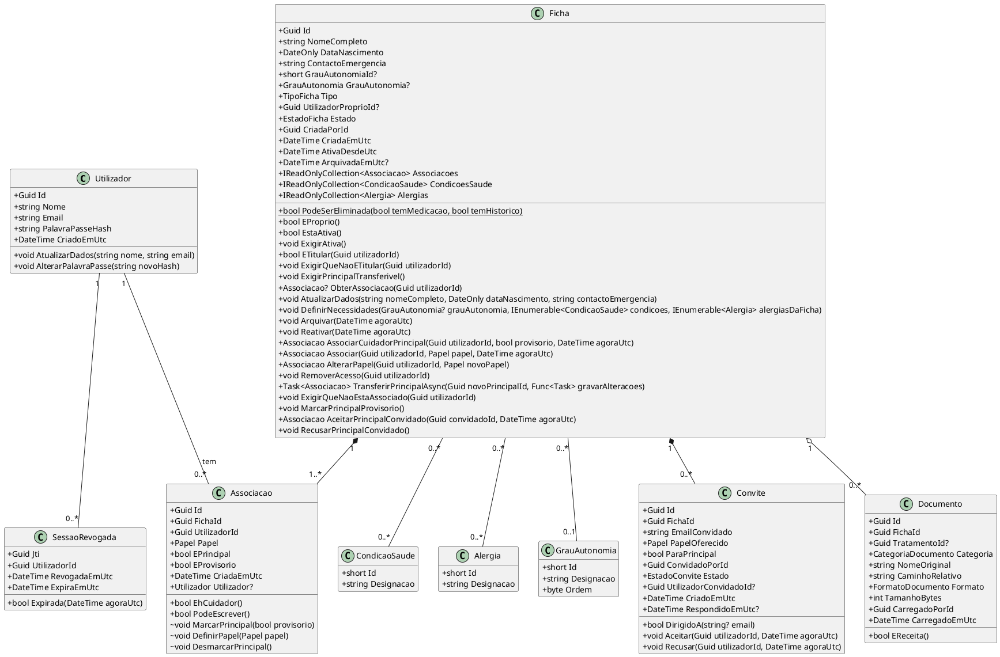
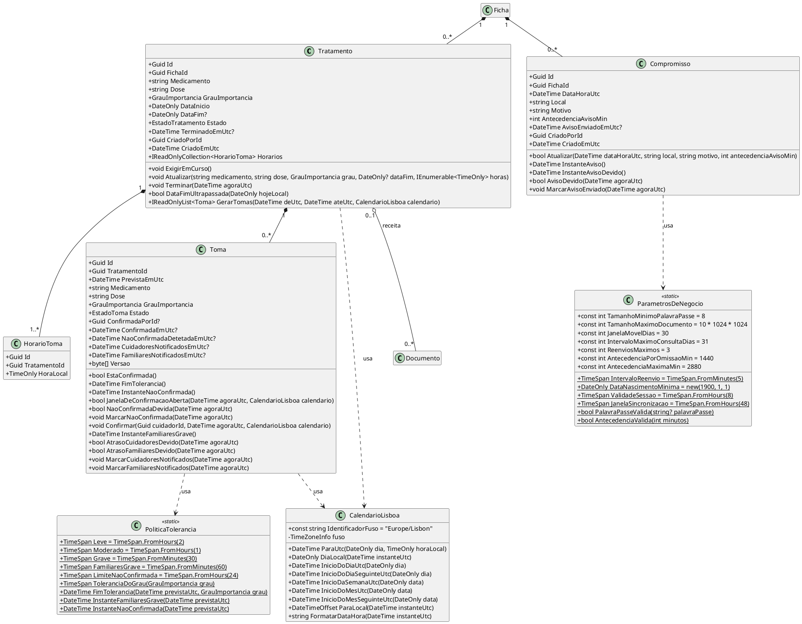
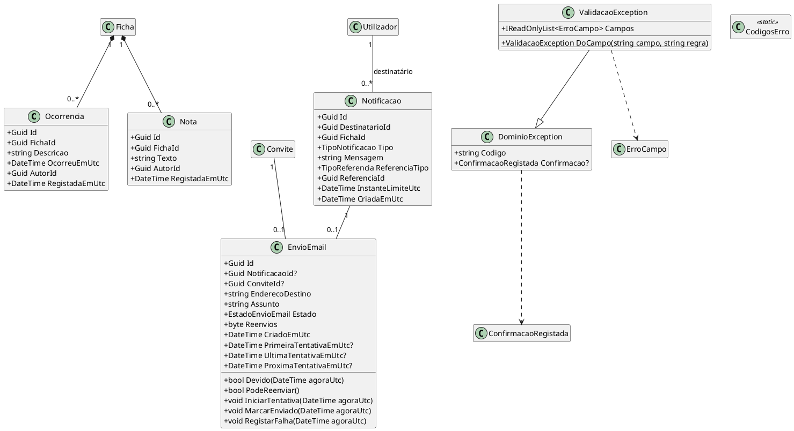
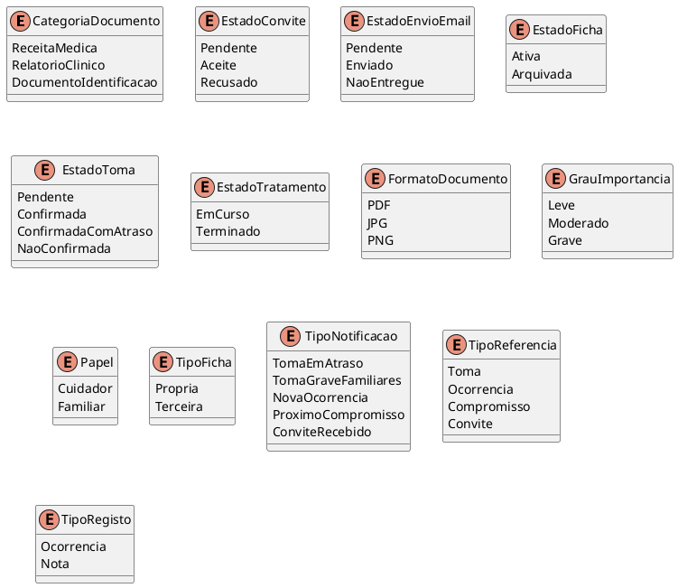

# MODELO DE CLASSES DO BACKEND

| Campo | Valor |
|---|---|
| Grupo | G07 |
| Projeto | DoseCerta |
| Milestone de Entrega | m4 |
| Versão | v04 |
| Módulo | Backend (ASP.NET Core 8) |

## 1. Finalidade e módulo

Este documento representa as classes do backend do DoseCerta, com responsabilidades, atributos, operações, relações e multiplicidades. Na v02 o modelo orientava a implementação; nesta versão (v03) descreve as classes tal como estão implementadas na branch `main`, no commit `7bf212c` (2026-10-30 12:25 UTC), depois do Sprint 05. Corrige as divergências D03, D11 a D23, C1 e C2 da Issue I054 (#68), classificadas como erro da documentação, e acrescenta as classes criadas no Sprint 05 (F006 a F011). As alterações face à v02 estão na secção 14. A F007 continua fora do âmbito, pela alteração autorizada de âmbito de 2026-10-19.

Na versão v04 (Issue I056) o modelo acrescenta o aviso antes de um compromisso (`ProximoCompromisso`, RF-117), que a v03 registava como lacuna do código: a classe `AvisoCompromissoService`, o passo 6 do processo periódico e as operações novas de `Compromisso`, `NotificacaoService`, `TextosNotificacao` e dos repositórios dos compromissos e das notificações. As alterações da v03 para a v04 estão na secção 14.5.

O backend é **um único módulo**: uma solução ASP.NET Core 8 (C# 12) com Entity Framework Core 8, que inclui a API REST e o processo periódico no mesmo processo. A arquitetura não o divide em serviços independentes, pelo que não existem módulos artificiais. A divisão interna corresponde às camadas da arquitetura e aos quatro projetos da solução. Os frontends têm os seus próprios modelos (`m3-modelo-classes-frontend-web-v02.md` e `m3-modelo-classes-frontend-mobile-v02.md`).

## 2. Referências

| Referência | Utilização |
|---|---|
| Código do backend, branch `main`, commit `7bf212c` (pasta `backend/src`), com as alterações da Issue I056 | Fonte das classes, atributos e operações desta versão |
| Issue I054 (#68) e Pull Request #64 | Lista de divergências D01 a D25, C1 e C2 |
| Documentação de Arquitetura `m3-documentacao-arquitetura-v02.md` | Camadas, processo periódico e decisões AD-01 a AD-14 |
| Modelo de Dados `m3-modelo-de-dados-dosecerta-v03.md` | Entidades, tabelas, restrições, índices e gatilhos |
| Documentação da API `m4-documentacao-api-v04.md` | Operações OP-01 a OP-34 e OP-41 a OP-51 implementadas pelos controllers, `GET /saude` e códigos de erro |
| Matriz de Permissões `m3-matriz-permissoes-ficha-v02.md` | Regras aplicadas por `AutorizacaoFichaService` |
| Diagrama de Estados da Toma `m3-diagrama-estados-toma-v02.md` | Comportamento das classes `Toma` e `EnvioEmail` |
| Especificação de Requisitos `m3-especificacao-requisitos-v02.md` | Requisitos RF-010 a RF-142 e RNF-001 a RNF-057 |

## 3. Pacotes e convenções

### 3.1 Projetos e namespaces

Os pacotes correspondem aos quatro projetos da solução, que são as camadas da arquitetura. As dependências vão da API para a aplicação, da aplicação para o domínio e da infraestrutura para a aplicação e o domínio: as interfaces dos repositórios e dos serviços externos estão na aplicação (`DoseCerta.Application.Repositorios` e `DoseCerta.Application.Abstracoes`) e são implementadas na infraestrutura. O domínio não depende de nenhum outro projeto. O processo periódico está no projeto da API (`DoseCerta.Api.Processos`, D03).

| Pacote (projeto) | Camada da arquitetura | Namespaces | Tipos |
|---|---|---|:---:|
| `DoseCerta.Api` | Controllers (API REST), erros, segurança, arranque e processo periódico | `DoseCerta.Api.Arranque`, `DoseCerta.Api.Contratos.Agenda`, `DoseCerta.Api.Contratos.Compromissos`, `DoseCerta.Api.Contratos.Contas`, `DoseCerta.Api.Contratos.Convites`, `DoseCerta.Api.Contratos.Fichas`, `DoseCerta.Api.Contratos.ListaDiaria`, `DoseCerta.Api.Contratos.Notificacoes`, `DoseCerta.Api.Contratos.Pessoas`, `DoseCerta.Api.Contratos.Registos`, `DoseCerta.Api.Contratos.Tomas`, `DoseCerta.Api.Contratos.Tratamentos`, `DoseCerta.Api.Controllers`, `DoseCerta.Api.Erros`, `DoseCerta.Api.Processos`, `DoseCerta.Api.Saude`, `DoseCerta.Api.Seguranca` | 63 |
| `DoseCerta.Application` | Serviços de aplicação, interfaces dos repositórios e dos serviços externos | `DoseCerta.Application`, `DoseCerta.Application.Abstracoes`, `DoseCerta.Application.Agenda`, `DoseCerta.Application.Compromissos`, `DoseCerta.Application.Comum`, `DoseCerta.Application.Contas`, `DoseCerta.Application.Convites`, `DoseCerta.Application.Documentos`, `DoseCerta.Application.Emails`, `DoseCerta.Application.Fichas`, `DoseCerta.Application.ListaDiaria`, `DoseCerta.Application.Notificacoes`, `DoseCerta.Application.Ocorrencias`, `DoseCerta.Application.Pessoas`, `DoseCerta.Application.Repositorios`, `DoseCerta.Application.Tomas`, `DoseCerta.Application.Tratamentos` | 67 |
| `DoseCerta.Domain` | Domínio (entidades, regras fixas, tempo e erros) | `DoseCerta.Domain.Comum`, `DoseCerta.Domain.Entidades`, `DoseCerta.Domain.Enumerados`, `DoseCerta.Domain.Tempo` | 38 |
| `DoseCerta.Infrastructure` | Repositórios (EF Core), persistência, e-mail, ficheiros, relógio e segurança | `DoseCerta.Infrastructure`, `DoseCerta.Infrastructure.Documentos`, `DoseCerta.Infrastructure.Email`, `DoseCerta.Infrastructure.Persistence`, `DoseCerta.Infrastructure.Persistence.Configuracoes`, `DoseCerta.Infrastructure.Persistence.Migrations`, `DoseCerta.Infrastructure.Persistence.Repositorios`, `DoseCerta.Infrastructure.Seguranca`, `DoseCerta.Infrastructure.Tempo` | 49 |

Total: 217 tipos públicos e internos de topo, incluindo 65 objetos de transferência e de valor sem comportamento (secções 5.4 e 6.3), 19 classes de configuração do EF Core e 3 classes de migração (secção 7). Os tipos aninhados privados, auxiliares de uma só classe, não são representados.

### 3.2 Convenções de representação

- Os atributos são as propriedades públicas, as constantes e os campos estáticos públicos e, nas classes que não são entidades, os campos privados só de leitura com as dependências injetadas. `?` depois do nome do atributo indica valor opcional; nos parâmetros e nos tipos de retorno usa-se a notação do C# (`Guid?`).
- As operações são os métodos públicos (`+`), internos (`~`) e protegidos (`#`); os métodos privados e os construtores não são representados. `static` indica um membro de classe.
- Todos os métodos assíncronos têm o sufixo `Async` e devolvem `Task` ou `Task<T>` (C1). Recebem ainda um último parâmetro `CancellationToken cancelamento`, que é omitido nas assinaturas deste documento para as manter legíveis.
- Nos controllers omitem-se os atributos de associação do ASP.NET Core (`[FromBody]`, `[FromQuery]`, `[FromForm]`) e indica-se entre parênteses a operação da API de cada ação.
- As constantes com o texto das mensagens de erro (`Mensagem*`) e com o SQL dos gatilhos (`CriarGatilho*`) não são representadas.

## 4. Domínio

O Domínio contém as entidades, os tipos enumerados, as regras fixas das tolerâncias, os cálculos de tempo em Europe/Lisbon e os erros de negócio. A **Ficha** é a raiz do agregado: as associações são alteradas só através dela, para garantir exatamente um Cuidador principal e uma ficha nunca sem Cuidador (RF-132, RF-134). Os métodos da `Ficha` recebem o identificador do Utilizador (`Guid`) e o instante (`DateTime`), e não a entidade `Utilizador`, e devolvem a `Associacao` criada ou alterada (D12). O comportamento da `Toma` está em `m3-diagrama-estados-toma-v02.md`. Os instantes são guardados em UTC e as horas fixas em hora de Lisboa (RNF-047). Namespaces: `DoseCerta.Domain.Entidades`, `DoseCerta.Domain.Enumerados`, `DoseCerta.Domain.Comum` e `DoseCerta.Domain.Tempo`.

### 4.1 Contas, fichas, pessoas e documentos

| Classe | Responsabilidade | Atributos | Operações |
|---|---|---|---|
| Utilizador | Conta de uma pessoa registada. Não guarda papéis: o papel é por ficha. A palavra-passe só existe em hash com salt e nunca é devolvida (RF-013, RNF-001). | `+Guid Id`; `+string Nome`; `+string Email`; `+string PalavraPasseHash`; `+DateTime CriadoEmUtc` | `+void AtualizarDados(string nome, string email)`; `+void AlterarPalavraPasse(string novoHash)` |
| SessaoRevogada | Credencial JWT terminada antes de expirar, que deixa de ser aceite (RF-016, RF-017). | `+Guid Jti`; `+Guid UtilizadorId`; `+DateTime RevogadaEmUtc`; `+DateTime ExpiraEmUtc` | `+bool Expirada(DateTime agoraUtc)` |
| CondicaoSaude | Valor da lista fechada de condições de saúde (RF-021). | `+short Id`; `+string Designacao` | - |
| Alergia | Valor da lista fechada de alergias (RF-021). | `+short Id`; `+string Designacao` | - |
| GrauAutonomia | Valor da lista fechada de graus de autonomia ou mobilidade (RF-021). | `+short Id`; `+string Designacao`; `+byte Ordem` | - |
| Ficha | Raiz do agregado da ficha: dados do utente, necessidades específicas, associações e estado. As associações só se alteram através da ficha (Modelo de Classes do Backend, secção 4.1). | `+Guid Id`; `+string NomeCompleto`; `+DateOnly DataNascimento`; `+string ContactoEmergencia`; `+short GrauAutonomiaId?`; `+GrauAutonomia GrauAutonomia?`; `+TipoFicha Tipo`; `+Guid UtilizadorProprioId?`; `+EstadoFicha Estado`; `+Guid CriadaPorId`; `+DateTime CriadaEmUtc`; `+DateTime AtivaDesdeUtc`; `+DateTime ArquivadaEmUtc?`; `+IReadOnlyCollection<Associacao> Associacoes`; `+IReadOnlyCollection<CondicaoSaude> CondicoesSaude`; `+IReadOnlyCollection<Alergia> Alergias` | `+static bool PodeSerEliminada(bool temMedicacao, bool temHistorico)`; `+bool EProprio()`; `+bool EstaAtiva()`; `+void ExigirAtiva()`; `+bool ETitular(Guid utilizadorId)`; `+void ExigirQueNaoETitular(Guid utilizadorId)`; `+void ExigirPrincipalTransferivel()`; `+Associacao? ObterAssociacao(Guid utilizadorId)`; `+void AtualizarDados(string nomeCompleto, DateOnly dataNascimento, string contactoEmergencia)`; `+void DefinirNecessidades(GrauAutonomia? grauAutonomia, IEnumerable<CondicaoSaude> condicoes, IEnumerable<Alergia> alergiasDaFicha)`; `+void Arquivar(DateTime agoraUtc)`; `+void Reativar(DateTime agoraUtc)`; `+Associacao AssociarCuidadorPrincipal(Guid utilizadorId, bool provisorio, DateTime agoraUtc)`; `+Associacao Associar(Guid utilizadorId, Papel papel, DateTime agoraUtc)`; `+Associacao AlterarPapel(Guid utilizadorId, Papel novoPapel)`; `+void RemoverAcesso(Guid utilizadorId)`; `+Task<Associacao> TransferirPrincipalAsync(Guid novoPrincipalId, Func<Task> gravarAlteracoes)`; `+void ExigirQueNaoEstaAssociado(Guid utilizadorId)`; `+void MarcarPrincipalProvisorio()`; `+Associacao AceitarPrincipalConvidado(Guid convidadoId, DateTime agoraUtc)`; `+void RecusarPrincipalConvidado()` |
| Associacao | Ligação de um Utilizador a uma ficha com um papel. O Cuidador principal é um Cuidador marcado e é provisório enquanto o convite para Cuidador principal está pendente (RF-025, DM-02, DM-03). | `+Guid Id`; `+Guid FichaId`; `+Guid UtilizadorId`; `+Papel Papel`; `+bool EPrincipal`; `+bool EProvisorio`; `+DateTime CriadaEmUtc`; `+Utilizador Utilizador?` | `+bool EhCuidador()`; `+bool PodeEscrever()`; `~void MarcarPrincipal(bool provisorio)`; `~void DefinirPapel(Papel papel)`; `~void DesmarcarPrincipal()` |
| Convite | Convite para uma ficha dirigido a um e-mail, com o papel oferecido e, se for o caso, para Cuidador principal. Não cria associação até ser aceite (DM-04, DM-05). | `+Guid Id`; `+Guid FichaId`; `+string EmailConvidado`; `+Papel PapelOferecido`; `+bool ParaPrincipal`; `+Guid ConvidadoPorId`; `+EstadoConvite Estado`; `+Guid UtilizadorConvidadoId?`; `+DateTime CriadoEmUtc`; `+DateTime RespondidoEmUtc?` | `+bool DirigidoA(string? email)`; `+void Aceitar(Guid utilizadorId, DateTime agoraUtc)`; `+void Recusar(Guid utilizadorId, DateTime agoraUtc)` |
| Documento | Metadados de um documento guardado no sistema de ficheiros do servidor, com a categoria e, na receita, o tratamento (RF-022, RF-052, DM-10). | `+Guid Id`; `+Guid FichaId`; `+Guid TratamentoId?`; `+CategoriaDocumento Categoria`; `+string NomeOriginal`; `+string CaminhoRelativo`; `+FormatoDocumento Formato`; `+int TamanhoBytes`; `+Guid CarregadoPorId`; `+DateTime CarregadoEmUtc` | `+bool EReceita()` |

A `Associacao` não tem `PodeConsultar()` (D11): qualquer associação permite consultar a ficha, e a regra está em `AutorizacaoFichaService.ExigirConsultaAsync`. As guardas `ETitular`, `ExigirQueNaoETitular`, `ExigirPrincipalTransferivel` e `ExigirQueNaoEstaAssociado` da `Ficha` aplicam as proteções do titular da ficha própria e do convite (RF-033, RF-034, RF-043). `TransferirPrincipalAsync` recebe a função que grava as alterações, porque a troca do Cuidador principal tem de ser gravada em dois passos para respeitar o índice `UQ_Associacao_Principal` (D12).

### 4.2 Medicação, compromissos e regras de tempo

| Classe | Responsabilidade | Atributos | Operações |
|---|---|---|---|
| Tratamento | Medicação prescrita a uma ficha, com horários, data de início e data de fim opcional (RF-050). Calcula as tomas a partir dos horários; sem data de fim é contínuo e as tomas geram-se numa janela móvel de 30 dias (RF-060). | `+Guid Id`; `+Guid FichaId`; `+string Medicamento`; `+string Dose`; `+GrauImportancia GrauImportancia`; `+DateOnly DataInicio`; `+DateOnly DataFim?`; `+EstadoTratamento Estado`; `+DateTime TerminadoEmUtc?`; `+Guid CriadoPorId`; `+DateTime CriadoEmUtc`; `+IReadOnlyCollection<HorarioToma> Horarios` | `+void ExigirEmCurso()`; `+void Atualizar(string medicamento, string dose, GrauImportancia grau, DateOnly? dataFim, IEnumerable<TimeOnly> horas)`; `+void Terminar(DateTime agoraUtc)`; `+bool DataFimUltrapassada(DateOnly hojeLocal)`; `+IReadOnlyList<Toma> GerarTomas(DateTime deUtc, DateTime ateUtc, CalendarioLisboa calendario)` |
| HorarioToma | Hora fixa do dia, em hora de Lisboa, de uma toma de um tratamento (RF-050). | `+Guid Id`; `+Guid TratamentoId`; `+TimeOnly HoraLocal` | - |
| Toma | Toma prevista num instante, gerada antecipadamente; copia o medicamento, a dose e o grau para preservar o histórico (DM-07, DM-17). Segue o diagrama de estados da toma: confirmação dentro ou fora da tolerância e passagem a não confirmada (F006). | `+Guid Id`; `+Guid TratamentoId`; `+DateTime PrevistaEmUtc`; `+string Medicamento`; `+string Dose`; `+GrauImportancia GrauImportancia`; `+EstadoToma Estado`; `+Guid ConfirmadaPorId?`; `+DateTime ConfirmadaEmUtc?`; `+DateTime NaoConfirmadaDetetadaEmUtc?`; `+DateTime CuidadoresNotificadosEmUtc?`; `+DateTime FamiliaresNotificadosEmUtc?`; `+byte[] Versao` | `+bool EstaConfirmada()`; `+DateTime FimTolerancia()`; `+DateTime InstanteNaoConfirmada()`; `+bool JanelaDeConfirmacaoAberta(DateTime agoraUtc, CalendarioLisboa calendario)`; `+bool NaoConfirmadaDevida(DateTime agoraUtc)`; `+void MarcarNaoConfirmada(DateTime agoraUtc)`; `+void Confirmar(Guid cuidadorId, DateTime agoraUtc, CalendarioLisboa calendario)`; `+DateTime InstanteFamiliaresGrave()`; `+bool AtrasoCuidadoresDevido(DateTime agoraUtc)`; `+bool AtrasoFamiliaresDevido(DateTime agoraUtc)`; `+void MarcarCuidadoresNotificados(DateTime agoraUtc)`; `+void MarcarFamiliaresNotificados(DateTime agoraUtc)` |
| Compromisso | Consulta ou compromisso de saúde de uma ficha, apenas para consulta: sem estado de realização e não confirmável (RF-080, RF-087). Tem a antecedência do aviso definida por compromisso (RF-116). `InstanteAviso` é a data e hora menos a antecedência; `InstanteAvisoDevido` é o maior entre esse instante e o do registo, comparado com a reativação da ficha (RF-142). `AvisoDevido` só é verdadeiro com o aviso por enviar, o instante do aviso chegado e a data do compromisso ainda por chegar: um compromisso que já passou nunca é avisado (I056). `Atualizar` repõe o aviso quando a data ou a antecedência mudam e indica-o, para a gravação escrever o aviso por enviar (RF-081, RF-117). | `+Guid Id`; `+Guid FichaId`; `+DateTime DataHoraUtc`; `+string Local`; `+string Motivo`; `+int AntecedenciaAvisoMin`; `+DateTime AvisoEnviadoEmUtc?`; `+Guid CriadoPorId`; `+DateTime CriadoEmUtc` | `+bool Atualizar(DateTime dataHoraUtc, string local, string motivo, int antecedenciaAvisoMin)`; `+DateTime InstanteAviso()`; `+DateTime InstanteAvisoDevido()`; `+bool AvisoDevido(DateTime agoraUtc)`; `+void MarcarAvisoEnviado(DateTime agoraUtc)` |
| PoliticaTolerancia | Regra fixa das tolerâncias da toma por grau (Leve 2 h, Moderado 1 h, Grave 30 min), do instante de notificação dos Familiares no grau Grave (60 minutos depois da hora prevista) e do limite de 24 horas para a toma passar a Não confirmada. Não é configurável (RF-067, RF-068, RF-110 a RF-113). | `+static TimeSpan Leve = TimeSpan.FromHours(2)`; `+static TimeSpan Moderado = TimeSpan.FromHours(1)`; `+static TimeSpan Grave = TimeSpan.FromMinutes(30)`; `+static TimeSpan FamiliaresGrave = TimeSpan.FromMinutes(60)`; `+static TimeSpan LimiteNaoConfirmada = TimeSpan.FromHours(24)` | `+static TimeSpan ToleranciaDoGrau(GrauImportancia grau)`; `+static DateTime FimTolerancia(DateTime previstaUtc, GrauImportancia grau)`; `+static DateTime InstanteFamiliaresGrave(DateTime previstaUtc)`; `+static DateTime InstanteNaoConfirmada(DateTime previstaUtc)` |
| CalendarioLisboa | Cálculos de tempo no fuso Europe/Lisbon (RNF-047, AD-09): início do dia, da semana (segunda-feira) e do mês, conversão da hora fixa para UTC e de UTC para a hora local, e formatação dd/mm/aaaa hh:mm com a cultura pt-PT, que só é usada aqui (D23). Numa hora repetida usa a primeira ocorrência; numa hora inexistente avança pela duração do salto. | `+const string IdentificadorFuso = "Europe/Lisbon"`; `-TimeZoneInfo fuso` | `+DateTime ParaUtc(DateOnly dia, TimeOnly horaLocal)`; `+DateOnly DiaLocal(DateTime instanteUtc)`; `+DateTime InicioDoDiaUtc(DateOnly dia)`; `+DateTime InicioDoDiaSeguinteUtc(DateOnly dia)`; `+DateTime InicioDaSemanaUtc(DateOnly data)`; `+DateTime InicioDoMesUtc(DateOnly data)`; `+DateTime InicioDoMesSeguinteUtc(DateOnly data)`; `+DateTimeOffset ParaLocal(DateTime instanteUtc)`; `+string FormatarDataHora(DateTime instanteUtc)` |
| ParametrosDeNegocio | Valores fixos das regras de negócio, num só lugar: tamanhos mínimos e máximos, janela móvel, intervalo máximo das consultas, reenvios, antecedência por omissão, validade da sessão, janela de sincronização e data de nascimento mínima (`DataNascimentoMinima`, 1900-01-01). O intervalo do ciclo do processo periódico não está aqui: é configuração (`OpcoesProcessoPeriodico`, D22). | `+const int TamanhoMinimoPalavraPasse = 8`; `+const int TamanhoMaximoDocumento = 10 * 1024 * 1024`; `+const int JanelaMovelDias = 30`; `+const int IntervaloMaximoConsultaDias = 31`; `+const int ReenviosMaximos = 3`; `+const int AntecedenciaPorOmissaoMin = 1440`; `+const int AntecedenciaMaximaMin = 2880`; `+static TimeSpan IntervaloReenvio = TimeSpan.FromMinutes(5)`; `+static DateOnly DataNascimentoMinima = new(1900, 1, 1)`; `+static TimeSpan ValidadeSessao = TimeSpan.FromHours(8)`; `+static TimeSpan JanelaSincronizacao = TimeSpan.FromHours(48)` | `+static bool PalavraPasseValida(string? palavraPasse)`; `+static bool AntecedenciaValida(int minutos)` |

`Tratamento.Atualizar` recebe `DateOnly? dataFim`: um tratamento pode passar a não ter data de fim (D14). `ParametrosDeNegocio` e `PoliticaTolerancia` são classes estáticas.

### 4.3 Registos, notificações, e-mail e erros

| Classe | Responsabilidade | Atributos | Operações |
|---|---|---|---|
| Ocorrencia | Ocorrência do dia a dia da pessoa cuidada; depois de registada não se altera nem se elimina (RF-090, RF-094). | `+Guid Id`; `+Guid FichaId`; `+string Descricao`; `+DateTime OcorreuEmUtc`; `+Guid AutorId`; `+DateTime RegistadaEmUtc` | - |
| Nota | Nota dirigida aos Cuidadores da ficha; depois de registada não se altera nem se elimina (RF-091, RF-095). | `+Guid Id`; `+Guid FichaId`; `+string Texto`; `+Guid AutorId`; `+DateTime RegistadaEmUtc` | - |
| Notificacao | Notificação dentro da aplicação, uma por destinatário e por evento, criada sempre mesmo que o e-mail falhe (RF-141, DM-12). | `+Guid Id`; `+Guid DestinatarioId`; `+Guid FichaId`; `+TipoNotificacao Tipo`; `+string Mensagem`; `+TipoReferencia ReferenciaTipo`; `+Guid ReferenciaId`; `+DateTime InstanteLimiteUtc`; `+DateTime CriadaEmUtc` | - |
| EnvioEmail | E-mail a enviar, de uma notificação ou de um convite, com o estado e os reenvios (RF-118, RF-136, DM-13). | `+Guid Id`; `+Guid NotificacaoId?`; `+Guid ConviteId?`; `+string EnderecoDestino`; `+string Assunto`; `+EstadoEnvioEmail Estado`; `+byte Reenvios`; `+DateTime CriadoEmUtc`; `+DateTime PrimeiraTentativaEmUtc?`; `+DateTime UltimaTentativaEmUtc?`; `+DateTime ProximaTentativaEmUtc?` | `+bool Devido(DateTime agoraUtc)`; `+bool PodeReenviar()`; `+void IniciarTentativa(DateTime agoraUtc)`; `+void MarcarEnviado(DateTime agoraUtc)`; `+void RegistarFalha(DateTime agoraUtc)` |
| DominioException | Erro de regra de negócio com o código de erro da API (`Codigo`) e, na confirmação repetida de uma toma, a confirmação que se mantém (`Confirmacao`). É traduzido numa resposta HTTP por `FiltroDeErros`. Substitui o nome `ExcecaoDominio` da v02: o sufixo `Exception` é exigido pela regra CA1710 da análise estática (C2). | `+string Codigo`; `+ConfirmacaoRegistada Confirmacao?` | - |
| ValidacaoException | Erro de validação dos dados submetidos (VALIDACAO_INVALIDA), com a lista dos campos em erro (RNF-028). | `+IReadOnlyList<ErroCampo> Campos` | `+static ValidacaoException DoCampo(string campo, string regra)` |
| CodigosErro | Códigos de erro da API (Documentação da API, secção 3.3; Modelo de Classes do Backend, secção 11.3). | - | - |

Os códigos de erro de `CodigosErro` (35 constantes) estão na secção 11.3.

| Objeto de valor | Campos | Responsabilidade |
|---|---|---|
| ConfirmacaoRegistada | `Guid ConfirmadaPorId`; `string ConfirmadaPorNome`; `DateTime ConfirmadaEmUtc` | Confirmação já gravada de uma toma, devolvida na recusa de uma segunda confirmação (TOMA_JA_CONFIRMADA, RF-105). |
| ErroCampo | `string Campo`; `string Regra` | Indica o campo em erro e a regra violada, com o valor ou formato esperado (RNF-028). |

### 4.4 Tipos enumerados

| Enumerado | Valores | Usado em |
|---|---|---|
| CategoriaDocumento | ReceitaMedica, RelatorioClinico, DocumentoIdentificacao | `Documento` |
| EstadoConvite | Pendente, Aceite, Recusado | `Convite` |
| EstadoEnvioEmail | Pendente, Enviado, NaoEntregue | `EnvioEmail` |
| EstadoFicha | Ativa, Arquivada | `Ficha` |
| EstadoToma | Pendente, Confirmada, ConfirmadaComAtraso, NaoConfirmada | `Toma` |
| EstadoTratamento | EmCurso, Terminado | `Tratamento` |
| FormatoDocumento | PDF, JPG, PNG | `Documento` |
| GrauImportancia | Leve, Moderado, Grave | `Toma`, `Tratamento`, `PoliticaTolerancia` |
| Papel | Cuidador, Familiar | `Associacao`, `Convite` |
| TipoFicha | Propria, Terceira | `Ficha` |
| TipoNotificacao | TomaEmAtraso, TomaGraveFamiliares, NovaOcorrencia, ProximoCompromisso, ConviteRecebido | `Notificacao` |
| TipoReferencia | Toma, Ocorrencia, Compromisso, Convite | `Notificacao` |
| TipoRegisto | Ocorrencia, Nota | `RegistoPartilhado`, `RegistosController` |

Na base de dados os valores são guardados como texto, com restrição `CHECK`, através de conversões de valor do Entity Framework Core. `TipoRegisto` não é persistente: distingue as ocorrências e as notas na consulta OP-48 e OP-49. O valor `ProximoCompromisso` de `TipoNotificacao` existe, mas nenhuma classe cria ainda notificações desse tipo (secção 14.3).

### 4.5 Estado da toma e janela de confirmação

Seja T a hora prevista da toma, em UTC. A tabela resume o comportamento de `Toma`, de `PoliticaTolerancia` e de `CalendarioLisboa`, e é coerente com `m3-diagrama-estados-toma-v02.md`.

| Momento | Estado da toma | Efeito de `Toma.Confirmar` | Notificações |
|---|---|---|---|
| Antes das 00:00 (Lisboa) do dia de T | `Pendente` | Recusada com `TOMA_FORA_DA_JANELA` | Nenhuma |
| Das 00:00 (Lisboa) do dia de T até T mais a tolerância, inclusive | `Pendente` | Aceite: `Confirmada` | Nenhuma |
| Depois de T mais a tolerância e antes de T mais 24 h | `Pendente` | Aceite: `ConfirmadaComAtraso` | Cuidadores, uma vez, estritamente depois do fim da tolerância (Leve 2 h, Moderado 1 h, Grave 30 min); Familiares só no grau Grave, a T mais 60 minutos |
| De T mais 24 h em diante | `NaoConfirmada`, final | Recusada com `TOMA_NAO_CONFIRMAVEL` | As que faltem são criadas antes da passagem a `NaoConfirmada` |

## 5. Serviços de aplicação

Os serviços aplicam as regras de negócio, orquestram a persistência e as notificações e usam `AutorizacaoFichaService` antes de qualquer operação sobre uma ficha. Cada operação de escrita corre numa transação (`IUnidadeDeTrabalho.ExecutarEmTransacaoAsync`). Uma operação com ficheiro guarda-o primeiro e regista a sua eliminação como compensação se a transação falhar (RNF-046). As regras de negócio lançam `DominioException` com o código de erro da API e as validações lançam `ValidacaoException` com os campos em erro. Namespaces: `DoseCerta.Application.<Área>`, por exemplo `DoseCerta.Application.Tomas`. Os serviços dependem das interfaces dos repositórios (`I*Repositorio`), nunca das implementações (D19).

### 5.1 Serviços

```plantuml
@startuml
hide members
skinparam linetype ortho
AutorizacaoFichaService ..> IFichaRepositorio
AuthService ..> IUtilizadorRepositorio
AuthService ..> ISessaoRevogadaRepositorio
AuthService ..> IConviteRepositorio
AuthService ..> IPasswordHasher
AuthService ..> ITokenService
ContaService ..> IUtilizadorRepositorio
ContaService ..> IPasswordHasher
FichaService ..> IFichaRepositorio
FichaService ..> IDominiosRepositorio
FichaService ..> ConviteService
FichaService ..> IDocumentoRepositorio
FichaService ..> INotificacaoRepositorio
FichaService ..> DocumentoService
FichaService ..> TomaService
FichaService ..> AutorizacaoFichaService
DocumentoService ..> IDocumentoRepositorio
DocumentoService ..> IArmazenamentoDocumentos
DocumentoService ..> AutorizacaoFichaService
PessoasService ..> IFichaRepositorio
PessoasService ..> IUtilizadorRepositorio
PessoasService ..> AutorizacaoFichaService
ConviteService ..> IConviteRepositorio
ConviteService ..> IFichaRepositorio
ConviteService ..> IUtilizadorRepositorio
ConviteService ..> INotificacaoRepositorio
ConviteService ..> EnvioEmailService
ConviteService ..> AutorizacaoFichaService
TratamentoService ..> ITratamentoRepositorio
TratamentoService ..> DocumentoService
TratamentoService ..> TomaService
TratamentoService ..> AutorizacaoFichaService
TomaService ..> ITomaRepositorio
TomaService ..> IFichaRepositorio
TomaService ..> ITratamentoRepositorio
TomaService ..> IUtilizadorRepositorio
TomaService ..> AutorizacaoFichaService
AtrasoTomaService ..> ITomaRepositorio
AtrasoTomaService ..> ITratamentoRepositorio
AtrasoTomaService ..> IFichaRepositorio
AtrasoTomaService ..> NotificacaoService
AvisoCompromissoService ..> ICompromissoRepositorio
AvisoCompromissoService ..> IFichaRepositorio
AvisoCompromissoService ..> NotificacaoService
CompromissoService ..> ICompromissoRepositorio
CompromissoService ..> AutorizacaoFichaService
OcorrenciaService ..> IOcorrenciaRepositorio
OcorrenciaService ..> INotaRepositorio
OcorrenciaService ..> IUtilizadorRepositorio
OcorrenciaService ..> INotificacaoRepositorio
OcorrenciaService ..> AutorizacaoFichaService
AgendaService ..> AutorizacaoFichaService
AgendaService ..> ICompromissoRepositorio
AgendaService ..> ITomaRepositorio
ListaDiariaService ..> ITomaRepositorio
ListaDiariaService ..> ICompromissoRepositorio
ListaDiariaService ..> AutorizacaoFichaService
NotificacaoService ..> INotificacaoRepositorio
NotificacaoService ..> IUtilizadorRepositorio
NotificacaoService ..> EnvioEmailService
EnvioEmailService ..> IEnvioEmailRepositorio
EnvioEmailService ..> IConviteRepositorio
EnvioEmailService ..> IEmailSender
@enduml
```

Todos os serviços que escrevem usam também `IUnidadeDeTrabalho` e quase todos usam `IRelogio`; essas dependências estão nas tabelas e são omitidas no diagrama para o manter legível.

| Classe | Responsabilidade | Atributos | Operações |
|---|---|---|---|
| AutorizacaoFichaService | Verifica, em cada pedido, a associação e o papel do Utilizador na ficha, lendo o papel da base de dados e nunca do token (RF-047, RF-048, RNF-004, RNF-005). Devolve `AcessoFicha` (ficha e associação; D17). Sem associação lança `FICHA_NAO_ENCONTRADA`; Familiar numa operação de Cuidador lança `ACESSO_PROIBIDO`; `ExigirCuidadorDeFichaAtivaAsync` lança também `FICHA_ARQUIVADA`. `IdentificadoresDeFichasAtivasAsync` dá as fichas ativas do Utilizador, opcionalmente filtradas por papel, para a agenda e a lista diária. | `-IFichaRepositorio fichas` | `+Task<AcessoFicha?> ObterAcessoAsync(Guid utilizadorId, Guid fichaId)`; `+Task<IReadOnlyDictionary<Guid, AcessoFicha>> IdentificadoresDeFichasAtivasAsync(Guid utilizadorId, Papel? papel)`; `+Task<AcessoFicha> ExigirConsultaAsync(Guid utilizadorId, Guid fichaId)`; `+Task<AcessoFicha> ExigirCuidadorAsync(Guid utilizadorId, Guid fichaId)`; `+Task<AcessoFicha> ExigirCuidadorDeFichaAtivaAsync(Guid utilizadorId, Guid fichaId)` |
| AuthService | Criação de conta, início e término de sessão (F001; RF-010, RF-011, RF-012, RF-016, RF-017, RF-044). | `-IUtilizadorRepositorio utilizadores`; `-ISessaoRevogadaRepositorio sessoesRevogadas`; `-IConviteRepositorio convites`; `-IPasswordHasher passwordHasher`; `-ITokenService tokenService`; `-IUnidadeDeTrabalho unidadeDeTrabalho`; `-IRelogio relogio`; `-Lazy<string> hashDeReferencia` | `+Task<ResultadoRegisto> RegistarAsync(string? nome, string? email, string? palavraPasse)`; `+Task<TokenSessao> AutenticarAsync(string? email, string? palavraPasse)`; `+Task TerminarSessaoAsync(Guid jti, Guid utilizadorId, DateTime expiraEmUtc)`; `+Task<bool> CredencialAceiteAsync(Guid jti)` |
| ContaService | Consulta e atualização dos dados da conta e alteração da palavra-passe (F001; RF-013, RF-014, RF-015). | `-IUtilizadorRepositorio utilizadores`; `-IPasswordHasher passwordHasher`; `-IUnidadeDeTrabalho unidadeDeTrabalho` | `+Task<Utilizador> ObterAsync(Guid utilizadorId)`; `+Task<Utilizador> AtualizarAsync(Guid utilizadorId, string? nome, string? email)`; `+Task AlterarPalavraPasseAsync(Guid utilizadorId, string? palavraPasseAtual, string? palavraPasseNova)` |
| FichaService | Criação (de terceiro ou própria), consulta, edição, arquivo, reativação e eliminação de fichas (F002, F003). Cria a ficha, as associações, o convite para Cuidador principal e os documentos numa só transação (RF-020 a RF-031, RF-120 a RF-123, RNF-046). `EliminarAsync` exige Cuidador, recusa com `FICHA_COM_HISTORICO` a ficha com medicação, tomas, ocorrências ou notas, apaga as notificações da ficha e elimina-a na mesma transação e, depois de a transação ser confirmada, remove os ficheiros dos documentos com `DocumentoService.EliminarFicheiros`, a partir dos caminhos lidos antes (D18). | `+const int ComprimentoMaximoNome = 150`; `-IFichaRepositorio fichas`; `-IDominiosRepositorio dominios`; `-ConviteService conviteService`; `-IDocumentoRepositorio documentos`; `-INotificacaoRepositorio notificacoes`; `-DocumentoService documentoService`; `-TomaService tomaService`; `-AutorizacaoFichaService autorizacao`; `-IUnidadeDeTrabalho unidadeDeTrabalho`; `-IRelogio relogio` | `+Task<AcessoFicha> CriarAsync(Guid criadorId, DadosFicha dados, bool propria, DefinicaoPrincipal? principal, IReadOnlyList<DocumentoSubmetido> documentosSubmetidos)`; `+Task<IReadOnlyList<AcessoFicha>> ListarAsync(Guid utilizadorId, EstadoFicha? estado)`; `+Task<AcessoFicha> ObterAsync(Guid utilizadorId, Guid fichaId)`; `+Task<AcessoFicha> EditarAsync(Guid utilizadorId, Guid fichaId, DadosFicha dados, IReadOnlyList<DocumentoSubmetido> documentosSubmetidos)`; `+Task ArquivarAsync(Guid utilizadorId, Guid fichaId)`; `+Task ReativarAsync(Guid utilizadorId, Guid fichaId)`; `+Task EliminarAsync(Guid utilizadorId, Guid fichaId)`; `+Task<DominiosNecessidades> ObterDominiosAsync()` |
| DocumentoService | Validação, gravação e leitura dos documentos das fichas (F002). Valida a categoria, o tamanho e o formato pelo conteúdo do ficheiro; o ficheiro é guardado antes dos metadados e é apagado se a transação falhar (RF-022, RF-023, RF-124, RNF-006 a RNF-008, RNF-046, AD-10). `EliminarFicheiros` recebe os caminhos dos ficheiros, porque depois do commit a ficha já não existe (D18). | `+const int ComprimentoMaximoNome = 255`; `-IDocumentoRepositorio documentos`; `-IArmazenamentoDocumentos armazenamento`; `-AutorizacaoFichaService autorizacao`; `-IUnidadeDeTrabalho unidadeDeTrabalho`; `-IRelogio relogio` | `+static Task<DocumentoValidado> ValidarAsync(DocumentoSubmetido documento, string prefixoCampo)`; `+static Task<IReadOnlyList<DocumentoValidado>> ValidarTodosAsync(IReadOnlyList<DocumentoSubmetido> submetidos)`; `+Task<Documento> GuardarNaTransacaoAsync(Guid fichaId, Guid? tratamentoId, DocumentoValidado documento, Guid autorId, DateTime agoraUtc)`; `+Task<Documento> CarregarAsync(Guid utilizadorId, Guid fichaId, DocumentoSubmetido submetido)`; `+Task<IReadOnlyList<Documento>> ListarAsync(Guid utilizadorId, Guid fichaId)`; `+Task<FicheiroLido> ObterAsync(Guid utilizadorId, Guid documentoId)`; `+Task<IReadOnlyDictionary<Guid, Guid>> ReceitasPorTratamentoAsync(Guid fichaId)`; `+void EliminarFicheiros(IEnumerable<string> caminhosRelativos)` |
| PessoasService | Gestão das pessoas associadas a uma ficha: listar, alterar o papel, remover o acesso e transferir o Cuidador principal (F004). As regras dos papéis são aplicadas pela `Ficha`; cada escrita corre numa só transação (RF-049, RF-130 a RF-134, RNF-046). | `-IFichaRepositorio fichas`; `-IUtilizadorRepositorio utilizadores`; `-AutorizacaoFichaService autorizacao`; `-IUnidadeDeTrabalho unidadeDeTrabalho` | `+Task<IReadOnlyList<PessoaAssociada>> ListarAsync(Guid utilizadorId, Guid fichaId)`; `+Task<PessoaAssociada> AlterarPapelAsync(Guid utilizadorId, Guid fichaId, Guid alvoId, Papel? novoPapel)`; `+Task RemoverAcessoAsync(Guid utilizadorId, Guid fichaId, Guid alvoId)`; `+Task<PessoaAssociada> TransferirPrincipalAsync(Guid utilizadorId, Guid fichaId, Guid? novoPrincipalId)` |
| ConviteService | Criação e resposta a convites para uma ficha (F004, RF-040 a RF-046, RF-135, RF-136). Cria a notificação `ConviteRecebido` (diretamente no `INotificacaoRepositorio`) e o e-mail do convite (`EnvioEmailService.RegistarDeConvite`); a falha do e-mail não desfaz o convite. Aceitar um convite para Cuidador principal transfere o papel e remove a associação provisória do criador. Cada escrita corre numa só transação (RNF-046). | `-IConviteRepositorio convites`; `-IFichaRepositorio fichas`; `-IUtilizadorRepositorio utilizadores`; `-INotificacaoRepositorio notificacoes`; `-EnvioEmailService envioEmail`; `-AutorizacaoFichaService autorizacao`; `-IUnidadeDeTrabalho unidadeDeTrabalho`; `-IRelogio relogio` | `+Task<ConviteResumo> ConvidarAsync(Guid utilizadorId, Guid fichaId, string? email, Papel? papel, bool paraPrincipal)`; `+Task<Convite> ConvidarParaPrincipalAsync(Ficha ficha, Guid criadorId, string email, DateTime agoraUtc)`; `+Task<IReadOnlyList<ConviteResumo>> ListarRecebidosAsync(Guid utilizadorId)`; `+Task<PessoaAssociada> AceitarAsync(Guid utilizadorId, Guid conviteId)`; `+Task RecusarAsync(Guid utilizadorId, Guid conviteId)` |
| TratamentoService | Registo, consulta, atualização e término de tratamentos, com receita opcional (F005, RF-050 a RF-057). Delega na `TomaService` a geração, a regeneração e a remoção das tomas futuras (RF-060). Cada escrita é atómica: se a receita não for guardada, nada é gravado (RF-053, RNF-046). | `+const int ComprimentoMaximoMedicamento = 120`; `+const int ComprimentoMaximoDose = 60`; `-ITratamentoRepositorio tratamentos`; `-DocumentoService documentoService`; `-TomaService tomaService`; `-AutorizacaoFichaService autorizacao`; `-IUnidadeDeTrabalho unidadeDeTrabalho`; `-IRelogio relogio` | `+Task<TratamentoComReceita> RegistarAsync(Guid utilizadorId, Guid fichaId, DadosTratamento dados, DocumentoSubmetido? receita)`; `+Task<IReadOnlyList<TratamentoComReceita>> ListarAsync(Guid utilizadorId, Guid fichaId, EstadoTratamento? estado)`; `+Task<TratamentoComReceita> ObterAsync(Guid utilizadorId, Guid tratamentoId)`; `+Task<TratamentoComReceita> AtualizarAsync(Guid utilizadorId, Guid tratamentoId, DadosTratamento dados, DocumentoSubmetido? receita)`; `+Task<int> TerminarConcluidosAsync(DateTime agoraUtc)`; `+Task<TratamentoComReceita> TerminarAsync(Guid utilizadorId, Guid tratamentoId)` |
| TomaService | Tomas previstas: geração, regeneração e remoção ao registar, alterar e terminar um tratamento (F005, RF-060), consulta (OP-32), confirmação (OP-33), calendário para os alarmes (OP-34), retoma da geração ao reativar uma ficha e passos 1 e 5 do processo periódico (F006, RF-061 a RF-069). As operações chamadas pelo `TratamentoService` e pelo `FichaService` correm dentro da transação de quem as chama. A remoção das tomas futuras ao arquivar uma ficha é feita por `IFichaRepositorio.EliminarFuturasPorConfirmarAsync`. | `-ITomaRepositorio tomas`; `-IFichaRepositorio fichas`; `-ITratamentoRepositorio tratamentos`; `-IUtilizadorRepositorio utilizadores`; `-AutorizacaoFichaService autorizacao`; `-IUnidadeDeTrabalho unidadeDeTrabalho`; `-IRelogio relogio` | `+Task<int> GerarParaTratamentoAsync(Tratamento tratamento, DateTime agoraUtc)`; `+Task RegerarFuturasAsync(Tratamento tratamento, DateTime agoraUtc)`; `+Task RemoverFuturasAsync(Tratamento tratamento, DateTime agoraUtc)`; `+Task<IReadOnlyList<TomaDaFicha>> ListarAsync(Guid utilizadorId, Guid fichaId, DateOnly? de, DateOnly? ate, EstadoToma? estado, Guid? tratamentoId)`; `+Task<TomaDaFicha> ConfirmarAsync(Guid utilizadorId, Guid tomaId)`; `+Task<IReadOnlyList<TomaParaSincronizar>> CalendarioParaSincronizarAsync(Guid utilizadorId)`; `+Task<int> PrologarJanelaMovelAsync(DateTime agoraUtc)`; `+Task<int> ConcluirNaoConfirmadasAsync(DateTime agoraUtc)`; `+Task<int> RetomarGeracaoDaFichaAsync(Guid fichaId, DateTime agoraUtc)` |
| AtrasoTomaService | Passos 2 e 3 do processo periódico: deteta as tomas `Pendente` cujo fim de tolerância passou e notifica os Cuidadores e, no grau Grave, 60 minutos depois da hora prevista, os Familiares (F011, RF-110 a RF-113). A toma continua `Pendente`: só a marca (`CuidadoresNotificadosEmUtc` ou `FamiliaresNotificadosEmUtc`) muda. Cada toma é tratada na sua transação, com a marca e as notificações juntas; um conflito de concorrência desfaz só essa toma. Numa ficha sem Familiares, a toma é só marcada. Não notifica tomas previstas antes de `AtivaDesdeUtc` de uma ficha reativada. Classe nova face à v02, que punha estes passos em `TomaService.DetetarAtrasos`. | `-ITomaRepositorio tomas`; `-ITratamentoRepositorio tratamentos`; `-IFichaRepositorio fichas`; `-NotificacaoService notificacoes`; `-IUnidadeDeTrabalho unidadeDeTrabalho`; `-IRelogio relogio` | `+Task<int> NotificarCuidadoresAsync(DateTime agoraUtc)`; `+Task<int> NotificarFamiliaresAsync(DateTime agoraUtc)` |
| AvisoCompromissoService | Passo 6 do processo periódico: aviso antes de um compromisso (F011, RF-116, RF-117). Lista os compromissos com o aviso por enviar e trata cada um na sua transação: relê o compromisso (removido ou já avisado: nada), verifica a ficha (arquivada, ou aviso devido antes da reativação: nada, RF-122, RF-142), marca o aviso com `ICompromissoRepositorio.MarcarAvisoEnviadoAsync`, uma instrução condicional sobre a data e a antecedência lidas, e só se a marca for desta execução notifica todas as pessoas associadas com `NotificacaoService.NotificarTodosAsync` (RNF-043, RNF-044). O instante-limite das notificações é `Compromisso.InstanteAviso`. Corresponde ao passo 3 da v02 (`CompromissoService.AvisarProximos`). Classe nova na v04. | `-ICompromissoRepositorio compromissos`; `-IFichaRepositorio fichas`; `-NotificacaoService notificacoes`; `-IUnidadeDeTrabalho unidadeDeTrabalho`; `-IRelogio relogio` | `+Task<int> AvisarProximosAsync(DateTime agoraUtc)` |
| CompromissoService | Registo, consulta, edição e remoção dos compromissos de saúde de uma ficha (F008, RF-080 a RF-082, RF-116). Nas escritas verifica a ficha e o papel antes de validar os dados; a antecedência por omissão é 1440 minutos. Os compromissos não são confirmáveis (RF-087). Não cria notificações: o aviso `ProximoCompromisso` (RF-117) é do `AvisoCompromissoService`. Na edição, quando `Compromisso.Atualizar` repõe o aviso, pede `ICompromissoRepositorio.GravarAvisoReposto`, para um aviso marcado entretanto pelo processo periódico com os valores antigos voltar a ficar por enviar. | `+const int ComprimentoMaximoLocal = 150`; `+const int ComprimentoMaximoMotivo = 250`; `-ICompromissoRepositorio compromissos`; `-AutorizacaoFichaService autorizacao`; `-IUnidadeDeTrabalho unidadeDeTrabalho`; `-IRelogio relogio` | `+Task<Compromisso> RegistarAsync(Guid utilizadorId, Guid fichaId, DadosCompromisso dados)`; `+Task<IReadOnlyList<Compromisso>> ListarAsync(Guid utilizadorId, Guid fichaId, DateOnly? de, DateOnly? ate)`; `+Task<Compromisso> EditarAsync(Guid utilizadorId, Guid compromissoId, DadosCompromisso dados)`; `+Task RemoverAsync(Guid utilizadorId, Guid compromissoId)` |
| OcorrenciaService | Registo e consulta de ocorrências e de notas partilhadas (F009, RF-090 a RF-095). Nas escritas verifica a ficha e o papel antes de validar os dados. Não há operações de alteração nem de eliminação (RF-090, RF-091, RNF-049). Ao registar uma ocorrência cria uma notificação `NovaOcorrencia` para cada pessoa associada, exceto o autor, sem a descrição na mensagem (RF-115); o e-mail é registado depois pelo passo 6. As notas não notificam e só os Cuidadores as consultam (RF-095). | `+const int ComprimentoMaximoDescricao = 2000`; `-IOcorrenciaRepositorio ocorrencias`; `-INotaRepositorio notas`; `-IUtilizadorRepositorio utilizadores`; `-INotificacaoRepositorio notificacoes`; `-AutorizacaoFichaService autorizacao`; `-IUnidadeDeTrabalho unidadeDeTrabalho`; `-IRelogio relogio` | `+Task<RegistoPartilhado> RegistarOcorrenciaAsync(Guid utilizadorId, Guid fichaId, string? descricao, DateTime? ocorreuEmUtc)`; `+Task<RegistoPartilhado> RegistarNotaAsync(Guid utilizadorId, Guid fichaId, string? texto)`; `+Task<IReadOnlyList<RegistoPartilhado>> ConsultarOcorrenciasAsync(Guid utilizadorId, Guid fichaId, DateOnly? de, DateOnly? ate)`; `+Task<IReadOnlyList<RegistoPartilhado>> ConsultarNotasAsync(Guid utilizadorId, Guid fichaId, DateOnly? de, DateOnly? ate)` |
| AgendaService | Agenda do Utilizador: reúne os compromissos e as tomas previstas das fichas ativas em que é Cuidador ou Familiar, numa vista diária, semanal ou mensal em hora de Lisboa, só para consulta (F008, RF-083 a RF-089, RNF-012, RNF-047). | `-AutorizacaoFichaService autorizacao`; `-ICompromissoRepositorio compromissos`; `-ITomaRepositorio tomas`; `-IRelogio relogio` | `+static VistaAgenda? LerVista(string? texto)`; `+Task<IReadOnlyList<ItemAgenda>> ConsultarAsync(Guid utilizadorId, string? vista, DateOnly? data)` |
| ListaDiariaService | Lista de tarefas diária consolidada (F010): reúne numa só consulta as tomas e os compromissos do dia das fichas ativas em que o Utilizador é Cuidador, incluindo as tomas do dia anterior que continuam pendentes quando o dia é hoje. As fichas arquivadas e as fichas em que é só Familiar não aparecem (RF-100, RF-101, RF-104; Matriz de Permissões, RP-17). | `-ITomaRepositorio tomas`; `-ICompromissoRepositorio compromissos`; `-AutorizacaoFichaService autorizacao`; `-IRelogio relogio` | `+Task<IReadOnlyList<ItemListaDiaria>> ConsultarAsync(Guid utilizadorId, DateOnly? data)` |
| NotificacaoService | Cria as notificações de atraso das tomas para os Cuidadores ou os Familiares de uma ficha, e as de aviso de compromisso para todas as pessoas associadas (`NotificarTodosAsync`, sem repetir quem já tem a notificação do mesmo evento), uma por destinatário, com o e-mail de cada uma registado na mesma transação, e consulta o histórico de cada Utilizador (OP-51; F011, RF-140 a RF-142). Não cria notificações de fichas arquivadas (RF-122, RF-142). Os convites e as ocorrências criam as suas notificações diretamente no `INotificacaoRepositorio` (`ConviteService` e `OcorrenciaService`). | `-INotificacaoRepositorio notificacoes`; `-IUtilizadorRepositorio utilizadores`; `-EnvioEmailService envioEmail`; `-IRelogio relogio` | `+Task<IReadOnlyList<Notificacao>> NotificarCuidadoresAsync(Ficha ficha, TipoNotificacao tipo, TipoReferencia referenciaTipo, Guid referenciaId, DateTime instanteLimiteUtc, string mensagem, DateTime agoraUtc)`; `+Task<IReadOnlyList<Notificacao>> NotificarFamiliaresAsync(Ficha ficha, TipoNotificacao tipo, TipoReferencia referenciaTipo, Guid referenciaId, DateTime instanteLimiteUtc, string mensagem, DateTime agoraUtc)`; `+Task<IReadOnlyList<Notificacao>> NotificarTodosAsync(Ficha ficha, TipoNotificacao tipo, TipoReferencia referenciaTipo, Guid referenciaId, DateTime instanteLimiteUtc, string mensagem, DateTime agoraUtc)`; `+Task<IReadOnlyList<ItemNotificacao>> HistoricoAsync(Guid utilizadorId, DateOnly? de, DateOnly? ate)` |
| EnvioEmailService | Regista os e-mails a enviar, separados do convite e da notificação que os originam, e submete-os ao serviço de e-mail com até 3 reenvios de 5 em 5 minutos; a falha nunca desfaz a operação de origem (RF-118, RF-119, RF-135, RF-136, RF-141). No passo 6 (`ProcessarPendentesAsync`) regista primeiro os e-mails das notificações que ainda não têm (`RegistarEmFaltaAsync`, por exemplo as `NovaOcorrencia`) e depois envia os devidos. O corpo do e-mail é construído no envio, com `TextosConvite` ou `TextosNotificacao`. | `-IEnvioEmailRepositorio envios`; `-IConviteRepositorio convites`; `-IEmailSender emailSender`; `-IUnidadeDeTrabalho unidadeDeTrabalho`; `-IRelogio relogio` | `+EnvioEmail RegistarDeConvite(Convite convite, Guid? notificacaoId, DateTime agoraUtc)`; `+EnvioEmail RegistarDeNotificacao(Notificacao notificacao, string enderecoDestino, DateTime agoraUtc)`; `+Task<int> RegistarEmFaltaAsync(DateTime agoraUtc)`; `+Task<int> ProcessarPendentesAsync(DateTime agoraUtc)` |

`AuthService.RegistarAsync` devolve `ResultadoRegisto` (o Utilizador criado e o número de convites pendentes para o seu e-mail) e `AutorizacaoFichaService` devolve `AcessoFicha` (D17).

### 5.2 Interfaces dos repositórios e dos serviços externos

Não existe um repositório genérico `IRepositorio<T>`: cada interface declara só as operações de que os serviços precisam (D19). As interfaces estão em `DoseCerta.Application.Repositorios` e `DoseCerta.Application.Abstracoes` e são implementadas na infraestrutura (secções 7 e 8).

| Classe | Responsabilidade | Atributos | Operações |
|---|---|---|---|
| IUnidadeDeTrabalho | Executa cada operação de escrita numa única transação (`ExecutarEmTransacaoAsync`), regista compensações a executar se a transação falhar (`AoFalhar`, por exemplo apagar um ficheiro já guardado) e permite gravar dentro da transação antes do fim (`GravarAlteracoesAsync`, usado na transferência do Cuidador principal) (RNF-046, AD-10; D20). | - | `+Task<T> ExecutarEmTransacaoAsync<T>(Func<Task<T>> operacao)`; `+void AoFalhar(Action compensacao)`; `+Task GravarAlteracoesAsync()` |
| IRelogio | Fornece o instante atual em UTC e o calendário de Lisboa; os testes fixam o relógio (RNF-047). | - | `+DateTime AgoraUtc()`; `+CalendarioLisboa Calendario()` |
| IPasswordHasher | Cálculo e verificação do hash com salt das palavras-passe (RNF-001). | - | `+string Hash(string palavraPasse)`; `+bool Verificar(string hash, string palavraPasse)` |
| ITokenService | Emissão de tokens JWT assinados, com identificador jti e validade de 8 horas (RNF-009, RNF-054). | - | `+TokenSessao Emitir(Utilizador utilizador, DateTime agoraUtc)` |
| IArmazenamentoDocumentos | Guarda, lê e elimina os ficheiros dos documentos no sistema de ficheiros do servidor, sem endereço público (RNF-006, RNF-007, AD-06). | - | `+Task<string> GuardarAsync(Stream conteudo, FormatoDocumento formato)`; `+Stream Abrir(string caminhoRelativo)`; `+void Eliminar(string caminhoRelativo)` |
| IEmailSender | Submete um e-mail ao serviço de e-mail transacional, a partir do endereço dedicado ao projeto (RNF-052). | - | `+Task<bool> EnviarAsync(string destino, string assunto, string corpo)` |
| ICompromissoRepositorio | Acesso aos compromissos de saúde (CompromissoRepositorio do Modelo de Classes do Backend), incluindo a procura e a marca condicional dos avisos (I056). | - | `+Task<Compromisso?> ObterPorIdAsync(Guid id)`; `+Task<IReadOnlyList<Compromisso>> DaFichaAsync(Guid fichaId, DateTime? deUtc, DateTime? ateUtc)`; `+Task<IReadOnlyList<Compromisso>> DoPeriodoDasFichasAsync(IReadOnlyCollection<Guid> fichaIds, DateTime deUtc, DateTime ateUtc)`; `+Task<IReadOnlyList<Guid>> PorAvisarAsync(DateTime agoraUtc)`; `+Task<bool> MarcarAvisoEnviadoAsync(Compromisso lido, DateTime agoraUtc)`; `+void GravarAvisoReposto(Compromisso compromisso)`; `+void Adicionar(Compromisso compromisso)`; `+void Remover(Compromisso compromisso)` |
| IConviteRepositorio | Acesso aos convites (ConviteRepositorio do Modelo de Classes do Backend). | - | `+Task<int> ContarPendentesPorEmailAsync(string email)`; `+Task<bool> ExistePendenteAsync(Guid fichaId, string email)`; `+Task<IReadOnlyList<ConviteResumo>> PendentesPorEmailAsync(string email)`; `+Task<Convite?> ObterAsync(Guid id)`; `+Task<ConviteResumo?> ObterResumoAsync(Guid id)`; `+void Adicionar(Convite convite)` |
| IDocumentoRepositorio | Acesso aos metadados dos documentos (DocumentoRepositorio do Modelo de Classes do Backend). | - | `+Task<Documento?> ObterPorIdAsync(Guid id)`; `+Task<IReadOnlyList<Documento>> DaFichaAsync(Guid fichaId)`; `+void Adicionar(Documento documento)` |
| IDominiosRepositorio | Acesso às listas fechadas de necessidades específicas (DominiosRepositorio do Modelo de Classes do Backend, RF-021). | - | `+Task<IReadOnlyList<CondicaoSaude>> ListarCondicoesAsync()`; `+Task<IReadOnlyList<Alergia>> ListarAlergiasAsync()`; `+Task<IReadOnlyList<GrauAutonomia>> ListarGrausAutonomiaAsync()`; `+Task<IReadOnlyList<CondicaoSaude>> CondicoesPorIdsAsync(IReadOnlyCollection<short> ids)`; `+Task<IReadOnlyList<Alergia>> AlergiasPorIdsAsync(IReadOnlyCollection<short> ids)`; `+Task<GrauAutonomia?> GrauPorIdAsync(short id)` |
| IEnvioEmailRepositorio | Acesso aos e-mails a enviar (EnvioEmailRepositorio do Modelo de Classes do Backend). | - | `+void Adicionar(EnvioEmail envio)`; `+Task<IReadOnlyList<EnvioEmail>> PendentesDevidosAsync(DateTime agoraUtc)`; `+Task<IReadOnlyList<NotificacaoSemEmail>> NotificacoesSemEmailAsync()`; `+Task<Notificacao?> ObterNotificacaoAsync(Guid notificacaoId)` |
| IFichaRepositorio | Acesso às fichas (FichaRepositorio do Modelo de Classes do Backend). | - | `+Task<Ficha?> ObterCompletaAsync(Guid id)`; `+Task<IReadOnlyList<Ficha>> ListarDoUtilizadorAsync(Guid utilizadorId, EstadoFicha? estado)`; `+Task<IReadOnlyList<PessoaAssociada>> ListarPessoasAsync(Guid fichaId)`; `+Task<bool> ExistePropriaDeAsync(Guid utilizadorId)`; `+Task<bool> TemMedicacaoAsync(Guid fichaId)`; `+Task<bool> TemHistoricoAsync(Guid fichaId)`; `+Task<int> EliminarFuturasPorConfirmarAsync(Guid fichaId, DateTime aPartirDeUtc)`; `+void Adicionar(Ficha ficha)`; `+void Remover(Ficha ficha)` |
| INotaRepositorio | Acesso às notas partilhadas (NotaRepositorio do Modelo de Classes do Backend). Não há operações de alteração nem de eliminação: as notas são imutáveis (RF-091, RNF-049). | - | `+Task<IReadOnlyList<RegistoPartilhado>> DaFichaAsync(Guid fichaId, DateTime? deUtc, DateTime? ateUtc)`; `+void Adicionar(Nota nota)` |
| INotificacaoRepositorio | Acesso às notificações (NotificacaoRepositorio do Modelo de Classes do Backend). | - | `+Task<int> EliminarDaFichaAsync(Guid fichaId)`; `+void Adicionar(Notificacao notificacao)`; `+Task<IReadOnlyList<Guid>> DestinatariosDoEventoAsync(TipoNotificacao tipo, Guid referenciaId, DateTime instanteLimiteUtc)`; `+Task<IReadOnlyList<ItemNotificacao>> DoUtilizadorAsync(Guid utilizadorId, DateTime? deUtc, DateTime? ateUtc)` |
| IOcorrenciaRepositorio | Acesso às ocorrências (OcorrenciaRepositorio do Modelo de Classes do Backend). Não há operações de alteração nem de eliminação: as ocorrências são imutáveis (RF-090, RNF-049). | - | `+Task<IReadOnlyList<RegistoPartilhado>> DaFichaAsync(Guid fichaId, DateTime? deUtc, DateTime? ateUtc)`; `+void Adicionar(Ocorrencia ocorrencia)` |
| ISessaoRevogadaRepositorio | Acesso às credenciais terminadas (SessaoRevogadaRepositorio do Modelo de Classes do Backend). | - | `+Task<bool> EstaRevogadaAsync(Guid jti)`; `+void Adicionar(SessaoRevogada sessao)`; `+Task<int> EliminarExpiradasAsync(DateTime agoraUtc)` |
| ITomaRepositorio | Acesso às tomas (TomaRepositorio do Modelo de Classes do Backend): geração e remoção (F005), consulta, confirmação, calendário e passagem a não confirmada (F006), e consulta da lista diária (F010). | - | `+Task<bool> AdicionarSeNaoExisteAsync(Toma toma)`; `+Task<int> EliminarFuturasPendentesAsync(Guid tratamentoId, DateTime aPartirDeUtc)`; `+Task<Toma?> ObterAsync(Guid tomaId)`; `+Task<IReadOnlyList<TomaDaFicha>> DoPeriodoAsync(Guid fichaId, DateTime deUtc, DateTime ateUtc, EstadoToma? estado, Guid? tratamentoId)`; `+Task<IReadOnlyList<TomaParaSincronizar>> PendentesProximas48hAsync(Guid utilizadorId, DateTime agoraUtc)`; `+Task<IReadOnlyList<Toma>> PendentesComVinteEQuatroHorasAsync(DateTime agoraUtc)`; `+Task<IReadOnlyList<TomaNaFicha>> DoPeriodoDasFichasAsync(IReadOnlyCollection<Guid> fichaIds, DateTime deUtc, DateTime ateUtc)`; `+Task<IReadOnlyList<TomaDoDia>> DoDiaDosCuidadoresAsync(IReadOnlyCollection<Guid> fichaIds, DateTime deUtc, DateTime ateUtc)`; `+Task<IReadOnlyList<Guid>> PorNotificarCuidadoresAsync(DateTime agoraUtc)`; `+Task<IReadOnlyList<Guid>> PorNotificarFamiliaresAsync(DateTime agoraUtc)` |
| ITratamentoRepositorio | Acesso aos tratamentos (TratamentoRepositorio do Modelo de Classes do Backend). | - | `+Task<Tratamento?> ObterPorIdAsync(Guid id)`; `+Task<IReadOnlyList<Tratamento>> DaFichaAsync(Guid fichaId, EstadoTratamento? estado)`; `+Task<IReadOnlyList<Tratamento>> ComDataFimUltrapassadaAsync(DateOnly hojeLocal)`; `+Task<IReadOnlyList<Tratamento>> EmCursoDeFichasAtivasAsync()`; `+void Adicionar(Tratamento tratamento)` |
| IUtilizadorRepositorio | Acesso às contas dos Utilizadores (UtilizadorRepositorio do Modelo de Classes do Backend). As comparações de e-mail não distinguem maiúsculas (collation da coluna, RF-011). | - | `+Task<Utilizador?> ObterPorIdAsync(Guid id)`; `+Task<Utilizador?> ObterPorEmailAsync(string email)`; `+Task<bool> ExisteEmailAsync(string email, Guid? excetoId)`; `+void Adicionar(Utilizador utilizador)` |

### 5.3 Textos e classes auxiliares

| Classe | Responsabilidade | Atributos | Operações |
|---|---|---|---|
| TextosNotificacao | Textos em português europeu das notificações de atraso das tomas, do aviso antes de um compromisso e do e-mail de qualquer notificação (RNF-020, RNF-029). O assunto nunca leva dados de saúde; a mensagem de uma toma só indica o medicamento, a ficha e a hora prevista (RF-110 CA1, OP-51) e a de um compromisso o nome do utente, o motivo, o local, a data e a hora de Lisboa (RF-117 CA1), encurtando o motivo e depois o local com «…» para caber nos 400 caracteres. Os textos do convite estão em `TextosConvite`. | `+const int MensagemMaxima = 400`; `+const string AssuntoTomaEmAtraso = "DoseCerta: toma por confirmar"`; `+const string AssuntoTomaGraveFamiliares`; `+const string AssuntoProximoCompromisso = "DoseCerta: compromisso próximo"`; `+const string AssuntoGenerico = "DoseCerta: tem uma nova notificação"` | `+static string TomaPorConfirmar(string medicamento, string nomeFicha, string horaPrevista)`; `+static string ProximoCompromisso(string motivo, string local, string nomeFicha, string data, string hora)`; `+static string AssuntoEmail(TipoNotificacao tipo)`; `+static string CorpoEmail(string mensagem, string criadaEm)` |
| TextosConvite | Textos em português europeu da notificação e do e-mail de convite (RF-041, RNF-020). Os textos das restantes notificações são da F011. | `+const string Assunto` | `+static string Notificacao(string nomeFicha, Papel papel, bool paraPrincipal, string convidadoPor)`; `+static string CorpoEmail(ConviteResumo convite, string criadoEm)`; `+static string PapelOferecido(Papel papel, bool paraPrincipal)` |
| TextosOcorrencia | Texto em português europeu da notificação NovaOcorrencia na aplicação (RF-115, RNF-020, RNF-029). O e-mail da notificação é da F011. | - | `+static string Notificacao(string nomeFicha, string nomeAutor, string ocorridaEm)` |
| ValidadorDados | Acumula os erros de validação dos dados submetidos e lança uma única `ValidacaoException` com todos os campos em erro (RNF-028). | `+const int ComprimentoMaximoEmail = 254`; `+const int ComprimentoMaximoTelefone = 30`; `-List<ErroCampo> erros`; `+bool TemErros` | `+static string? Normalizar(string? valor)`; `+static bool EmailValido(string? email)`; `+ValidadorDados Erro(string campo, string regra)`; `+ValidadorDados Obrigatorio(string campo, string? valor, int comprimentoMaximo)`; `+ValidadorDados Email(string campo, string? valor)`; `+ValidadorDados PalavraPasse(string campo, string? valor)`; `+ValidadorDados Telefone(string campo, string? valor)`; `+void LancarSeInvalido()` |
| ConflitoDeVersaoException | Outra operação alterou o mesmo registo entre a leitura e a gravação (concorrência otimista, AD-11, RNF-044). A unidade de trabalho lança-a depois de desfazer a transação, para a camada de aplicação não depender do EF Core. | - | - |

### 5.4 Objetos de transferência da aplicação

Registos (`record`) e enumerados sem comportamento, trocados entre os controllers, os serviços e os repositórios.

| Tipo | Namespace | Campos ou valores |
|---|---|---|
| AcessoFicha | `DoseCerta.Application.Fichas` | `Ficha Ficha`; `Associacao Associacao` |
| ConviteResumo | `DoseCerta.Application.Convites` | `Guid Id`; `Guid FichaId`; `string NomeFicha`; `Papel PapelOferecido`; `bool ParaPrincipal`; `string ConvidadoPor`; `EstadoConvite Estado`; `DateTime CriadoEmUtc` |
| DadosCompromisso | `DoseCerta.Application.Compromissos` | `DateTimeOffset? DataHora`; `string? Local`; `string? Motivo`; `int? AntecedenciaAvisoMinutos` |
| DadosFicha | `DoseCerta.Application.Fichas` | `string? NomeCompleto`; `DateOnly? DataNascimento`; `string? ContactoEmergencia`; `short? GrauAutonomiaId`; `IReadOnlyCollection<short>? CondicoesSaudeIds`; `IReadOnlyCollection<short>? AlergiasIds` |
| DadosTratamento | `DoseCerta.Application.Tratamentos` | `string? Medicamento`; `string? Dose`; `string? GrauImportancia`; `DateOnly? DataInicio`; `DateOnly? DataFim`; `IReadOnlyList<string>? Horarios` |
| DefinicaoPrincipal | `DoseCerta.Application.Fichas` | `bool? Eu`; `string? Email` |
| DocumentoSubmetido | `DoseCerta.Application.Documentos` | `string? Categoria`; `string? NomeOriginal`; `long TamanhoBytes`; `Func<Stream>? AbrirLeitura` |
| DocumentoValidado | `DoseCerta.Application.Documentos` | `CategoriaDocumento Categoria`; `FormatoDocumento Formato`; `string NomeOriginal`; `int TamanhoBytes`; `Func<Stream> AbrirLeitura` |
| DominiosNecessidades | `DoseCerta.Application.Fichas` | `IReadOnlyList<CondicaoSaude> CondicoesSaude`; `IReadOnlyList<Alergia> Alergias`; `IReadOnlyList<GrauAutonomia> GrausAutonomia` |
| FicheiroLido | `DoseCerta.Application.Documentos` | `Documento Documento`; `Stream Conteudo` |
| ItemAgenda | `DoseCerta.Application.Agenda` | `Guid Id`; `TipoItemAgenda Tipo`; `Guid FichaId`; `string NomeFicha`; `string Titulo`; `DateTime InicioUtc`; `EstadoToma? Estado`; `bool Confirmavel` |
| ItemListaDiaria | `DoseCerta.Application.ListaDiaria` | `TipoItemListaDiaria Tipo`; `Guid Id`; `Guid FichaId`; `string NomeFicha`; `string Titulo`; `DateTime PrevistaEmUtc`; `EstadoToma? Estado`; `string? ConfirmadaPor`; `DateTime? ConfirmadaEmUtc`; `bool Confirmavel` |
| ItemNotificacao | `DoseCerta.Application.Notificacoes` | `Guid Id`; `TipoNotificacao Tipo`; `string Mensagem`; `Guid FichaId`; `string NomeFicha`; `string? Medicamento`; `DateTime? PrevistaEmUtc`; `DateTime CriadaEmUtc`; `EstadoEnvioEmail Email` |
| NotificacaoSemEmail | `DoseCerta.Application.Emails` | `Notificacao Notificacao`; `string EnderecoDestino` |
| PessoaAssociada | `DoseCerta.Application.Pessoas` | `Guid UtilizadorId`; `string Nome`; `string Email`; `Papel Papel`; `bool Principal`; `bool Provisorio` |
| RegistoPartilhado | `DoseCerta.Application.Ocorrencias` | `Guid Id`; `Guid FichaId`; `TipoRegisto Tipo`; `string Descricao`; `Guid AutorId`; `string NomeAutor`; `DateTime? OcorreuEmUtc`; `DateTime RegistadaEmUtc` |
| ResultadoRegisto | `DoseCerta.Application.Contas` | `Utilizador Utilizador`; `int ConvitesPendentes` |
| TipoItemAgenda | `DoseCerta.Application.Agenda` | Toma, Compromisso |
| TipoItemListaDiaria | `DoseCerta.Application.ListaDiaria` | Toma, Compromisso |
| TokenSessao | `DoseCerta.Application.Contas` | `string Token`; `Guid Jti`; `DateTime ExpiraEmUtc` |
| TomaDaFicha | `DoseCerta.Application.Tomas` | `Toma Toma`; `string? ConfirmadaPorNome` |
| TomaDoDia | `DoseCerta.Application.Tomas` | `Guid Id`; `Guid FichaId`; `string NomeFicha`; `string Medicamento`; `string Dose`; `DateTime PrevistaEmUtc`; `EstadoToma Estado`; `string? ConfirmadaPor`; `DateTime? ConfirmadaEmUtc` |
| TomaNaFicha | `DoseCerta.Application.Tomas` | `Guid FichaId`; `Toma Toma` |
| TomaParaSincronizar | `DoseCerta.Application.Tomas` | `Guid TomaId`; `Guid FichaId`; `string NomeFicha`; `string Medicamento`; `string Dose`; `DateTime PrevistaEmUtc` |
| TratamentoComReceita | `DoseCerta.Application.Tratamentos` | `Tratamento Tratamento`; `Guid? ReceitaDocumentoId` |
| VistaAgenda | `DoseCerta.Application.Agenda` | Dia, Semana, Mes |

## 6. API: controllers, erros, segurança e arranque

Cada controller implementa um conjunto de operações da API e só chama serviços de aplicação. Lê o pedido, converte-o e devolve a resposta; as regras de negócio e a autorização ficam nos serviços. As 45 operações (OP-01 a OP-34 e OP-41 a OP-51) estão distribuídas pelos 15 controllers do namespace `DoseCerta.Api.Controllers`. Algumas operações têm mais de uma ação (D15, D16): OP-09, OP-11, OP-27 e OP-30 têm uma ação para `application/json` e outra para `multipart/form-data` (`*ComDocumentos`, `*ComReceita`); OP-23 e OP-24 partilham `AlterarPapelDeUmaPessoa`, porque partilham a rota e o corpo indica o papel; OP-48 e OP-49 partilham `ConsultarRegistos`, distinguidas pelo parâmetro `tipo`. As ações marcadas com (405) só recusam pedidos que não correspondem a operações.

### 6.1 Controllers

```plantuml
@startuml
hide members
skinparam linetype ortho
AgendaController --> AgendaService
AuthController --> AuthService
CompromissosController --> CompromissoService
ContaController --> ContaService
ConvitesController --> ConviteService
DocumentosController --> DocumentoService
DominiosController --> FichaService
FichasController --> FichaService
ListaDiariaController --> ListaDiariaService
NotificacoesController --> NotificacaoService
PessoasController --> PessoasService
RegistosController --> OcorrenciaService
TomasController --> TomaService
TratamentosController --> TratamentoService
ValidadorDeCredencial ..> AuthService
@enduml
```

Os controllers que convertem instantes para a hora de Lisboa usam também `IRelogio`.

| Classe | Responsabilidade | Atributos | Operações |
|---|---|---|---|
| AgendaController | Agenda em vista diária, semanal e mensal (F008). Endpoint: OP-45. | `-AgendaService agendaService`; `-IRelogio relogio` | `+Task<IActionResult> ConsultarAgenda(string? vista, DateOnly? data) (OP-45)` |
| AuthController | Criação de conta, início e término de sessão (F001). As duas primeiras operações são as únicas sem sessão (RF-017). Endpoints: OP-01, OP-02 e OP-03. | `-AuthService authService`; `-IRelogio relogio` | `+Task<IActionResult> RegistarConta(PedidoRegisto pedido) (OP-01)`; `+Task<IActionResult> IniciarSessao(PedidoLogin pedido) (OP-02)`; `+Task<IActionResult> TerminarSessao() (OP-03)` |
| CompromissosController | Compromissos de saúde (F008). Endpoints: OP-41, OP-42, OP-43 e OP-44. Não há operação de confirmação: o pedido de confirmação de um compromisso é recusado com 405 (RF-087). | `-CompromissoService compromissoService`; `-IRelogio relogio` | `+Task<IActionResult> RegistarCompromisso(Guid fichaId, PedidoCompromisso pedido) (OP-41)`; `+Task<IActionResult> ListarCompromissosDaFicha(Guid fichaId, DateOnly? de, DateOnly? ate) (OP-42)`; `+Task<IActionResult> EditarCompromisso(Guid compromissoId, PedidoCompromisso pedido) (OP-43)`; `+Task<IActionResult> RemoverCompromisso(Guid compromissoId) (OP-44)`; `+IActionResult ConfirmarCompromisso(Guid compromissoId) (405)` |
| ContaController | Dados da conta e palavra-passe do Utilizador autenticado (F001). Endpoints: OP-04, OP-05 e OP-06. | `-ContaService contaService` | `+Task<IActionResult> ConsultarDadosDaConta() (OP-04)`; `+Task<IActionResult> AtualizarDadosDaConta(PedidoAtualizacaoConta pedido) (OP-05)`; `+Task<IActionResult> AlterarPalavraPasse(PedidoAlteracaoPalavraPasse pedido) (OP-06)` |
| ConvitesController | Convites para uma ficha: criar, listar os recebidos, aceitar e recusar (F004). Endpoints: OP-19, OP-20, OP-21 e OP-22. | `-ConviteService conviteService`; `-IRelogio relogio` | `+Task<IActionResult> ConvidarPessoaParaAFicha(Guid fichaId, PedidoConvite pedido) (OP-19)`; `+Task<IActionResult> ListarConvitesRecebidos() (OP-20)`; `+Task<IActionResult> AceitarConvite(Guid conviteId) (OP-21)`; `+Task<IActionResult> RecusarConvite(Guid conviteId) (OP-22)` |
| DocumentosController | Documentos das fichas; é a única forma de obter um ficheiro, sempre com verificação da associação à ficha (F002, RNF-007). Endpoints: OP-15, OP-16 e OP-17. | `-DocumentoService documentoService`; `-IRelogio relogio` | `+Task<IActionResult> CarregarDocumentoNaFicha(Guid fichaId, string? categoria, IFormFile? ficheiro) (OP-15)`; `+Task<IActionResult> ListarDocumentosDaFicha(Guid fichaId) (OP-16)`; `+Task<IActionResult> DescarregarDocumento(Guid documentoId) (OP-17)`; `~static string TipoConteudo(FormatoDocumento formato)` |
| DominiosController | Listas fechadas de condições de saúde, alergias e graus de autonomia (F002). Endpoint: OP-08. | `-FichaService fichaService` | `+Task<IActionResult> ObterAsListasDeNecessidades() (OP-08)` |
| FichasController | Fichas de utentes: listar, criar, consultar, editar, arquivar, reativar e eliminar (F002, F003). Endpoints: OP-07, OP-09, OP-10, OP-11, OP-12, OP-13 e OP-14. A criação e a edição aceitam application/json ou, com documentos, multipart/form-data: a parte dados leva o JSON do pedido, cada parte documento leva um ficheiro e as partes categoria levam, pela mesma ordem, a categoria de cada documento. | `+const string ParteDados = LeitorMultipart.ParteDados`; `+const string ParteDocumento = "documento"`; `+const string ParteCategoria = "categoria"`; `-FichaService fichaService`; `-JsonSerializerOptions opcoesJson` | `+Task<IActionResult> ListarFichasDoUtilizador(EstadoFicha? estado) (OP-07)`; `+Task<IActionResult> CriarFicha(PedidoCriacaoFicha pedido) (OP-09)`; `+Task<IActionResult> CriarFichaComDocumentos() (OP-09)`; `+Task<IActionResult> ConsultarFicha(Guid fichaId) (OP-10)`; `+Task<IActionResult> EditarFicha(Guid fichaId, PedidoEdicaoFicha pedido) (OP-11)`; `+Task<IActionResult> EditarFichaComDocumentos(Guid fichaId) (OP-11)`; `+Task<IActionResult> ArquivarFicha(Guid fichaId) (OP-12)`; `+Task<IActionResult> ReativarFicha(Guid fichaId) (OP-13)`; `+Task<IActionResult> EliminarFicha(Guid fichaId) (OP-14)`; `~static RespostaFicha Resposta(AcessoFicha acesso)` |
| ListaDiariaController | Lista de tarefas diária consolidada (F010). Endpoints: OP-50. | `-ListaDiariaService listaDiariaService`; `-IRelogio relogio` | `+Task<IActionResult> ConsultarListaDeTarefasDiaria(string? data) (OP-50)` |
| NotificacoesController | Histórico de notificações (F011). Endpoint: OP-51. | `-NotificacaoService notificacaoService`; `-IRelogio relogio` | `+Task<IActionResult> ConsultarHistoricoDeNotificacoes(DateOnly? de, DateOnly? ate) (OP-51)` |
| PessoasController | Pessoas associadas a uma ficha, alteração de papel, remoção de acesso e transferência do Cuidador principal (F004). Endpoints: OP-18, OP-23, OP-24, OP-25 e OP-26. | `-PessoasService pessoasService` | `+Task<IActionResult> ListarPessoasAssociadasAFicha(Guid fichaId) (OP-18)`; `+Task<IActionResult> AlterarPapelDeUmaPessoa(Guid fichaId, Guid utilizadorId, PedidoPapel pedido) (OP-23, OP-24)`; `+Task<IActionResult> RemoverAcessoDeUmaPessoa(Guid fichaId, Guid utilizadorId) (OP-25)`; `+Task<IActionResult> TransferirOPapelDeCuidadorPrincipal(Guid fichaId, PedidoTransferenciaPrincipal pedido) (OP-26)`; `~static RespostaPessoa Resposta(PessoaAssociada pessoa)` |
| RegistosController | Ocorrências diárias e notas partilhadas (F009). Endpoints: OP-46, OP-47, OP-48 e OP-49. Os registos são imutáveis: PUT, PATCH e DELETE em /api/v1/fichas/{fichaId}/registos/{registoId} respondem 405 REGISTO_IMUTAVEL e não correspondem a operações (Documentação da API, secção 4). | `-OcorrenciaService ocorrenciaService`; `-IRelogio relogio` | `+Task<IActionResult> RegistarOcorrencia(Guid fichaId, PedidoOcorrencia pedido) (OP-46)`; `+Task<IActionResult> RegistarNotaPartilhada(Guid fichaId, PedidoNota pedido) (OP-47)`; `+Task<IActionResult> ConsultarRegistos(Guid fichaId, TipoRegisto? tipo, DateOnly? de, DateOnly? ate) (OP-48, OP-49)`; `+IActionResult RecusarAlteracaoDeRegisto() (405)` |
| TomasController | Horários de toma e confirmação de toma (F006). Endpoints: OP-32, OP-33 e OP-34. | `-TomaService tomaService`; `-IRelogio relogio` | `+Task<IActionResult> ListarTomasDaFicha(Guid fichaId, DateOnly? de, DateOnly? ate, EstadoToma? estado, Guid? tratamentoId) (OP-32)`; `+Task<IActionResult> ConfirmarToma(Guid tomaId) (OP-33)`; `+Task<IActionResult> SincronizarOCalendarioDeTomas() (OP-34)` |
| TratamentosController | Tratamentos (F005). Endpoints: OP-27, OP-28, OP-29, OP-30 e OP-31. O registo e a atualização aceitam application/json ou, com receita, multipart/form-data: a parte dados leva o JSON do pedido e a parte receita leva o ficheiro (PDF, JPG ou PNG até 10 MB). | `+const string ParteReceita = "receita"`; `-TratamentoService tratamentoService`; `-JsonSerializerOptions opcoesJson` | `+Task<IActionResult> RegistarTratamento(Guid fichaId, PedidoTratamento pedido) (OP-27)`; `+Task<IActionResult> RegistarTratamentoComReceita(Guid fichaId) (OP-27)`; `+Task<IActionResult> ListarTratamentosDaFicha(Guid fichaId, EstadoTratamento? estado) (OP-28)`; `+Task<IActionResult> ConsultarTratamento(Guid tratamentoId) (OP-29)`; `+Task<IActionResult> AtualizarTratamento(Guid tratamentoId, PedidoTratamento pedido) (OP-30)`; `+Task<IActionResult> AtualizarTratamentoComReceita(Guid tratamentoId) (OP-30)`; `+Task<IActionResult> TerminarTratamentoAntecipadamente(Guid tratamentoId) (OP-31)`; `~static RespostaTratamento Resposta(TratamentoComReceita dados)` |

### 6.2 Erros, segurança, arranque e verificação de estado

```plantuml
@startuml
skinparam classAttributeIconSize 0
hide empty members
class FiltroDeErros {
  -ILogger<FiltroDeErros> registo
  {static} +int EstadoHttp(string codigo)
  {static} +(int Estado, ProblemaApi Corpo) Converter(Exception erro)
  +ValueTask<bool> TryHandleAsync(HttpContext httpContext, Exception exception)
}
class ValidadorDeCredencial {
  +Task TokenValidated(TokenValidatedContext context)
  +Task Challenge(JwtBearerChallengeContext context)
}
class ConfiguracaoJwtBearer {
  -OpcoesJwt opcoesJwt
  +void Configure(string? name, JwtBearerOptions options)
  +void Configure(JwtBearerOptions options)
}
class ArranqueApi <<static>> {
  {static} +void ConfigurarServicos(WebApplicationBuilder builder)
  {static} +void ConfigurarPipeline(WebApplication app)
  {static} +Task AplicarMigracoesAsync(WebApplication app)
}
class VerificacaoBaseDados {
  -DoseCertaDbContext contexto
  +Task<HealthCheckResult> CheckHealthAsync(HealthCheckContext context)
}
FiltroDeErros ..|> IExceptionHandler
ValidadorDeCredencial --|> JwtBearerEvents
ConfiguracaoJwtBearer ..|> IConfigureNamedOptions
VerificacaoBaseDados ..|> IHealthCheck
FiltroDeErros ..> ProblemaApi
@enduml
```

| Classe | Responsabilidade | Atributos | Operações |
|---|---|---|---|
| FiltroDeErros | Implementa `IExceptionHandler`: traduz `ValidacaoException`, `DominioException` e `BadHttpRequestException` em respostas `ProblemaApi`, com o código HTTP do mapa `EstadosPorCodigo` e o código de erro da API (Documentação da API, secção 3.3; RNF-028). Qualquer outra exceção dá 500 `ERRO_INTERNO`, sem detalhes na resposta, e fica registada. Os 405 das rotas sem operação são lançados por `CompromissosController.ConfirmarCompromisso` e `RegistosController.RecusarAlteracaoDeRegisto`. | `-ILogger<FiltroDeErros> registo` | `+static int EstadoHttp(string codigo)`; `+static (int Estado, ProblemaApi Corpo) Converter(Exception erro)`; `+ValueTask<bool> TryHandleAsync(HttpContext httpContext, Exception exception)` |
| RespostaValidacaoModelo | Converte os erros de formato do pedido detetados pelo ASP.NET Core (por exemplo, JSON inválido ou um valor que não pode ser convertido) numa resposta VALIDACAO_INVALIDA com o campo em erro (RNF-028). | - | `+static IActionResult Criar(ActionContext contexto)`; `+static IReadOnlyList<ErroCampoApi> Campos(ModelStateDictionary estado)`; `+static string NomeDoCampo(string chave)` |
| ValidadorDeCredencial | Deriva de `JwtBearerEvents`: em `TokenValidated` recusa os tokens de sessões terminadas, consultando `AuthService.CredencialAceiteAsync` (RF-016); em `Challenge` responde 401 `NAO_AUTENTICADO` com corpo `ProblemaApi` a pedidos sem token válido (RF-017, RNF-009). | - | `+Task TokenValidated(TokenValidatedContext context)`; `+Task Challenge(JwtBearerChallengeContext context)` |
| ConfiguracaoJwtBearer | Configura a validação dos tokens JWT a partir de `OpcoesJwt`: assinatura HMAC-SHA256, emissor, público e prazo de validade obrigatório, sem tolerância de relógio (AD-02, RNF-009, RNF-054). | `-OpcoesJwt opcoesJwt` | `+void Configure(string? name, JwtBearerOptions options)`; `+void Configure(JwtBearerOptions options)` |
| UtilizadorAutenticado | Lê do token validado o identificador do Utilizador (sub), da credencial (jti) e a expiração (exp). O papel numa ficha nunca é lido do token: é sempre lido da base de dados (RNF-004). | - | `+static Guid Id(ClaimsPrincipal principal)`; `+static Guid Jti(ClaimsPrincipal principal)`; `+static DateTime ExpiraEmUtc(ClaimsPrincipal principal)` |
| LeitorMultipart | Leitura dos pedidos multipart/form-data com ficheiros: a parte dados leva o JSON do pedido. | `+const string ParteDados = "dados"` | `+static T LerDados<T>(IFormCollection formulario, JsonSerializerOptions opcoesJson)` |
| ArranqueApi | Raiz de composição da API: regista a aplicação (`AddAplicacao`), a infraestrutura (`AddInfraestrutura`), a autenticação JWT, o `FiltroDeErros`, a verificação de estado `baseDados` e o `ProcessoPeriodico`, e configura o pipeline HTTP (HTTPS, HSTS fora de desenvolvimento, autenticação, controllers e `GET /saude`). `AplicarMigracoesAsync` aplica as migrações do EF Core (RNF-002, RNF-032, RNF-057). Não define uma cultura global: só a formatação de datas e horas usa pt-PT, em `CalendarioLisboa` (D23). | `+const string CaminhoSaude = "/saude"` | `+static void ConfigurarServicos(WebApplicationBuilder builder)`; `+static void ConfigurarPipeline(WebApplication app)`; `+static Task AplicarMigracoesAsync(WebApplication app)` |
| VerificacaoBaseDados | Verificação do estado da aplicação: confirma que a API consegue ligar ao SQL Server. | `-DoseCertaDbContext contexto` | `+Task<HealthCheckResult> CheckHealthAsync(HealthCheckContext context)` |
| ComandoEmailTeste | Comando de linha de comandos que envia uma mensagem de teste pelo serviço de e-mail configurado, para demonstrar a configuração do envio sem expor um endpoint na API. Utilização: dotnet run --project src/DoseCerta.Api -- --enviar-email-teste destino@exemplo.pt. | `+const string Argumento = "--enviar-email-teste"` | `+static bool Pedido(stringargs, out string destino)`; `+static Task<int> ExecutarAsync(IServiceProvider servicos, string destino)` |
| PontoEntradaApi | Tipo de referência do assembly da API, usado pelos testes de integração para arrancar a aplicação (WebApplicationFactory&lt;PontoEntradaApi&gt;). | - | - |

`FiltroDeErros` implementa `IExceptionHandler` em vez de um método `AoOcorrerExcecao`; `ValidadorDeCredencial` deriva de `JwtBearerEvents` (métodos `TokenValidated` e `Challenge`) em vez de `AoValidarToken`; `ArranqueApi.ConfigurarServicos` recebe o `WebApplicationBuilder` (D21). A injeção de dependências de cada projeto está nos métodos de extensão `AddAplicacao` (`DoseCerta.Application.InjecaoDependencias`) e `AddInfraestrutura` (`DoseCerta.Infrastructure.InjecaoDependencias`), chamados por `ArranqueApi`.

### 6.3 Contratos da API

Registos (`record`) dos corpos dos pedidos e das respostas, em `DoseCerta.Api.Contratos.<Área>` e `DoseCerta.Api.Erros`. Os campos são serializados em `camelCase` e correspondem aos exemplos da Documentação da API.

| Tipo | Namespace | Campos |
|---|---|---|
| RespostaItemAgenda | `DoseCerta.Api.Contratos.Agenda` | `Guid Id`; `TipoItemAgenda Tipo`; `Guid FichaId`; `string NomeFicha`; `string Titulo`; `DateTimeOffset Inicio`; `EstadoToma? Estado`; `bool Confirmavel` |
| PedidoCompromisso | `DoseCerta.Api.Contratos.Compromissos` | `DateTimeOffset? DataHora`; `string? Local`; `string? Motivo`; `int? AntecedenciaAvisoMinutos` |
| RespostaCompromisso | `DoseCerta.Api.Contratos.Compromissos` | `Guid Id`; `Guid FichaId`; `DateTimeOffset DataHora`; `string Local`; `string Motivo`; `int AntecedenciaAvisoMinutos` |
| PedidoAlteracaoPalavraPasse | `DoseCerta.Api.Contratos.Contas` | `string? PalavraPasseAtual`; `string? PalavraPasseNova` |
| PedidoAtualizacaoConta | `DoseCerta.Api.Contratos.Contas` | `string? Nome`; `string? Email` |
| PedidoLogin | `DoseCerta.Api.Contratos.Contas` | `string? Email`; `string? PalavraPasse` |
| PedidoRegisto | `DoseCerta.Api.Contratos.Contas` | `string? Nome`; `string? Email`; `string? PalavraPasse` |
| RespostaConta | `DoseCerta.Api.Contratos.Contas` | `Guid Id`; `string Nome`; `string Email` |
| RespostaRegisto | `DoseCerta.Api.Contratos.Contas` | `Guid Id`; `string Nome`; `string Email`; `int ConvitesPendentes` |
| RespostaSessao | `DoseCerta.Api.Contratos.Contas` | `string Token`; `string Tipo`; `DateTimeOffset ExpiraEm` |
| PedidoConvite | `DoseCerta.Api.Contratos.Convites` | `string? Email`; `Papel? Papel`; `bool? ParaPrincipal` |
| RespostaConvite | `DoseCerta.Api.Contratos.Convites` | `Guid Id`; `Guid FichaId`; `string NomeFicha`; `Papel PapelOferecido`; `bool ParaPrincipal`; `string ConvidadoPor`; `EstadoConvite Estado`; `DateTimeOffset CriadoEm` |
| PedidoCriacaoFicha | `DoseCerta.Api.Contratos.Fichas` | `bool? Propria`; `string? NomeCompleto`; `DateOnly? DataNascimento`; `string? ContactoEmergencia`; `short? GrauAutonomiaId`; `IReadOnlyList<short>? CondicoesSaudeIds`; `IReadOnlyList<short>? AlergiasIds`; `PedidoCuidadorPrincipal? CuidadorPrincipal` |
| PedidoCuidadorPrincipal | `DoseCerta.Api.Contratos.Fichas` | `bool? Eu`; `string? Email` |
| PedidoEdicaoFicha | `DoseCerta.Api.Contratos.Fichas` | `string? NomeCompleto`; `DateOnly? DataNascimento`; `string? ContactoEmergencia`; `short? GrauAutonomiaId`; `IReadOnlyList<short>? CondicoesSaudeIds`; `IReadOnlyList<short>? AlergiasIds` |
| RespostaDocumento | `DoseCerta.Api.Contratos.Fichas` | `Guid Id`; `CategoriaDocumento Categoria`; `string NomeOriginal`; `FormatoDocumento Formato`; `int TamanhoBytes`; `DateTimeOffset CarregadoEm` |
| RespostaDominios | `DoseCerta.Api.Contratos.Fichas` | `IReadOnlyList<RespostaItemDominio> CondicoesSaude`; `IReadOnlyList<RespostaItemDominio> Alergias`; `IReadOnlyList<RespostaItemDominio> GrausAutonomia` |
| RespostaFicha | `DoseCerta.Api.Contratos.Fichas` | `Guid Id`; `string NomeCompleto`; `DateOnly DataNascimento`; `string ContactoEmergencia`; `bool EProprio`; `EstadoFicha Estado`; `RespostaItemDominio? GrauAutonomia`; `IReadOnlyList<RespostaItemDominio> CondicoesSaude`; `IReadOnlyList<RespostaItemDominio> Alergias`; `Papel MeuPapel`; `bool SouPrincipal` |
| RespostaItemDominio | `DoseCerta.Api.Contratos.Fichas` | `short Id`; `string Designacao` |
| RespostaResumoFicha | `DoseCerta.Api.Contratos.Fichas` | `Guid Id`; `string NomeCompleto`; `bool EProprio`; `EstadoFicha Estado`; `Papel MeuPapel`; `bool SouPrincipal` |
| RespostaItemListaDiaria | `DoseCerta.Api.Contratos.ListaDiaria` | `TipoItemListaDiaria Tipo`; `Guid Id`; `Guid FichaId`; `string NomeFicha`; `string Titulo`; `DateTimeOffset PrevistaEm`; `EstadoToma? Estado`; `string? ConfirmadaPor`; `DateTimeOffset? ConfirmadaEm`; `bool Confirmavel` |
| RespostaNotificacao | `DoseCerta.Api.Contratos.Notificacoes` | `Guid Id`; `TipoNotificacao Tipo`; `string Mensagem`; `Guid FichaId`; `string NomeFicha`; `string? Medicamento`; `DateTimeOffset? PrevistaEm`; `DateTimeOffset CriadaEm`; `EstadoEnvioEmail Email` |
| PedidoPapel | `DoseCerta.Api.Contratos.Pessoas` | `Papel? Papel` |
| PedidoTransferenciaPrincipal | `DoseCerta.Api.Contratos.Pessoas` | `Guid? UtilizadorId` |
| RespostaPessoa | `DoseCerta.Api.Contratos.Pessoas` | `Guid UtilizadorId`; `string Nome`; `string Email`; `Papel Papel`; `bool Principal`; `bool Provisorio` |
| PedidoNota | `DoseCerta.Api.Contratos.Registos` | `string? Descricao` |
| PedidoOcorrencia | `DoseCerta.Api.Contratos.Registos` | `string? Descricao`; `DateTimeOffset? OcorridaEm` |
| RespostaAutor | `DoseCerta.Api.Contratos.Registos` | `Guid Id`; `string Nome` |
| RespostaRegisto | `DoseCerta.Api.Contratos.Registos` | `Guid Id`; `Guid FichaId`; `TipoRegisto Tipo`; `string Descricao`; `RespostaAutor Autor`; `DateTimeOffset? OcorridaEm`; `DateTimeOffset CriadaEm` |
| PessoaConfirmou | `DoseCerta.Api.Contratos.Tomas` | `Guid Id`; `string Nome` |
| RespostaToma | `DoseCerta.Api.Contratos.Tomas` | `Guid Id`; `Guid TratamentoId`; `string Medicamento`; `string Dose`; `GrauImportancia GrauImportancia`; `DateTimeOffset PrevistaEm`; `EstadoToma Estado`; `PessoaConfirmou? ConfirmadaPor`; `DateTimeOffset? ConfirmadaEm` |
| RespostaTomaSincronizada | `DoseCerta.Api.Contratos.Tomas` | `Guid TomaId`; `Guid FichaId`; `string NomeFicha`; `string Medicamento`; `string Dose`; `DateTimeOffset PrevistaEm` |
| PedidoTratamento | `DoseCerta.Api.Contratos.Tratamentos` | `string? Medicamento`; `string? Dose`; `string? GrauImportancia`; `DateOnly? DataInicio`; `DateOnly? DataFim`; `IReadOnlyList<string>? Horarios` |
| RespostaTratamento | `DoseCerta.Api.Contratos.Tratamentos` | `Guid Id`; `Guid FichaId`; `string Medicamento`; `string Dose`; `GrauImportancia GrauImportancia`; `DateOnly DataInicio`; `DateOnly? DataFim`; `IReadOnlyList<string> Horarios`; `EstadoTratamento Estado`; `Guid? ReceitaDocumentoId` |
| ConfirmacaoApi | `DoseCerta.Api.Erros` | `PessoaConfirmou ConfirmadaPor`; `DateTimeOffset ConfirmadaEm` |
| ErroCampoApi | `DoseCerta.Api.Erros` | `string Campo`; `string Regra` |
| ProblemaApi | `DoseCerta.Api.Erros` | `string Codigo`; `string Mensagem`; `IReadOnlyList<ErroCampoApi>? Campos`; `ConfirmacaoApi? Confirmacao` |

## 7. Repositórios e persistência

`DoseCertaDbContext` é o contexto do Entity Framework Core 8 (code-first) sobre SQL Server 2022, com o esquema gerido por migrações. O mapeamento de cada entidade está numa classe de configuração própria (`DoseCerta.Infrastructure.Persistence.Configuracoes`). Cada repositório implementa uma interface da secção 5.2 e não há repositório genérico (D19). A agenda usa `IX_Compromisso_FichaData`, o histórico de notificações usa `IX_Notificacao_DestinatarioData` e as consultas do processo periódico usam `IX_Toma_PendentePrevista` e `IX_EnvioEmail_PendenteProxima`. A lista diária e a agenda são consultas agregadas sobre as fichas devolvidas por `AutorizacaoFichaService.IdentificadoresDeFichasAtivasAsync`, o que limita sempre o resultado às fichas do Utilizador (RNF-005, RNF-010, RNF-012). A unicidade das notificações e das tomas é garantida pelos índices únicos `UQ_Notificacao_Origem` e `UQ_Toma_TratamentoInstante`; a concorrência das notificações de atraso é tratada pela marca na `Toma` e pelo token de concorrência `Versao`, numa transação por toma (`AtrasoTomaService`).

```plantuml
@startuml
skinparam classAttributeIconSize 0
hide empty members
class DoseCertaDbContext {
  +DbSet<Utilizador> Utilizadores
  +DbSet<SessaoRevogada> SessoesRevogadas
  +DbSet<CondicaoSaude> CondicoesSaude
  +DbSet<Alergia> Alergias
  +DbSet<GrauAutonomia> GrausAutonomia
  +DbSet<Ficha> Fichas
  +DbSet<Associacao> Associacoes
  +DbSet<Convite> Convites
  +DbSet<Documento> Documentos
  +DbSet<Tratamento> Tratamentos
  +DbSet<HorarioToma> HorariosToma
  +DbSet<Toma> Tomas
  +DbSet<Compromisso> Compromissos
  +DbSet<Ocorrencia> Ocorrencias
  +DbSet<Nota> Notas
  +DbSet<Notificacao> Notificacoes
  +DbSet<EnvioEmail> EnviosEmail
  #void ConfigureConventions(ModelConfigurationBuilder configurationBuilder)
  #void OnModelCreating(ModelBuilder modelBuilder)
}
class UnidadeDeTrabalho {
  -DoseCertaDbContext contexto
  -ILogger<UnidadeDeTrabalho> registo
  -List<Action> compensacoes
  +Task<T> ExecutarEmTransacaoAsync<T>(Func<Task<T>> operacao)
  +Task GravarAlteracoesAsync()
  +void AoFalhar(Action compensacao)
}
interface IUnidadeDeTrabalho {
  +Task<T> ExecutarEmTransacaoAsync<T>(Func<Task<T>> operacao)
  +void AoFalhar(Action compensacao)
  +Task GravarAlteracoesAsync()
}
interface ICompromissoRepositorio
interface IConviteRepositorio
interface IDocumentoRepositorio
interface IDominiosRepositorio
interface IEnvioEmailRepositorio
interface IFichaRepositorio
interface INotaRepositorio
interface INotificacaoRepositorio
interface IOcorrenciaRepositorio
interface ISessaoRevogadaRepositorio
interface ITomaRepositorio
interface ITratamentoRepositorio
interface IUtilizadorRepositorio
CompromissoRepositorio ..|> ICompromissoRepositorio
CompromissoRepositorio --> DoseCertaDbContext
ConviteRepositorio ..|> IConviteRepositorio
ConviteRepositorio --> DoseCertaDbContext
DocumentoRepositorio ..|> IDocumentoRepositorio
DocumentoRepositorio --> DoseCertaDbContext
DominiosRepositorio ..|> IDominiosRepositorio
DominiosRepositorio --> DoseCertaDbContext
EnvioEmailRepositorio ..|> IEnvioEmailRepositorio
EnvioEmailRepositorio --> DoseCertaDbContext
FichaRepositorio ..|> IFichaRepositorio
FichaRepositorio --> DoseCertaDbContext
NotaRepositorio ..|> INotaRepositorio
NotaRepositorio --> DoseCertaDbContext
NotificacaoRepositorio ..|> INotificacaoRepositorio
NotificacaoRepositorio --> DoseCertaDbContext
OcorrenciaRepositorio ..|> IOcorrenciaRepositorio
OcorrenciaRepositorio --> DoseCertaDbContext
SessaoRevogadaRepositorio ..|> ISessaoRevogadaRepositorio
SessaoRevogadaRepositorio --> DoseCertaDbContext
TomaRepositorio ..|> ITomaRepositorio
TomaRepositorio --> DoseCertaDbContext
TratamentoRepositorio ..|> ITratamentoRepositorio
TratamentoRepositorio --> DoseCertaDbContext
UtilizadorRepositorio ..|> IUtilizadorRepositorio
UtilizadorRepositorio --> DoseCertaDbContext
UnidadeDeTrabalho ..|> IUnidadeDeTrabalho
UnidadeDeTrabalho --> DoseCertaDbContext
UnidadeDeTrabalho ..> ConversorViolacaoUnicidade
@enduml
```

| Classe | Responsabilidade | Atributos | Operações |
|---|---|---|---|
| DoseCertaDbContext | Contexto do Entity Framework Core 8 (code-first) sobre SQL Server 2022 (AD-04, RNF-053, RNF-057). O mapeamento de cada entidade está numa classe de configuração própria, na pasta Configuracoes, e segue o script T-SQL da secção 13.2 do modelo de dados (nomes de chaves, restrições, índices e gatilhos). | `+DbSet<Utilizador> Utilizadores`; `+DbSet<SessaoRevogada> SessoesRevogadas`; `+DbSet<CondicaoSaude> CondicoesSaude`; `+DbSet<Alergia> Alergias`; `+DbSet<GrauAutonomia> GrausAutonomia`; `+DbSet<Ficha> Fichas`; `+DbSet<Associacao> Associacoes`; `+DbSet<Convite> Convites`; `+DbSet<Documento> Documentos`; `+DbSet<Tratamento> Tratamentos`; `+DbSet<HorarioToma> HorariosToma`; `+DbSet<Toma> Tomas`; `+DbSet<Compromisso> Compromissos`; `+DbSet<Ocorrencia> Ocorrencias`; `+DbSet<Nota> Notas`; `+DbSet<Notificacao> Notificacoes`; `+DbSet<EnvioEmail> EnviosEmail` | `#void ConfigureConventions(ModelConfigurationBuilder configurationBuilder)`; `#void OnModelCreating(ModelBuilder modelBuilder)` |
| UnidadeDeTrabalho | Implementação de `IUnidadeDeTrabalho` sobre a transação do `DoseCertaDbContext`. Uma falha (incluindo de concorrência ou de unicidade) desfaz a transação inteira, executa as compensações registadas e volta a lançar o erro original, exceto a violação de um índice único que garante uma regra de negócio, que é lançada como o erro dessa regra (`ConversorViolacaoUnicidade`); um conflito de versão é lançado como `ConflitoDeVersaoException`. | `-DoseCertaDbContext contexto`; `-ILogger<UnidadeDeTrabalho> registo`; `-List<Action> compensacoes` | `+Task<T> ExecutarEmTransacaoAsync<T>(Func<Task<T>> operacao)`; `+Task GravarAlteracoesAsync()`; `+void AoFalhar(Action compensacao)` |
| ConversorViolacaoUnicidade | Converte a violação de um índice único que garante uma regra de negócio na `DominioException` dessa regra. Cobre os pedidos simultâneos que passam ambos a verificação prévia do serviço (RF-031, RF-043, RNF-046). A violação de UQ_Associacao_Principal (duas transferências do Cuidador principal em simultâneo) não é convertida: a documentação da API não define o erro; o índice garante que a ficha nunca fica com dois Cuidadores principais (limitação conhecida, D8). | - | `+static DominioException? Converter(DbUpdateException erro)`; `~static DominioException? DaMensagem(string mensagemSql)` |
| GatilhosSql | Gatilhos de imutabilidade do histórico (modelo de dados, secção 13.2; DM-18; RNF-049). O EF Core não gera gatilhos: as entidades declaram-nos com HasTrigger e a migração inicial cria-os com `CriarGatilhosDoseCerta` e remove-os com `RemoverGatilhosDoseCerta`. O gatilho da F007 (`NomeGatilhoExecucaoTarefa`) foi retirado pela migração RetirarTarefasRecorrentes; o seu SQL mantém-se só para as migrações já integradas (modelo de dados, secção 15). | `+const string NomeGatilhoToma = "TR_Toma_Historico"`; `+const string NomeGatilhoExecucaoTarefa = "TR_ExecucaoTarefa_Historico"`; `+const string NomeGatilhoOcorrencia = "TR_Ocorrencia_Imutavel"`; `+const string NomeGatilhoNota = "TR_Nota_Imutavel"` | `+static IReadOnlyList<string> Nomes()`; `+static void CriarGatilhosDoseCerta(MigrationBuilder migrationBuilder)`; `+static void RemoverGatilhosDoseCerta(MigrationBuilder migrationBuilder)` |
| FabricaDesignDoseCertaDbContext | Fábrica usada apenas pelas ferramentas do EF Core (dotnet ef) para gerar migrações e scripts, sem arrancar a API. A connection string só é usada pelos comandos que ligam à base de dados e lê-se da variável de ambiente ConnectionStrings__DoseCerta. | - | `+DoseCertaDbContext CreateDbContext(stringargs)` |
| CompromissoRepositorio | Repositório EF Core dos compromissos de saúde (F008). As consultas por intervalo usam IX_Compromisso_FichaData. A procura dos avisos por enviar (`PorAvisarAsync`) limita a data a (agora, agora + 48 h] e usa IX_Compromisso_AvisoPendente; a marca do aviso é um `ExecuteUpdateAsync` condicional (`AvisoEnviadoEmUtc IS NULL` e a data e a antecedência lidas); `GravarAvisoReposto` marca a coluna do aviso como alterada na gravação da edição (I056). | `-DoseCertaDbContext contexto` | `+Task<Compromisso?> ObterPorIdAsync(Guid id)`; `+Task<IReadOnlyList<Compromisso>> DaFichaAsync(Guid fichaId, DateTime? deUtc, DateTime? ateUtc)`; `+Task<IReadOnlyList<Compromisso>> DoPeriodoDasFichasAsync(IReadOnlyCollection<Guid> fichaIds, DateTime deUtc, DateTime ateUtc)`; `+Task<IReadOnlyList<Guid>> PorAvisarAsync(DateTime agoraUtc)`; `+Task<bool> MarcarAvisoEnviadoAsync(Compromisso lido, DateTime agoraUtc)`; `+void GravarAvisoReposto(Compromisso compromisso)`; `+void Adicionar(Compromisso compromisso)`; `+void Remover(Compromisso compromisso)` |
| ConviteRepositorio | Repositório EF Core dos convites. A igualdade de e-mail usa a collation CI_AI da coluna. | `-DoseCertaDbContext contexto` | `+Task<int> ContarPendentesPorEmailAsync(string email)`; `+Task<bool> ExistePendenteAsync(Guid fichaId, string email)`; `+Task<IReadOnlyList<ConviteResumo>> PendentesPorEmailAsync(string email)`; `+Task<ConviteResumo?> ObterResumoAsync(Guid id)`; `+Task<Convite?> ObterAsync(Guid id)`; `+void Adicionar(Convite convite)` |
| DocumentoRepositorio | Repositório EF Core dos metadados dos documentos; os ficheiros vivem no sistema de ficheiros do servidor (AD-06). | `-DoseCertaDbContext contexto` | `+Task<Documento?> ObterPorIdAsync(Guid id)`; `+Task<IReadOnlyList<Documento>> DaFichaAsync(Guid fichaId)`; `+void Adicionar(Documento documento)` |
| DominiosRepositorio | Repositório EF Core das listas fechadas de condições de saúde, alergias e graus de autonomia (RF-021). | `-DoseCertaDbContext contexto` | `+Task<IReadOnlyList<CondicaoSaude>> ListarCondicoesAsync()`; `+Task<IReadOnlyList<Alergia>> ListarAlergiasAsync()`; `+Task<IReadOnlyList<GrauAutonomia>> ListarGrausAutonomiaAsync()`; `+Task<IReadOnlyList<CondicaoSaude>> CondicoesPorIdsAsync(IReadOnlyCollection<short> ids)`; `+Task<IReadOnlyList<Alergia>> AlergiasPorIdsAsync(IReadOnlyCollection<short> ids)`; `+Task<GrauAutonomia?> GrauPorIdAsync(short id)` |
| EnvioEmailRepositorio | Repositório EF Core dos e-mails a enviar. | `-DoseCertaDbContext contexto` | `+void Adicionar(EnvioEmail envio)`; `+Task<IReadOnlyList<EnvioEmail>> PendentesDevidosAsync(DateTime agoraUtc)`; `+Task<IReadOnlyList<NotificacaoSemEmail>> NotificacoesSemEmailAsync()`; `+Task<Notificacao?> ObterNotificacaoAsync(Guid notificacaoId)` |
| FichaRepositorio | Repositório EF Core das fichas. As consultas partem sempre das associações do Utilizador (RNF-005). | `-DoseCertaDbContext contexto` | `+Task<Ficha?> ObterCompletaAsync(Guid id)`; `+Task<IReadOnlyList<Ficha>> ListarDoUtilizadorAsync(Guid utilizadorId, EstadoFicha? estado)`; `+Task<IReadOnlyList<PessoaAssociada>> ListarPessoasAsync(Guid fichaId)`; `+Task<bool> ExistePropriaDeAsync(Guid utilizadorId)`; `+Task<bool> TemMedicacaoAsync(Guid fichaId)`; `+Task<bool> TemHistoricoAsync(Guid fichaId)`; `+Task<int> EliminarFuturasPorConfirmarAsync(Guid fichaId, DateTime aPartirDeUtc)`; `+void Adicionar(Ficha ficha)`; `+void Remover(Ficha ficha)` |
| NotaRepositorio | Repositório EF Core das notas partilhadas. A imutabilidade é garantida também pelo gatilho TR_Nota_Imutavel. | `-DoseCertaDbContext contexto` | `+Task<IReadOnlyList<RegistoPartilhado>> DaFichaAsync(Guid fichaId, DateTime? deUtc, DateTime? ateUtc)`; `+void Adicionar(Nota nota)` |
| NotificacaoRepositorio | Repositório EF Core das notificações. | `-DoseCertaDbContext contexto` | `+Task<int> EliminarDaFichaAsync(Guid fichaId)`; `+void Adicionar(Notificacao notificacao)`; `+Task<IReadOnlyList<Guid>> DestinatariosDoEventoAsync(TipoNotificacao tipo, Guid referenciaId, DateTime instanteLimiteUtc)`; `+Task<IReadOnlyList<ItemNotificacao>> DoUtilizadorAsync(Guid utilizadorId, DateTime? deUtc, DateTime? ateUtc)` |
| OcorrenciaRepositorio | Repositório EF Core das ocorrências. A imutabilidade é garantida também pelo gatilho TR_Ocorrencia_Imutavel. | `-DoseCertaDbContext contexto` | `+Task<IReadOnlyList<RegistoPartilhado>> DaFichaAsync(Guid fichaId, DateTime? deUtc, DateTime? ateUtc)`; `+void Adicionar(Ocorrencia ocorrencia)` |
| SessaoRevogadaRepositorio | Repositório EF Core das credenciais terminadas. | `-DoseCertaDbContext contexto` | `+Task<bool> EstaRevogadaAsync(Guid jti)`; `+void Adicionar(SessaoRevogada sessao)`; `+Task<int> EliminarExpiradasAsync(DateTime agoraUtc)` |
| TomaRepositorio | Repositório EF Core das tomas: geração e remoção (F005), consulta, calendário e passagem a não confirmada (F006), e consulta da lista diária (F010). | `-DoseCertaDbContext contexto`; `-Dictionary<Guid, HashSet<DateTime>> instantes` | `+Task<bool> AdicionarSeNaoExisteAsync(Toma toma)`; `+Task<int> EliminarFuturasPendentesAsync(Guid tratamentoId, DateTime aPartirDeUtc)`; `+Task<Toma?> ObterAsync(Guid tomaId)`; `+Task<IReadOnlyList<TomaDaFicha>> DoPeriodoAsync(Guid fichaId, DateTime deUtc, DateTime ateUtc, EstadoToma? estado, Guid? tratamentoId)`; `+Task<IReadOnlyList<TomaParaSincronizar>> PendentesProximas48hAsync(Guid utilizadorId, DateTime agoraUtc)`; `+Task<IReadOnlyList<Toma>> PendentesComVinteEQuatroHorasAsync(DateTime agoraUtc)`; `+Task<IReadOnlyList<TomaNaFicha>> DoPeriodoDasFichasAsync(IReadOnlyCollection<Guid> fichaIds, DateTime deUtc, DateTime ateUtc)`; `+Task<IReadOnlyList<TomaDoDia>> DoDiaDosCuidadoresAsync(IReadOnlyCollection<Guid> fichaIds, DateTime deUtc, DateTime ateUtc)`; `+Task<IReadOnlyList<Guid>> PorNotificarCuidadoresAsync(DateTime agoraUtc)`; `+Task<IReadOnlyList<Guid>> PorNotificarFamiliaresAsync(DateTime agoraUtc)` |
| TratamentoRepositorio | Repositório EF Core dos tratamentos. | `-DoseCertaDbContext contexto` | `+Task<Tratamento?> ObterPorIdAsync(Guid id)`; `+Task<IReadOnlyList<Tratamento>> DaFichaAsync(Guid fichaId, EstadoTratamento? estado)`; `+Task<IReadOnlyList<Tratamento>> ComDataFimUltrapassadaAsync(DateOnly hojeLocal)`; `+Task<IReadOnlyList<Tratamento>> EmCursoDeFichasAtivasAsync()`; `+void Adicionar(Tratamento tratamento)` |
| UtilizadorRepositorio | Repositório EF Core das contas. A igualdade de e-mail usa a collation CI_AI da coluna (RF-011). | `-DoseCertaDbContext contexto` | `+Task<Utilizador?> ObterPorIdAsync(Guid id)`; `+Task<Utilizador?> ObterPorEmailAsync(string email)`; `+Task<bool> ExisteEmailAsync(string email, Guid? excetoId)`; `+void Adicionar(Utilizador utilizador)` |

| Classes | Responsabilidade |
|---|---|
| `AlergiaConfiguracao`, `AssociacaoConfiguracao`, `CompromissoConfiguracao`, `CondicaoSaudeConfiguracao`, `ConviteConfiguracao`, `DocumentoConfiguracao`, `EnvioEmailConfiguracao`, `FichaConfiguracao`, `GrauAutonomiaConfiguracao`, `HorarioTomaConfiguracao`, `NotaConfiguracao`, `NotificacaoConfiguracao`, `OcorrenciaConfiguracao`, `SessaoRevogadaConfiguracao`, `TomaConfiguracao`, `TratamentoConfiguracao`, `UtilizadorConfiguracao` | Uma classe `IEntityTypeConfiguration<T>` por entidade: tabela, chaves, tipos, conversões dos enumerados para texto, restrições `CHECK`, índices e gatilhos declarados com `HasTrigger` |
| `ExtensoesConfiguracao` | Métodos de extensão comuns às configurações |
| `DadosPredefinidos` | Valores iniciais das três listas fechadas de necessidades específicas (modelo de dados, secção 8; RF-021). São criados pela migração inicial. |
| `Inicial`, `RetirarTarefasRecorrentes`, `DoseCertaDbContextModelSnapshot` | Migrações do EF Core: a inicial cria o esquema e os gatilhos (`GatilhosSql.CriarGatilhosDoseCerta`); a segunda retira as tabelas e o gatilho da F007. As migrações já aplicadas não se editam |

## 8. Infraestrutura e processo periódico

A infraestrutura isola as dependências externas atrás das interfaces da secção 5.2, o que permite substituí-las por duplos de teste: o relógio, o hash de palavras-passe, os tokens, o armazenamento de documentos e o envio de e-mail. As opções (`Opcoes*`) são lidas da configuração; os segredos nunca são versionados.

```plantuml
@startuml
skinparam classAttributeIconSize 0
hide empty members
class RelogioSistema {
  -TimeProvider fornecedorTempo
  -CalendarioLisboa calendario
  +DateTime AgoraUtc()
  +CalendarioLisboa Calendario()
}
class PasswordHasherPbkdf2 {
  +const string Algoritmo = "PBKDF2-SHA256"
  +const int Iteracoes = 100_000
  +string Hash(string palavraPasse)
  +bool Verificar(string hash, string palavraPasse)
}
class JwtTokenService {
  -OpcoesJwt opcoes
  -JwtSecurityTokenHandler manipulador
  +TokenSessao Emitir(Utilizador utilizador, DateTime agoraUtc)
}
class OpcoesJwt {
  +const string Seccao = "Jwt"
  +const int TamanhoMinimoChave = 32
  +string Emissor
  +string Publico
  +string Chave
  +void Validar()
}
class ArmazenamentoSistemaFicheiros {
  +const int TentativasEliminacao = 3
  -string pastaRaiz
  -ILogger<ArmazenamentoSistemaFicheiros> registo
  +Task<string> GuardarAsync(Stream conteudo, FormatoDocumento formato)
  +Stream Abrir(string caminhoRelativo)
  +void Eliminar(string caminhoRelativo)
}
class OpcoesDocumentos {
  +const string Seccao = "Documentos"
  +string PastaRaiz
  +string PastaEfetiva()
}
class EmailSenderSmtp {
  -OpcoesEmail opcoes
  -ILogger<EmailSenderSmtp> registo
  +Task<bool> EnviarAsync(string destino, string assunto, string corpo)
}
class OpcoesEmail {
  +const string Seccao = "Email"
  +string Servidor
  +int Porta
  +bool UsarTls
  +string Utilizador
  +string PalavraPasse
  +string Remetente
  +string NomeRemetente
  +bool Configurado
}
class ProcessoPeriodico {
  -IServiceScopeFactory ambitos
  -IRelogio relogio
  -OpcoesProcessoPeriodico opcoes
  -ILogger<ProcessoPeriodico> registo
  +Task ExecutarCicloAsync()
  #Task ExecuteAsync()
}
class OpcoesProcessoPeriodico {
  +const string Seccao = "ProcessoPeriodico"
  +bool Ativo
  +int IntervaloSegundos
}
interface IRelogio
interface IPasswordHasher
interface ITokenService
interface IArmazenamentoDocumentos
interface IEmailSender
RelogioSistema ..|> IRelogio
PasswordHasherPbkdf2 ..|> IPasswordHasher
JwtTokenService ..|> ITokenService
ArmazenamentoSistemaFicheiros ..|> IArmazenamentoDocumentos
EmailSenderSmtp ..|> IEmailSender
JwtTokenService ..> OpcoesJwt
ArmazenamentoSistemaFicheiros ..> OpcoesDocumentos
EmailSenderSmtp ..> OpcoesEmail
ProcessoPeriodico --|> BackgroundService
ProcessoPeriodico ..> OpcoesProcessoPeriodico
ProcessoPeriodico ..> TomaService
ProcessoPeriodico ..> AtrasoTomaService
ProcessoPeriodico ..> TratamentoService
ProcessoPeriodico ..> AvisoCompromissoService
ProcessoPeriodico ..> EnvioEmailService
ProcessoPeriodico ..> ISessaoRevogadaRepositorio
@enduml
```

| Classe | Responsabilidade | Atributos | Operações |
|---|---|---|---|
| RelogioSistema | Relógio do servidor, com o fuso Europe/Lisbon. | `-TimeProvider fornecedorTempo`; `-CalendarioLisboa calendario` | `+DateTime AgoraUtc()`; `+CalendarioLisboa Calendario()` |
| PasswordHasherPbkdf2 | Hash das palavras-passe com PBKDF2-HMAC-SHA256 e salt aleatório de 16 bytes (RNF-001). Formato guardado: PBKDF2-SHA256$&lt;iterações&gt;$&lt;salt base64&gt;$&lt;hash base64&gt;. As 100 000 iterações mantêm o início de sessão abaixo dos 2 segundos (RNF-013). | `+const string Algoritmo = "PBKDF2-SHA256"`; `+const int Iteracoes = 100_000` | `+string Hash(string palavraPasse)`; `+bool Verificar(string hash, string palavraPasse)` |
| JwtTokenService | Emissão de tokens JWT assinados com HMAC-SHA256, com sub (Utilizador), jti (credencial) e validade de 8 horas (AD-02, RNF-009, RNF-054). Os tokens não são renovados. | `-OpcoesJwt opcoes`; `-JwtSecurityTokenHandler manipulador` | `+TokenSessao Emitir(Utilizador utilizador, DateTime agoraUtc)` |
| OpcoesJwt | Configuração dos tokens JWT (secção Jwt da configuração; AD-02, RNF-054). A chave de assinatura é um segredo: nunca é versionada (Regulamento Interno do Grupo, secção 14.2). | `+const string Seccao = "Jwt"`; `+const int TamanhoMinimoChave = 32`; `+string Emissor`; `+string Publico`; `+string Chave` | `+void Validar()` |
| ArmazenamentoSistemaFicheiros | Implementação de `IArmazenamentoDocumentos` sobre uma pasta do servidor, sem serviços externos e sem endereço público (RNF-006, RNF-007). O nome do ficheiro é gerado pelo servidor (GUID) e o conteúdo é escrito em fluxo (RNF-014). | `+const int TentativasEliminacao = 3`; `-string pastaRaiz`; `-ILogger<ArmazenamentoSistemaFicheiros> registo` | `+Task<string> GuardarAsync(Stream conteudo, FormatoDocumento formato)`; `+Stream Abrir(string caminhoRelativo)`; `+void Eliminar(string caminhoRelativo)` |
| OpcoesDocumentos | Configuração do armazenamento de documentos (secção Documentos da configuração, RNF-006). | `+const string Seccao = "Documentos"`; `+string PastaRaiz` | `+string PastaEfetiva()` |
| EmailSenderSmtp | Implementação de `IEmailSender` sobre o SMTP do serviço de e-mail transacional, com o remetente dedicado ao projeto (RNF-048, RNF-052). Na v02 chamava-se `EmailSenderTransacional`. Uma falha nunca é propagada: fica registada no log e o método devolve `false`, deixando a decisão ao chamador. | `-OpcoesEmail opcoes`; `-ILogger<EmailSenderSmtp> registo` | `+Task<bool> EnviarAsync(string destino, string assunto, string corpo)` |
| OpcoesEmail | Configuração do serviço de e-mail transacional (secção Email da configuração). O endereço do remetente é dedicado ao projeto (RNF-052). As credenciais nunca são versionadas: ficam em variáveis de ambiente, em user-secrets ou em GitHub Secrets (Regulamento Interno do Grupo, secção 14.2). | `+const string Seccao = "Email"`; `+string Servidor`; `+int Porta`; `+bool UsarTls`; `+string Utilizador`; `+string PalavraPasse`; `+string Remetente`; `+string NomeRemetente`; `+bool Configurado` | - |
| ProcessoPeriodico | `BackgroundService` do ASP.NET Core dentro do processo da API, no namespace `DoseCerta.Api.Processos` (D03; a arquitetura, AD-05, põe o processo dentro da API). Corre um ciclo no arranque e depois de `IntervaloSegundos` em `IntervaloSegundos` segundos (30 por omissão, `OpcoesProcessoPeriodico`), com os passos da secção 8.1. Cada passo corre no seu âmbito de injeção de dependências e na sua transação; a falha de um passo fica registada e não impede os restantes (RNF-040, RNF-042). Não tem regras de negócio: delega nos serviços de aplicação. | `-IServiceScopeFactory ambitos`; `-IRelogio relogio`; `-OpcoesProcessoPeriodico opcoes`; `-ILogger<ProcessoPeriodico> registo` | `+Task ExecutarCicloAsync()`; `#Task ExecuteAsync()` |
| OpcoesProcessoPeriodico | Configuração do processo periódico (secção `ProcessoPeriodico` do `appsettings.json`): `Ativo` (por omissão verdadeiro; os testes desligam-no) e `IntervaloSegundos` (por omissão 30). Substitui o `IntervaloDoCiclo` que a v02 punha em `ParametrosDeNegocio` (D22). | `+const string Seccao = "ProcessoPeriodico"`; `+bool Ativo`; `+int IntervaloSegundos` | - |

`ITokenService` só emite tokens (`Emitir`): a validação é feita pelo ASP.NET Core com `ConfiguracaoJwtBearer` e `ValidadorDeCredencial`. `IEmailSender` é implementado por `EmailSenderSmtp`, sobre o SMTP do serviço de e-mail transacional (o nome `EmailSenderTransacional` da v02 não foi usado).

### 8.1 Passos do ciclo

`ExecutarCicloAsync` executa, por esta ordem, os passos seguintes. O `ProcessoPeriodico` não contém regras de negócio: cada passo é uma operação de um serviço de aplicação ou de um repositório, num âmbito e numa transação próprios. Um ciclo que corra mais de uma vez para o mesmo instante, ou que corra depois de um reinício, não duplica efeitos (RNF-042, RNF-043).

| Passo | Operação | O que faz | Requisitos |
|---|---|---|---|
| 1 | `TomaService.PrologarJanelaMovelAsync` | Gera as tomas dos próximos 30 dias dos tratamentos em curso das fichas ativas, a partir de `max(agora, AtivaDesdeUtc)`; a chave única por instante torna a geração idempotente | RF-060, RF-122 |
| 2 | `AtrasoTomaService.NotificarCuidadoresAsync` | Para cada toma `Pendente` de ficha ativa cujo fim de tolerância passou (estritamente depois) e sem marca, notifica os Cuidadores e grava a marca `CuidadoresNotificadosEmUtc`, numa transação por toma. A toma continua `Pendente` | RF-066, RF-110 a RF-112, RNF-040, RNF-043 |
| 3 | `AtrasoTomaService.NotificarFamiliaresAsync` | Para cada toma `Pendente` de grau Grave, 60 minutos depois da hora prevista e sem marca, notifica os Familiares e grava a marca `FamiliaresNotificadosEmUtc`; sem Familiares, só grava a marca | RF-113, RNF-043 |
| 4 | `TratamentoService.TerminarConcluidosAsync` | Termina os tratamentos cuja data de fim foi ultrapassada, em hora de Lisboa | RF-050, RF-056 |
| 5 | `TomaService.ConcluirNaoConfirmadasAsync` | Passa a `NaoConfirmada` as tomas ainda `Pendente` 24 horas ou mais depois da hora prevista; como os passos 2 e 3 correm antes, as notificações em falta já foram criadas, mesmo depois de uma paragem de mais de 24 horas; o estado é final | RF-068, RNF-049 |
| 6 | `AvisoCompromissoService.AvisarProximosAsync` | Para cada compromisso de ficha ativa com o instante do aviso chegado, a data ainda por chegar e o aviso por enviar, marca o aviso com uma instrução condicional e notifica todas as pessoas associadas, numa transação por compromisso; um compromisso registado depois do instante do aviso é avisado neste passo, no ciclo seguinte. Corre antes do passo 7 para o e-mail sair no mesmo ciclo | RF-116, RF-117, RF-122, RF-142, RNF-040, RNF-043 |
| 7 | `EnvioEmailService.ProcessarPendentesAsync` | Regista os e-mails das notificações que ainda não os têm e submete os e-mails `Pendente` cuja próxima tentativa chegou; em caso de falha agenda o reenvio a 5 minutos, até 3 reenvios, e depois marca `NaoEntregue` | RF-118, RF-119, RF-136, RNF-018 |
| 8 | `ISessaoRevogadaRepositorio.EliminarExpiradasAsync` | Elimina as credenciais terminadas cuja validade já expirou | RF-016 |

O aviso dos compromissos (RF-117), passo 3 da v02 (`CompromissoService.AvisarProximos`), é o passo 6 desde a v04 (I056), em `AvisoCompromissoService`; o envio dos e-mails e a eliminação das credenciais passaram de 6 e 7 a 7 e 8.

## 9. Relações e multiplicidades

| Relação | Tipo | Multiplicidade | Observação |
|---|---|---|---|
| Utilizador - Associacao | Associação | 1 para 0..* | Uma associação por ficha (`UQ_Associacao_FichaUtilizador`) |
| Ficha - Associacao | Composição | 1 para 1..* | Pelo menos um Cuidador; exatamente um é principal |
| Ficha - Convite | Composição | 1 para 0..* | Um só convite pendente por e-mail e ficha |
| Ficha - Documento | Agregação | 1 para 0..* | O ficheiro vive no sistema de ficheiros do servidor |
| Ficha - GrauAutonomia | Associação | 0..* para 0..1 |  |
| Ficha - CondicaoSaude e Alergia | Associação | 0..* para 0..* | Tabelas de junção `FichaCondicaoSaude` e `FichaAlergia` |
| Ficha - Tratamento | Composição | 1 para 0..* |  |
| Tratamento - HorarioToma | Composição | 1 para 1..* | Uma ou mais horas por dia |
| Tratamento - Toma | Composição | 1 para 0..* | As tomas são geradas, não editadas |
| Tratamento - Documento (receita) | Agregação | 0..1 para 0..* | O documento da receita tem categoria `ReceitaMedica` |
| Ficha - Compromisso | Composição | 1 para 0..* |  |
| Ficha - Ocorrencia | Composição | 1 para 0..* | Imutável depois de registada |
| Ficha - Nota | Composição | 1 para 0..* | Imutável depois de registada |
| Utilizador - Notificacao | Associação | 1 para 0..* | Uma por destinatário e por evento |
| Notificacao - EnvioEmail | Associação | 1 para 0..1 | `UQ_EnvioEmail_Notificacao` |
| Convite - EnvioEmail | Associação | 1 para 0..1 | `UQ_EnvioEmail_Convite` |
| Utilizador - SessaoRevogada | Associação | 1 para 0..* | Credenciais terminadas antes de expirar |
| Toma e Tratamento - CalendarioLisboa | Dependência | - | Cálculo dos instantes em UTC a partir das horas de Lisboa |
| Toma - PoliticaTolerancia | Dependência | - | Tolerância e instantes de notificação por grau |
| Ficha - Toma (marcas de notificação) | Dependência | - | `AtrasoTomaService` lê a ficha da toma para escolher os destinatários |
| Controller - Serviço de aplicação | Dependência | 1 para 1 | Cada controller usa um serviço (secção 6.1) |
| Serviço de aplicação - Interface de repositório | Dependência | 1 para 0..* | Secção 5.1; a implementação está na infraestrutura (secção 7) |

## 10. Regras de domínio e onde são implementadas

| Regra | Implementação | Requisitos |
|---|---|---|
| Exatamente um Cuidador principal por ficha; a ficha nunca fica sem Cuidador | `Ficha.AlterarPapel`, `Ficha.RemoverAcesso` e `Ficha.TransferirPrincipalAsync` (invariantes do agregado); índice `UQ_Associacao_Principal` | RF-132, RF-133, RF-134 |
| Ordem das verificações ao mudar o papel ou remover a pessoa: `PESSOA_NAO_ENCONTRADA`, depois `CUIDADOR_PRINCIPAL_PROTEGIDO` (titular da ficha própria), `FICHA_SEM_CUIDADOR` (único Cuidador) e `CUIDADOR_PRINCIPAL_SEM_SUBSTITUTO` (Cuidador principal com outro Cuidador por escolher) | `Ficha.AlterarPapel` e `Ficha.RemoverAcesso` | RF-033, RF-133, RF-134 |
| O titular da ficha própria é sempre o Cuidador principal e não é despromovido, removido nem substituído | `Ficha.AlterarPapel`, `Ficha.RemoverAcesso`, `Ficha.TransferirPrincipalAsync` e `ConviteService.ConvidarAsync` (recusa `paraPrincipal` na ficha própria) | RF-033, RF-034 |
| Uma só ficha própria por Utilizador | `FichaService.CriarAsync` e índice `UQ_Ficha_UtilizadorProprio` | RF-031 |
| Papel verificado no servidor em cada pedido, lido da base de dados; sem associação a resposta é 404 | `AutorizacaoFichaService` | RF-047, RF-048, RNF-004, RNF-005 |
| Ficha arquivada só para consulta: as 14 operações de registo e alteração (OP-11, 15, 19, 23, 24, 25, 26, 27, 30, 41, 43, 44, 46 e 47) são recusadas com `FICHA_ARQUIVADA`; ficam permitidas a consulta (incluindo OP-10, 16, 17, 18, 28, 29, 32, 42, 48, 49 e 51), a reativação (OP-13), a eliminação sem registos (OP-14), a resposta a convites (OP-21, OP-22), o término de tratamento (OP-31) e a confirmação das tomas que ficaram por confirmar antes do arquivo (OP-33); o arquivo preserva o histórico | `AutorizacaoFichaService.ExigirCuidadorDeFichaAtivaAsync`, `Ficha.ExigirAtiva` | RF-120, RNF-049 |
| Convite para Cuidador principal: o criador fica Cuidador principal provisório; aceitar transfere o papel e remove a associação do criador; recusar mantém o criador como principal | `Ficha.AssociarCuidadorPrincipal`, `Ficha.MarcarPrincipalProvisorio`, `Ficha.AceitarPrincipalConvidado`, `Ficha.RecusarPrincipalConvidado`, `ConviteService` | RF-025, RF-026, RF-027 |
| Um só convite pendente por e-mail e ficha, e um só convite para Cuidador principal pendente por ficha; novo convite possível depois de recusado; pessoa já associada não é convidada nem aceita um convite | `IConviteRepositorio.ExistePendenteAsync`, `ConviteService.ConvidarAsync`, `Ficha.MarcarPrincipalProvisorio`, `Ficha.ExigirQueNaoEstaAssociado`, índice `UQ_Convite_Pendente`, `ConversorViolacaoUnicidade` | RF-025, RF-043 |
| O convite pendente aparece ao Utilizador pelo e-mail, mesmo que tenha sido criado antes da conta | `Convite.DirigidoA`, `IConviteRepositorio.PendentesPorEmailAsync` | RF-044 |
| Ficheiro (PDF, JPG ou PNG, até 10 MB) guardado antes dos metadados; sem referência a ficheiro se a operação falhar; ficheiro apagado se a transação falhar | `DocumentoService.ValidarAsync`, `DocumentoService.GuardarNaTransacaoAsync`, `IUnidadeDeTrabalho.AoFalhar`, `IArmazenamentoDocumentos.Eliminar` | RF-023, RF-053, RNF-008, RNF-046 |
| Documentos sem endereço público; o ficheiro só se obtém por `DocumentosController` com verificação da associação | `ArmazenamentoSistemaFicheiros`, `DocumentoService.ObterAsync` | RNF-006, RNF-007 |
| Eliminação de ficha só sem medicação, tomas, ocorrências nem notas (o histórico são as tomas, as ocorrências e as notas); caso contrário `FICHA_COM_HISTORICO`. Com a ficha saem, na mesma operação, os compromissos, os documentos (incluindo os ficheiros no armazenamento), os convites, as associações e as notificações: cascata na base de dados para Associacao, Convite, Compromisso e Documento; o serviço apaga antes as notificações e, depois de a transação ser confirmada, remove os ficheiros | `Ficha.PodeSerEliminada`, `IFichaRepositorio.TemMedicacaoAsync` e `IFichaRepositorio.TemHistoricoAsync`, `FichaService.EliminarAsync`, `DocumentoService.EliminarFicheiros`, `IArmazenamentoDocumentos.Eliminar`, `INotificacaoRepositorio.EliminarDaFichaAsync` | RF-123, RNF-046 |
| Tratamento sem data de fim é contínuo; as tomas geram-se numa janela móvel de 30 dias, prolongada a cada ciclo | `Tratamento.GerarTomas`, `TomaService.PrologarJanelaMovelAsync`, `ParametrosDeNegocio.JanelaMovelDias` | RF-050, RF-060 |
| Geração idempotente: uma só toma por tratamento e instante | `ITomaRepositorio.AdicionarSeNaoExisteAsync`, `UQ_Toma_TratamentoInstante` | RF-060, RNF-043 |
| Alterar um tratamento só afeta as tomas futuras; terminar remove as futuras por confirmar; as anteriores mantêm hora e estado | `TomaService.RegerarFuturasAsync`, `TomaService.RemoverFuturasAsync` | RF-055, RF-056, RNF-049 |
| A toma copia os dados que o histórico preserva (medicamento, dose e grau) | `Toma.Medicamento`, `Toma.Dose`, `Toma.GrauImportancia` | RF-057, RNF-049 |
| Arquivar apaga as tomas futuras por confirmar e suspende geração, avisos e notificações; reativar retoma a geração a partir de `AtivaDesdeUtc`, sem eventos do período arquivado | `FichaService.ArquivarAsync`, `FichaService.ReativarAsync`, `Ficha.Arquivar`, `Ficha.Reativar`, `IFichaRepositorio.EliminarFuturasPorConfirmarAsync`, `TomaService.RetomarGeracaoDaFichaAsync` | RF-069, RF-121, RF-122, RF-142 |
| Tolerâncias fixas por grau: Leve 2 h, Moderado 1 h, Grave 30 min; não configuráveis | `PoliticaTolerancia` | RF-067, RF-110 a RF-112 |
| Estado da toma: nasce `Pendente`; `Confirmada` até ao fim da tolerância, inclusive, e `ConfirmadaComAtraso` depois; a tolerância terminada sem confirmação não altera o estado | `Toma.Confirmar`, `Toma.FimTolerancia`, `PoliticaTolerancia.FimTolerancia` | RF-066, RF-067 |
| Janela de confirmação: desde as 00:00 do dia previsto (Lisboa) até 24 horas depois da hora prevista, exclusive; antes é `TOMA_FORA_DA_JANELA`; depois é `TOMA_NAO_CONFIRMAVEL` | `Toma.JanelaDeConfirmacaoAberta`, `Toma.Confirmar`, `CalendarioLisboa.InicioDoDiaUtc` | RF-064, RF-068 |
| A toma passa a `NaoConfirmada` 24 horas ou mais depois da hora prevista, depois das notificações em falta; o estado é final e protegido por gatilho | `TomaService.ConcluirNaoConfirmadasAsync`, `Toma.NaoConfirmadaDevida`, `Toma.MarcarNaoConfirmada`, `TR_Toma_Historico` | RF-068, RNF-049 |
| Notificação aos Cuidadores só depois do fim da tolerância (estritamente); aos Familiares só no grau Grave, 60 minutos depois da hora prevista | `Toma.AtrasoCuidadoresDevido`, `Toma.AtrasoFamiliaresDevido`, `PoliticaTolerancia.InstanteFamiliaresGrave` | RF-110 a RF-113 |
| Deteção de atrasos e antecedências com precisão de 60 segundos, mesmo depois de um reinício | `ProcessoPeriodico.ExecutarCicloAsync` (30 s e ciclo no arranque), `ITomaRepositorio.PorNotificarCuidadoresAsync`, `ITomaRepositorio.PorNotificarFamiliaresAsync`, `ICompromissoRepositorio.PorAvisarAsync` | RNF-040, RNF-042 |
| Notificação idempotente: uma por destinatário e por evento, mesmo com execuções concorrentes ou reinícios | Índice `UQ_Notificacao_Origem`; marcas `Toma.MarcarCuidadoresNotificados` e `Toma.MarcarFamiliaresNotificados`, gravadas na mesma transação que as notificações e protegidas por `Toma.Versao` (`AtrasoTomaService`); marca condicional `ICompromissoRepositorio.MarcarAvisoEnviadoAsync` e `NotificacaoService.NotificarTodosAsync`, que não repete o evento (`AvisoCompromissoService`) | RNF-043 |
| Confirmação concorrente: só uma é aceite; a outra recebe `TOMA_JA_CONFIRMADA` com quem confirmou e quando | `Toma.Versao`, `UnidadeDeTrabalho.ExecutarEmTransacaoAsync`, `ConflitoDeVersaoException`, `TomaService.ConfirmarAsync`, `DominioException.Confirmacao`, `TR_Toma_Historico` | RF-105, RNF-044 |
| O termo «ocorrência» fica reservado para a F009 | `Ocorrencia` | RF-090 |
| Compromisso só para consulta: sem estado de realização e sem confirmação (405 `COMPROMISSO_NAO_CONFIRMAVEL`) | `Compromisso`, `CompromissosController.ConfirmarCompromisso` | RF-087 |
| Antecedência do aviso: 30 min, 1 h, 2 h, 24 h ou 48 h, por omissão 24 h | `ParametrosDeNegocio.AntecedenciaValida`, `ParametrosDeNegocio.AntecedenciaPorOmissaoMin`, `CompromissoService.RegistarAsync`, `CompromissoService.EditarAsync` | RF-116 |
| Aviso antes de um compromisso, uma vez por pessoa associada; registado depois do instante do aviso, sai no ciclo seguinte; com a data já passada, nunca sai; a edição da data ou da antecedência repõe-no e a remoção cancela-o | `Compromisso.AvisoDevido`, `Compromisso.InstanteAvisoDevido`, `Compromisso.Atualizar`, `AvisoCompromissoService.AvisarProximosAsync`, `ICompromissoRepositorio.GravarAvisoReposto` | RF-081, RF-082, RF-117 |
| Ocorrências e notas imutáveis: sem operações de alteração; 405 `REGISTO_IMUTAVEL`; gatilhos na base de dados | `OcorrenciaService`, `RegistosController.RecusarAlteracaoDeRegisto`, `TR_Ocorrencia_Imutavel`, `TR_Nota_Imutavel` | RF-090, RF-091, RNF-049 |
| A ocorrência notifica todos os associados, menos o autor; a nota é só para Cuidadores e não notifica | `OcorrenciaService.RegistarOcorrenciaAsync`, `TextosOcorrencia.Notificacao`, `OcorrenciaService.ConsultarNotasAsync` | RF-095, RF-115 |
| A notificação na aplicação é criada sempre; o e-mail é registado com ela, ou no passo 6 se ainda não existir, e submetido pelo processo periódico, em 2 minutos | `NotificacaoService`, `EnvioEmailService.RegistarDeNotificacao`, `EnvioEmailService.RegistarEmFaltaAsync`, `EnvioEmailService.ProcessarPendentesAsync` | RF-141, RNF-018 |
| E-mail: até 3 reenvios com 5 minutos de intervalo; depois `NaoEntregue`; a falha nunca desfaz a operação nem o convite | `EnvioEmail.IniciarTentativa`, `EnvioEmail.RegistarFalha`, `EnvioEmail.PodeReenviar`, `ParametrosDeNegocio.ReenviosMaximos` | RF-118, RF-119, RF-135, RF-136 |
| Instantes em UTC; horas fixas em hora de Lisboa; hora repetida usa a primeira ocorrência e hora inexistente avança uma hora; dia, semana (segunda a domingo) e mês em Europe/Lisbon | `CalendarioLisboa`, `IRelogio` | RNF-047 |
| Palavra-passe com pelo menos 8 caracteres, uma letra e um algarismo; só o hash com salt é guardado | `ParametrosDeNegocio.PalavraPasseValida`, `PasswordHasherPbkdf2` | RNF-001, RNF-003 |
| Sessão JWT de 8 horas; terminar a sessão regista o `jti` e a credencial deixa de ser aceite | `JwtTokenService`, `AuthService.TerminarSessaoAsync`, `SessaoRevogada`, `ValidadorDeCredencial` | RF-016, RNF-009 |
| Cada operação de escrita é atómica (dados, ficheiros e referências) | `IUnidadeDeTrabalho`, `UnidadeDeTrabalho` | RNF-046 |
| Lista diária só com fichas ativas em que o Utilizador é Cuidador; agenda com as fichas ativas em que é Cuidador ou Familiar | `AutorizacaoFichaService.IdentificadoresDeFichasAtivasAsync`, `ListaDiariaService`, `AgendaService` | RF-083, RF-100 |
| Ordem das verificações nas escritas de F008 e F009: ficha ou recurso, papel e ficha arquivada antes da validação dos dados | `CompromissoService`, `OcorrenciaService` (chamam `AutorizacaoFichaService.ExigirCuidadorDeFichaAtivaAsync` antes de `ValidadorDados.LancarSeInvalido`) | RNF-028 |

## 11. Coerência com a arquitetura e com o modelo de dados

### 11.1 Entidades e tabelas

| Entidade do Domínio | Tabela do modelo de dados |
|---|---|
| Utilizador | Utilizador |
| SessaoRevogada | SessaoRevogada |
| CondicaoSaude | CondicaoSaude |
| Alergia | Alergia |
| GrauAutonomia | GrauAutonomia |
| Ficha | Ficha, FichaCondicaoSaude, FichaAlergia |
| Associacao | Associacao |
| Convite | Convite |
| Documento | Documento |
| Tratamento | Tratamento |
| HorarioToma | HorarioToma |
| Toma | Toma |
| Compromisso | Compromisso |
| Ocorrencia | Ocorrencia |
| Nota | Nota |
| Notificacao | Notificacao |
| EnvioEmail | EnvioEmail |

Todas as 19 tabelas do modelo de dados têm representação no domínio: 17 entidades, e as tabelas de junção `FichaCondicaoSaude` e `FichaAlergia` mapeadas pelas coleções de condições de saúde e de alergias de `Ficha`. O nome e o tipo de cada atributo coincidem com o campo da tabela correspondente. `PoliticaTolerancia`, `CalendarioLisboa`, `ParametrosDeNegocio`, `CodigosErro`, `ConfirmacaoRegistada`, `ErroCampo`, `DominioException` e `ValidacaoException` não são persistentes.

### 11.2 Arquitetura

| Componente de arquitetura | Classes deste modelo |
|---|---|
| API REST | Projetos `DoseCerta.Api`, `DoseCerta.Application`, `DoseCerta.Domain` e `DoseCerta.Infrastructure`; `ArranqueApi`, `FiltroDeErros`, `ValidadorDeCredencial`, `VerificacaoBaseDados` (`GET /saude`) |
| Processo periódico | `ProcessoPeriodico` (`DoseCerta.Api.Processos`), `OpcoesProcessoPeriodico` e os passos da secção 8.1 |
| Base de dados | `DoseCertaDbContext`, as configurações, as migrações, `UnidadeDeTrabalho`, `ConversorViolacaoUnicidade`, `GatilhosSql` e os repositórios |
| Armazenamento de documentos | `IArmazenamentoDocumentos`, `ArmazenamentoSistemaFicheiros`, `DocumentoService` (AD-06) |
| Serviço de e-mail | `IEmailSender`, `EmailSenderSmtp`, `OpcoesEmail`, `EnvioEmailService`, `TextosNotificacao`, `TextosConvite` (AD-08) |
| Frontend web | Fora deste modelo: `m3-modelo-classes-frontend-web-v02.md` |
| Frontend mobile | Fora deste modelo: `m3-modelo-classes-frontend-mobile-v02.md` |
| Alarmes locais | Fora deste modelo: `TomaService.CalendarioParaSincronizarAsync` fornece as tomas a agendar (AD-07) |
| Cópias de segurança | Sem classes: cópia diária da base de dados e dos documentos (AD-13) |

O relógio (`IRelogio`) e o calendário de Lisboa (`CalendarioLisboa`) implementam a decisão AD-09; a unidade de trabalho e a compensação do ficheiro implementam AD-10; `Versao` implementa AD-11; a chave única de origem e as marcas de notificação da toma, gravadas com as notificações numa transação protegida por `Versao`, implementam AD-12.

### 11.3 Códigos de erro e classes que os lançam

As regras de negócio lançam `DominioException` com o código de erro da Documentação da API; `FiltroDeErros` traduz-a na resposta HTTP com o mapa `EstadosPorCodigo`. A tabela foi gerada a partir do código confrontado: o código HTTP é o desse mapa e a última coluna indica onde cada código é lançado.

| Código HTTP | Código de erro | Lançado por |
|---|---|---|
| 400 | `VALIDACAO_INVALIDA` | `ValidacaoException` (lançada por `ValidadorDados.LancarSeInvalido`, pelas entidades e pelos controllers); `RespostaValidacaoModelo.Criar`; `FiltroDeErros.Converter` (`BadHttpRequestException`) |
| 401 | `CREDENCIAIS_INVALIDAS` | `AuthService.AutenticarAsync` |
| 401 | `NAO_AUTENTICADO` | `ValidadorDeCredencial.Challenge`; `UtilizadorAutenticado` (token sem os dados esperados); `ContaService.ObterAsync` e `ConviteService` (conta inexistente) |
| 403 | `ACESSO_PROIBIDO` | `AutorizacaoFichaService.ExigirCuidadorAsync` (usada também por `ExigirCuidadorDeFichaAtivaAsync`) |
| 403 | `CUIDADOR_PRINCIPAL_PROTEGIDO` | `Ficha.ExigirPrincipalTransferivel`; `Ficha.ExigirQueNaoETitular` |
| 403 | `PALAVRA_PASSE_ATUAL_INCORRETA` | `ContaService.AlterarPalavraPasseAsync` |
| 404 | `CONVITE_NAO_ENCONTRADO` | `ConviteService` (método privado `ObterConviteDirigidoAsync`) |
| 404 | `DOCUMENTO_NAO_ENCONTRADO` | `DocumentoService.ObterAsync` |
| 404 | `FICHA_NAO_ENCONTRADA` | `AutorizacaoFichaService.ExigirConsultaAsync` (usada também por `ExigirCuidadorAsync` e `ExigirCuidadorDeFichaAtivaAsync`); nas operações sobre tomas, tratamentos e compromissos é convertido em `RECURSO_NAO_ENCONTRADO` |
| 404 | `PESSOA_NAO_ENCONTRADA` | `Ficha` (método privado `ExigirAssociacao`) |
| 404 | `RECURSO_NAO_ENCONTRADO` | `CompromissoService` (método privado `ObterComAcessoAsync`); `TomaService` (método privado `ObterComAcessoAsync`); `TratamentoService` (método privado `ObterComAcessoAsync`) |
| 405 | `COMPROMISSO_NAO_CONFIRMAVEL` | `CompromissosController.ConfirmarCompromisso` |
| 405 | `REGISTO_IMUTAVEL` | `RegistosController.RecusarAlteracaoDeRegisto` |
| 409 | `CONVITE_JA_RESPONDIDO` | `Convite` (método privado `Responder`) |
| 409 | `CONVITE_PENDENTE_EXISTE` | `ConversorViolacaoUnicidade.Converter` (pedidos simultâneos); `ConviteService.ConvidarAsync`; `Ficha.MarcarPrincipalProvisorio` |
| 409 | `CUIDADOR_PRINCIPAL_SEM_SUBSTITUTO` | `Ficha` (método privado `ExigirQuePodeDeixarDeSerCuidador`) |
| 409 | `DESTINATARIO_NAO_E_CUIDADOR` | `Ficha.TransferirPrincipalAsync` |
| 409 | `EMAIL_JA_REGISTADO` | `AuthService.RegistarAsync`; `ContaService.AtualizarAsync` |
| 409 | `FICHA_ARQUIVADA` | `Ficha.ExigirAtiva` (chamada por `AutorizacaoFichaService.ExigirCuidadorDeFichaAtivaAsync`) |
| 409 | `FICHA_COM_HISTORICO` | `FichaService.EliminarAsync` |
| 409 | `FICHA_JA_ARQUIVADA` | `Ficha.Arquivar` |
| 409 | `FICHA_NAO_ARQUIVADA` | `Ficha.Reativar` |
| 409 | `FICHA_PROPRIA_JA_EXISTE` | `ConversorViolacaoUnicidade.Converter` (pedidos simultâneos); `FichaService.CriarAsync` |
| 409 | `FICHA_SEM_CUIDADOR` | `Ficha` (método privado `ExigirQuePodeDeixarDeSerCuidador`) |
| 409 | `PESSOA_JA_ASSOCIADA` | `ConversorViolacaoUnicidade.Converter` (pedidos simultâneos); `Ficha.ExigirQueNaoEstaAssociado` |
| 409 | `TOMA_FORA_DA_JANELA` | `Toma.Confirmar` |
| 409 | `TOMA_JA_CONFIRMADA` | `Toma.Confirmar`; `TomaService` (método privado `JaConfirmadaAsync`) |
| 409 | `TOMA_NAO_CONFIRMAVEL` | `Toma.Confirmar` |
| 409 | `TRATAMENTO_JA_TERMINADO` | `Tratamento.Terminar` |
| 409 | `TRATAMENTO_TERMINADO` | `Tratamento.ExigirEmCurso` |
| 413 | `FICHEIRO_DEMASIADO_GRANDE` | `DocumentoService.ValidarAsync` |
| 415 | `FORMATO_NAO_SUPORTADO` | `DocumentoService.ValidarAsync` |
| 500 | `ERRO_INTERNO` | `FiltroDeErros.Converter` (qualquer exceção não prevista) |
| 503 | `DOCUMENTO_INDISPONIVEL` | `DocumentoService.ObterAsync` |
| 503 | `DOCUMENTO_NAO_GUARDADO` | `DocumentoService.GuardarNaTransacaoAsync` |

## 12. Rastreabilidade dos requisitos

### 12.1 Por funcionalidade

| Funcionalidade | Requisitos funcionais | Classes principais |
|---|---|---|
| F001 Autenticação e gestão de conta | RF-010 a RF-017 | `AuthController`, `ContaController`, `AuthService`, `ContaService`, `ValidadorDeCredencial`, `Utilizador`, `SessaoRevogada`, `IPasswordHasher`, `ITokenService` |
| F002 Fichas de utentes | RF-020 a RF-029; RF-120 a RF-124 | `FichasController`, `DominiosController`, `DocumentosController`, `FichaService`, `DocumentoService`, `Ficha`, `Associacao`, `Documento`, `CondicaoSaude`, `Alergia`, `GrauAutonomia`, `IArmazenamentoDocumentos` |
| F003 Ficha própria | RF-030 a RF-034 | `FichasController`, `FichaService`, `Ficha`, `Associacao` |
| F004 Associação de Cuidadores e Familiares | RF-040 a RF-049; RF-130 a RF-136 | `PessoasController`, `ConvitesController`, `PessoasService`, `ConviteService`, `TextosConvite`, `Ficha`, `Associacao`, `Convite` |
| F005 Registo de medicação | RF-050 a RF-057 | `TratamentosController`, `TratamentoService`, `Tratamento`, `HorarioToma`, `Documento`, `PoliticaTolerancia` |
| F006 Horários e alarmes | RF-060 a RF-069 | `TomasController`, `TomaService`, `Toma`, `PoliticaTolerancia`, `CalendarioLisboa` |
| F007 Tarefas recorrentes | Retirada do âmbito (RF-070 a RF-078 descontinuados) | Sem classes |
| F008 Agenda e compromissos | RF-080 a RF-089 | `CompromissosController`, `AgendaController`, `CompromissoService`, `AgendaService`, `Compromisso` |
| F009 Ocorrências e notas | RF-090 a RF-095 | `RegistosController`, `OcorrenciaService`, `TextosOcorrencia`, `Ocorrencia`, `Nota` |
| F010 Lista diária | RF-100 a RF-102; RF-104; RF-105 | `ListaDiariaController`, `ListaDiariaService`, `Toma`, `Compromisso` |
| F011 Notificações | RF-110 a RF-119; RF-140 a RF-142 | `NotificacoesController`, `NotificacaoService`, `AtrasoTomaService`, `EnvioEmailService`, `TextosNotificacao`, `ProcessoPeriodico`, `Notificacao`, `EnvioEmail`, `IEmailSender`, `AvisoCompromissoService` |

### 12.2 Requisitos funcionais

Cada requisito funcional indica as classes e operações que o implementam. Os controllers e os serviços implementam as operações da API; as regras estão nas entidades do domínio.

| Requisito | Título | Classes e operações |
|---|---|---|
| RF-010 | Criar conta | `AuthController.RegistarConta`; `AuthService.RegistarAsync`; `ParametrosDeNegocio.PalavraPasseValida`; `IPasswordHasher.Hash`; `Utilizador` |
| RF-011 | Impedir conta com e-mail já registado | `AuthService.RegistarAsync`; `ContaService.AtualizarAsync`; `IUtilizadorRepositorio.ExisteEmailAsync` |
| RF-012 | Iniciar sessão | `AuthController.IniciarSessao`; `AuthService.AutenticarAsync`; `IPasswordHasher.Verificar`; `ITokenService.Emitir` |
| RF-013 | Consultar dados da conta | `ContaController.ConsultarDadosDaConta`; `ContaService.ObterAsync`; `Utilizador` |
| RF-014 | Atualizar nome e e-mail da conta | `ContaController.AtualizarDadosDaConta`; `ContaService.AtualizarAsync`; `Utilizador.AtualizarDados` |
| RF-015 | Alterar palavra-passe | `ContaController.AlterarPalavraPasse`; `ContaService.AlterarPalavraPasseAsync`; `Utilizador.AlterarPalavraPasse`; `IPasswordHasher.Verificar` |
| RF-016 | Terminar sessão | `AuthController.TerminarSessao`; `AuthService.TerminarSessaoAsync`; `SessaoRevogada`; `ISessaoRevogadaRepositorio.EstaRevogadaAsync` |
| RF-017 | Exigir sessão iniciada | `ValidadorDeCredencial.TokenValidated`; `ValidadorDeCredencial.Challenge`; `AuthService.CredencialAceiteAsync`; `ConfiguracaoJwtBearer`; `ArranqueApi.ConfigurarPipeline` |
| RF-020 | Criar ficha de terceiro | `FichasController.CriarFicha`; `FichaService.CriarAsync`; `Ficha` |
| RF-021 | Registar necessidades específicas | `DominiosController.ObterAsListasDeNecessidades`; `FichaService.ObterDominiosAsync`; `DominiosRepositorio`; `Ficha.DefinirNecessidades`; `CondicaoSaude`; `Alergia`; `GrauAutonomia` |
| RF-022 | Carregar documentos na ficha | `DocumentosController.CarregarDocumentoNaFicha`; `DocumentoService.CarregarAsync`; `Documento`; `IArmazenamentoDocumentos.GuardarAsync` |
| RF-023 | Recusar a operação da ficha quando o documento não é guardado | `DocumentoService.GuardarNaTransacaoAsync`; `FichaService.CriarAsync`; `FichaService.EditarAsync`; `IUnidadeDeTrabalho.AoFalhar`; `IArmazenamentoDocumentos.Eliminar` |
| RF-024 | Definir o criador como Cuidador principal | `FichaService.CriarAsync`; `Ficha.AssociarCuidadorPrincipal`; `Associacao` |
| RF-025 | Convidar outra pessoa para Cuidador principal | `FichaService.CriarAsync`; `ConviteService.ConvidarParaPrincipalAsync`; `Ficha.MarcarPrincipalProvisorio`; `Associacao.EProvisorio`; `Convite.ParaPrincipal` |
| RF-026 | Transferir o papel de Cuidador principal quando o convite é aceite | `ConviteService.AceitarAsync`; `Convite.Aceitar`; `Ficha.AceitarPrincipalConvidado` |
| RF-027 | Manter o criador como Cuidador principal quando o convite é recusado | `ConviteService.RecusarAsync`; `Convite.Recusar`; `Ficha.RecusarPrincipalConvidado` |
| RF-028 | Consultar ficha | `FichasController.ConsultarFicha`; `FichasController.ListarFichasDoUtilizador`; `FichaService.ObterAsync`; `FichaService.ListarAsync`; `AutorizacaoFichaService.ExigirConsultaAsync` |
| RF-029 | Editar ficha | `FichasController.EditarFicha`; `FichaService.EditarAsync`; `Ficha.AtualizarDados`; `AutorizacaoFichaService.ExigirCuidadorDeFichaAtivaAsync` |
| RF-030 | Criar ficha própria | `FichaService.CriarAsync`; `Ficha.EProprio`; `TipoFicha` |
| RF-031 | Limitar a uma ficha própria por Utilizador | `FichaService.CriarAsync`; `IFichaRepositorio.ExistePropriaDeAsync`; `ConversorViolacaoUnicidade` |
| RF-032 | Aplicar à ficha própria as regras das restantes fichas | `FichaService`; `AutorizacaoFichaService`; `Ficha` |
| RF-033 | Proteger o titular da ficha própria | `Ficha.AlterarPapel`; `Ficha.RemoverAcesso`; `Ficha.EProprio` |
| RF-034 | Manter o titular como Cuidador principal da ficha própria | `Ficha.TransferirPrincipalAsync`; `Ficha.AssociarCuidadorPrincipal`; `ConviteService.ConvidarAsync` |
| RF-040 | Convidar pessoa para uma ficha | `ConvitesController.ConvidarPessoaParaAFicha`; `ConviteService.ConvidarAsync`; `Convite` |
| RF-041 | Enviar notificação e e-mail de convite | `ConviteService.ConvidarAsync`; `INotificacaoRepositorio.Adicionar`; `EnvioEmailService.RegistarDeConvite`; `TextosConvite.Notificacao`; `TextosConvite.CorpoEmail` |
| RF-042 | Disponibilizar convites na área de convites | `ConvitesController.ListarConvitesRecebidos`; `ConviteService.ListarRecebidosAsync`; `IConviteRepositorio.PendentesPorEmailAsync` |
| RF-043 | Impedir convite pendente duplicado | `IConviteRepositorio.ExistePendenteAsync`; `ConviteService.ConvidarAsync` |
| RF-044 | Apresentar convites pendentes após o registo | `ConviteService.ListarRecebidosAsync`; `Convite.DirigidoA`; `IConviteRepositorio.PendentesPorEmailAsync` |
| RF-045 | Aceitar convite | `ConvitesController.AceitarConvite`; `ConviteService.AceitarAsync`; `Convite.Aceitar`; `Ficha.Associar` |
| RF-046 | Recusar convite | `ConvitesController.RecusarConvite`; `ConviteService.RecusarAsync`; `Convite.Recusar` |
| RF-047 | Conceder ao Cuidador acesso completo à ficha | `Associacao.PodeEscrever`; `AutorizacaoFichaService.ExigirCuidadorAsync` |
| RF-048 | Restringir o Familiar a consulta | `AutorizacaoFichaService.ExigirConsultaAsync`; `AutorizacaoFichaService.ExigirCuidadorAsync`; `Associacao.EhCuidador` |
| RF-049 | Promover Familiar a Cuidador | `PessoasController.AlterarPapelDeUmaPessoa`; `PessoasService.AlterarPapelAsync`; `Ficha.AlterarPapel` |
| RF-050 | Registar medicação | `TratamentosController.RegistarTratamento`; `TratamentoService.RegistarAsync`; `Tratamento`; `HorarioToma`; `TratamentoService.TerminarConcluidosAsync` |
| RF-051 | Atribuir grau de importância à medicação | `Tratamento.GrauImportancia`; `GrauImportancia`; `PoliticaTolerancia.ToleranciaDoGrau` |
| RF-052 | Carregar receita no tratamento | `TratamentoService.RegistarAsync`; `DocumentoService.GuardarNaTransacaoAsync`; `Documento.EReceita` |
| RF-053 | Recusar a operação do tratamento quando a receita não é guardada | `TratamentoService.RegistarAsync`; `TratamentoService.AtualizarAsync`; `IUnidadeDeTrabalho.AoFalhar`; `DocumentoService.GuardarNaTransacaoAsync` |
| RF-054 | Consultar medicação da ficha | `TratamentosController.ListarTratamentosDaFicha`; `TratamentosController.ConsultarTratamento`; `TratamentoService.ListarAsync`; `TratamentoService.ObterAsync` |
| RF-055 | Atualizar tratamento em curso | `TratamentosController.AtualizarTratamento`; `TratamentoService.AtualizarAsync`; `Tratamento.Atualizar`; `TomaService.RegerarFuturasAsync` |
| RF-056 | Terminar tratamento antecipadamente | `TratamentosController.TerminarTratamentoAntecipadamente`; `TratamentoService.TerminarAsync`; `Tratamento.Terminar`; `TomaService.RemoverFuturasAsync` |
| RF-057 | Preservar histórico de tratamentos terminados | `TratamentoService.ListarAsync`; `EstadoTratamento`; `Toma.Medicamento` |
| RF-060 | Gerar as tomas previstas de uma medicação | `TomaService.GerarParaTratamentoAsync`; `TomaService.PrologarJanelaMovelAsync`; `Tratamento.GerarTomas`; `CalendarioLisboa.ParaUtc`; `ITomaRepositorio.AdicionarSeNaoExisteAsync` |
| RF-061 | Sincronizar o calendário de tomas com a aplicação móvel | `TomasController.SincronizarOCalendarioDeTomas`; `TomaService.CalendarioParaSincronizarAsync`; `ITomaRepositorio.PendentesProximas48hAsync` |
| RF-062 | Emitir o aviso local da toma prevista | `TomaService.CalendarioParaSincronizarAsync` (dados do aviso: ficha, medicamento e dose; o alarme é agendado no Frontend mobile) |
| RF-063 | Apresentar o calendário de tomas de uma ficha | `TomasController.ListarTomasDaFicha`; `TomaService.ListarAsync`; `ITomaRepositorio.DoPeriodoAsync` |
| RF-064 | Confirmar uma toma | `TomasController.ConfirmarToma`; `TomaService.ConfirmarAsync`; `Toma.Confirmar`; `Toma.JanelaDeConfirmacaoAberta` |
| RF-065 | Registar o autor e o momento da confirmação de uma toma | `Toma.Confirmar`; `Toma.ConfirmadaPorId`; `Toma.ConfirmadaEmUtc`; `ConfirmacaoRegistada` |
| RF-066 | Atribuir o estado "pendente" às tomas por confirmar | `Toma.Estado`; `EstadoToma`; `Toma.AtrasoCuidadoresDevido` |
| RF-067 | Marcar como atrasada a toma confirmada fora da tolerância | `Toma.Confirmar`; `Toma.FimTolerancia`; `PoliticaTolerancia.FimTolerancia` |
| RF-068 | Marcar como não confirmada a toma não confirmada em 24 horas | `TomaService.ConcluirNaoConfirmadasAsync`; `Toma.NaoConfirmadaDevida`; `Toma.MarcarNaoConfirmada`; `PoliticaTolerancia.InstanteNaoConfirmada` |
| RF-069 | Suspender a geração de tomas numa ficha arquivada | `FichaService.ArquivarAsync`; `FichaService.ReativarAsync`; `IFichaRepositorio.EliminarFuturasPorConfirmarAsync`; `TomaService.RetomarGeracaoDaFichaAsync` |
| RF-080 | Registar um compromisso de saúde | `CompromissosController.RegistarCompromisso`; `CompromissoService.RegistarAsync`; `Compromisso` |
| RF-081 | Editar um compromisso de saúde | `CompromissosController.EditarCompromisso`; `CompromissoService.EditarAsync`; `Compromisso.Atualizar` |
| RF-082 | Remover um compromisso de saúde | `CompromissosController.RemoverCompromisso`; `CompromissoService.RemoverAsync` |
| RF-083 | Reunir na agenda os eventos de todas as fichas do Utilizador | `AgendaController.ConsultarAgenda`; `AgendaService.ConsultarAsync`; `AutorizacaoFichaService.IdentificadoresDeFichasAtivasAsync` |
| RF-084 | Apresentar a agenda em vista diária | `AgendaService.ConsultarAsync`; `VistaAgenda`; `CalendarioLisboa.InicioDoDiaUtc`; `CalendarioLisboa.InicioDoDiaSeguinteUtc` |
| RF-085 | Apresentar a agenda em vista semanal | `AgendaService.ConsultarAsync`; `VistaAgenda`; `CalendarioLisboa.InicioDaSemanaUtc` |
| RF-086 | Apresentar a agenda em vista mensal | `AgendaService.ConsultarAsync`; `VistaAgenda`; `CalendarioLisboa.InicioDoMesUtc`; `CalendarioLisboa.InicioDoMesSeguinteUtc` |
| RF-087 | Impedir a confirmação de compromissos | `Compromisso` (sem estado de realização nem operação de confirmação); `CompromissosController.ConfirmarCompromisso` |
| RF-088 | Impedir a alteração de tomas a partir da agenda | `AgendaService.ConsultarAsync` (só leitura; `ItemAgenda` não tem operações de alteração) |
| RF-089 | Identificar a ficha de cada evento da agenda | `AgendaService.ConsultarAsync`; `ItemAgenda` |
| RF-090 | Registar uma ocorrência | `RegistosController.RegistarOcorrencia`; `OcorrenciaService.RegistarOcorrenciaAsync`; `Ocorrencia` |
| RF-091 | Registar uma nota dirigida aos Cuidadores | `RegistosController.RegistarNotaPartilhada`; `OcorrenciaService.RegistarNotaAsync`; `Nota` |
| RF-092 | Registar o autor e o momento de ocorrências e notas | `Ocorrencia.AutorId`; `Ocorrencia.RegistadaEmUtc`; `Nota.AutorId`; `Nota.RegistadaEmUtc` |
| RF-093 | Disponibilizar ocorrências e notas aos Cuidadores da ficha | `OcorrenciaService.ConsultarOcorrenciasAsync`; `AutorizacaoFichaService.ExigirConsultaAsync` |
| RF-094 | Consultar o histórico de ocorrências de uma ficha | `RegistosController.ConsultarRegistos`; `OcorrenciaService.ConsultarOcorrenciasAsync`; `IOcorrenciaRepositorio.DaFichaAsync` |
| RF-095 | Consultar as notas de uma ficha | `RegistosController.ConsultarRegistos`; `OcorrenciaService.ConsultarNotasAsync`; `INotaRepositorio.DaFichaAsync`; `AutorizacaoFichaService.ExigirCuidadorAsync` |
| RF-100 | Apresentar a lista diária consolidada | `ListaDiariaController.ConsultarListaDeTarefasDiaria`; `ListaDiariaService.ConsultarAsync`; `ITomaRepositorio.DoDiaDosCuidadoresAsync`; `ICompromissoRepositorio.DoPeriodoDasFichasAsync` |
| RF-101 | Identificar a ficha de cada item da lista diária | `ListaDiariaService.ConsultarAsync`; `ItemListaDiaria` |
| RF-102 | Confirmar uma toma a partir da lista diária | `TomasController.ConfirmarToma`; `TomaService.ConfirmarAsync` |
| RF-104 | Refletir as confirmações nas listas dos restantes Cuidadores | `ListaDiariaService.ConsultarAsync`; `ConfirmacaoRegistada` |
| RF-105 | Impedir a confirmação repetida de um item | `TomaService.ConfirmarAsync`; `DominioException.Confirmacao`; `ConfirmacaoRegistada`; `Toma.Versao`; `ConflitoDeVersaoException` |
| RF-110 | Notificar Cuidadores de toma Leve não confirmada | `AtrasoTomaService.NotificarCuidadoresAsync`; `Toma.AtrasoCuidadoresDevido`; `PoliticaTolerancia.FimTolerancia`; `NotificacaoService.NotificarCuidadoresAsync` |
| RF-111 | Notificar Cuidadores de toma Moderado não confirmada | `AtrasoTomaService.NotificarCuidadoresAsync`; `Toma.AtrasoCuidadoresDevido`; `PoliticaTolerancia.FimTolerancia`; `NotificacaoService.NotificarCuidadoresAsync` |
| RF-112 | Notificar Cuidadores de toma Grave não confirmada | `AtrasoTomaService.NotificarCuidadoresAsync`; `Toma.AtrasoCuidadoresDevido`; `PoliticaTolerancia.FimTolerancia`; `NotificacaoService.NotificarCuidadoresAsync` |
| RF-113 | Notificar Familiares de toma Grave com atraso prolongado | `AtrasoTomaService.NotificarFamiliaresAsync`; `Toma.AtrasoFamiliaresDevido`; `PoliticaTolerancia.InstanteFamiliaresGrave`; `NotificacaoService.NotificarFamiliaresAsync` |
| RF-115 | Notificar o registo de uma nova ocorrência | `OcorrenciaService.RegistarOcorrenciaAsync`; `TextosOcorrencia.Notificacao`; `INotificacaoRepositorio.Adicionar`; `EnvioEmailService.RegistarEmFaltaAsync` |
| RF-116 | Definir a antecedência de aviso de um compromisso | `CompromissoService.RegistarAsync`; `CompromissoService.EditarAsync`; `Compromisso.AntecedenciaAvisoMin`; `ParametrosDeNegocio.AntecedenciaValida` |
| RF-117 | Notificar antes de um compromisso | `AvisoCompromissoService.AvisarProximosAsync`; `Compromisso.InstanteAviso`; `Compromisso.AvisoDevido`; `ICompromissoRepositorio.PorAvisarAsync`; `ICompromissoRepositorio.MarcarAvisoEnviadoAsync`; `NotificacaoService.NotificarTodosAsync`; `TextosNotificacao.ProximoCompromisso` |
| RF-118 | Reenviar o e-mail de notificação após falha | `EnvioEmailService.ProcessarPendentesAsync`; `EnvioEmail.RegistarFalha`; `EnvioEmail.PodeReenviar`; `ParametrosDeNegocio.ReenviosMaximos` |
| RF-119 | Identificar no histórico o e-mail não entregue | `NotificacaoService.HistoricoAsync`; `INotificacaoRepositorio.DoUtilizadorAsync`; `EstadoEnvioEmail`; `EnvioEmail.Estado` |
| RF-120 | Arquivar ficha | `FichasController.ArquivarFicha`; `FichaService.ArquivarAsync`; `Ficha.Arquivar` |
| RF-121 | Reativar ficha | `FichasController.ReativarFicha`; `FichaService.ReativarAsync`; `Ficha.Reativar` |
| RF-122 | Suspender tarefas, avisos e notificações de fichas arquivadas | `Ficha.EstaAtiva`; `NotificacaoService.NotificarCuidadoresAsync`; `TomaService.PrologarJanelaMovelAsync`; `ITomaRepositorio.PorNotificarCuidadoresAsync` |
| RF-123 | Eliminar ficha sem registos | `FichasController.EliminarFicha`; `FichaService.EliminarAsync`; `Ficha.PodeSerEliminada`; `IFichaRepositorio.TemHistoricoAsync`; `DocumentoService.EliminarFicheiros`; `INotificacaoRepositorio.EliminarDaFichaAsync` |
| RF-124 | Informar falha ao consultar documento | `DocumentosController.DescarregarDocumento`; `DocumentoService.ObterAsync`; `IArmazenamentoDocumentos.Abrir` |
| RF-130 | Despromover Cuidador a Familiar | `PessoasController.AlterarPapelDeUmaPessoa`; `PessoasService.AlterarPapelAsync`; `Ficha.AlterarPapel` |
| RF-131 | Remover acesso à ficha | `PessoasController.RemoverAcessoDeUmaPessoa`; `PessoasService.RemoverAcessoAsync`; `Ficha.RemoverAcesso` |
| RF-132 | Transferir o papel de Cuidador principal | `PessoasController.TransferirOPapelDeCuidadorPrincipal`; `PessoasService.TransferirPrincipalAsync`; `Ficha.TransferirPrincipalAsync` |
| RF-133 | Exigir substituto antes de despromover ou remover o Cuidador principal | `Ficha.AlterarPapel`; `Ficha.RemoverAcesso` |
| RF-134 | Garantir que a ficha tem sempre um Cuidador | `Ficha.AlterarPapel`; `Ficha.RemoverAcesso` |
| RF-135 | Manter o convite quando o e-mail não é entregue | `ConviteService.ConvidarAsync`; `EnvioEmailService.RegistarDeConvite`; `EnvioEmail` |
| RF-136 | Reenviar e-mail de convite em caso de falha | `EnvioEmailService.ProcessarPendentesAsync`; `EnvioEmail.RegistarFalha`; `EnvioEmail.Reenvios` |
| RF-140 | Consultar o histórico de notificações recebidas (F011) | `NotificacoesController.ConsultarHistoricoDeNotificacoes`; `NotificacaoService.HistoricoAsync` |
| RF-141 | Criar a notificação na aplicação independentemente do e-mail (F011) | `NotificacaoService.NotificarCuidadoresAsync`; `EnvioEmailService.RegistarDeNotificacao`; `IUnidadeDeTrabalho.ExecutarEmTransacaoAsync`; `Notificacao` |
| RF-142 | Suspender notificações de ficha arquivada (F011) | `Ficha.EstaAtiva`; `NotificacaoService.NotificarCuidadoresAsync`; `NotificacaoService.NotificarFamiliaresAsync`; `NotificacaoService.NotificarTodosAsync`; `AtrasoTomaService.NotificarCuidadoresAsync`; `Compromisso.InstanteAvisoDevido` |

### 12.3 Requisitos não funcionais

Os requisitos não funcionais realizados fora do backend indicam o componente que os realiza; as classes dos frontends estão nos respetivos modelos.

| Requisito | Título | Classes e operações |
|---|---|---|
| RNF-001 | Proteção das palavras-passe | `IPasswordHasher.Hash`; `PasswordHasherPbkdf2`; `Utilizador.PalavraPasseHash` |
| RNF-002 | Comunicação cifrada | `ArranqueApi.ConfigurarPipeline` |
| RNF-003 | Requisitos mínimos da palavra-passe | `ParametrosDeNegocio.PalavraPasseValida`; `AuthService.RegistarAsync`; `ContaService.AlterarPalavraPasseAsync` |
| RNF-004 | Autorização verificada no servidor | `AutorizacaoFichaService` (usada por todos os serviços que acedem a uma ficha); `Associacao.PodeEscrever` |
| RNF-005 | Isolamento dos dados das fichas | `AutorizacaoFichaService.ExigirConsultaAsync`; `AutorizacaoFichaService.IdentificadoresDeFichasAtivasAsync`; `IFichaRepositorio.ListarDoUtilizadorAsync` |
| RNF-006 | Armazenamento local dos documentos | `IArmazenamentoDocumentos`; `ArmazenamentoSistemaFicheiros` |
| RNF-007 | Acesso restrito aos documentos | `ArmazenamentoSistemaFicheiros`; `DocumentosController.DescarregarDocumento`; `DocumentoService.ObterAsync`; `ArranqueApi.ConfigurarPipeline` |
| RNF-008 | Formatos e tamanho dos documentos | `DocumentoService.ValidarAsync`; `ParametrosDeNegocio.TamanhoMaximoDocumento`; `FormatoDocumento` |
| RNF-009 | Validade da sessão | `JwtTokenService`; `ParametrosDeNegocio.ValidadeSessao`; `SessaoRevogada`; `ValidadorDeCredencial` |
| RNF-010 | Tempo de carregamento da lista diária | `ListaDiariaService.ConsultarAsync`; `ITomaRepositorio.DoDiaDosCuidadoresAsync`; `ICompromissoRepositorio.DoPeriodoDasFichasAsync` |
| RNF-011 | Tempo de resposta da confirmação de tomas | `TomaService.ConfirmarAsync` |
| RNF-012 | Tempo de carregamento da agenda | `AgendaService.ConsultarAsync`; `ICompromissoRepositorio.DoPeriodoDasFichasAsync` |
| RNF-013 | Tempo de autenticação | `PasswordHasherPbkdf2`; `IUtilizadorRepositorio.ObterPorEmailAsync` |
| RNF-014 | Tempo de carregamento de documentos | `DocumentoService.CarregarAsync`; `IArmazenamentoDocumentos.GuardarAsync` (escrita em fluxo) |
| RNF-015 | Capacidade de utilizadores simultâneos | `IUnidadeDeTrabalho`; `DoseCertaDbContext` (sem estado partilhado em memória) |
| RNF-016 | Tempo de arranque da aplicação móvel | Sem classes no backend: realizado pelo Frontend mobile |
| RNF-017 | Tempo de sincronização do calendário de tomas | `TomaService.CalendarioParaSincronizarAsync`; `ITomaRepositorio.PendentesProximas48hAsync` |
| RNF-018 | Tempo até ao envio do e-mail de notificação | `ProcessoPeriodico.ExecutarCicloAsync`; `EnvioEmailService.ProcessarPendentesAsync`; `OpcoesProcessoPeriodico.IntervaloSegundos` |
| RNF-019 | Desempenho do carregamento inicial do frontend web | Sem classes no backend: realizado pelo Frontend web |
| RNF-020 | Língua da interface | `TextosNotificacao`; `TextosConvite`; `TextosOcorrencia`; `FiltroDeErros.Converter`; `RespostaValidacaoModelo.Criar` |
| RNF-021 | Número de interações para confirmar uma toma | Sem classes no backend: realizado pelo desenho dos frontends |
| RNF-022 | Eficácia em teste com utilizadores | Sem classes no backend: realizado pelo desenho dos frontends |
| RNF-023 | Satisfação percebida (SUS) | Sem classes no backend: realizado pelo desenho dos frontends |
| RNF-024 | Acessibilidade do frontend web | Sem classes no backend: realizado pelo Frontend web |
| RNF-025 | Dimensão dos alvos de toque | Sem classes no backend: realizado pelo Frontend mobile |
| RNF-026 | Adaptação ao tamanho de letra do sistema | Sem classes no backend: realizado pelo Frontend mobile |
| RNF-027 | Estados sem dependência exclusiva da cor | `EstadoToma` (estados explícitos devolvidos pela API) |
| RNF-028 | Mensagens de erro de validação | `ValidadorDados`; `ValidacaoException`; `RespostaValidacaoModelo.Criar`; `FiltroDeErros.Converter`; `ErroCampo` |
| RNF-029 | Formatos de data e hora | `TextosNotificacao`; `CalendarioLisboa.FormatarDataHora` |
| RNF-030 | Disponibilidade do backend no período de avaliação | `ProcessoPeriodico`; `ArranqueApi`; `VerificacaoBaseDados` (`GET /saude`) |
| RNF-031 | Tempo de resposta após inatividade | `ProcessoPeriodico`; `ArranqueApi` |
| RNF-032 | Indisponibilidade causada por implementações | `ArranqueApi.AplicarMigracoesAsync`; `DoseCertaDbContext` |
| RNF-033 | Indicação de ausência de ligação | Sem classes no backend: realizado pelos frontends |
| RNF-034 | Tempo de reposição após falha grave | Sem classes no backend: reposição a partir das cópias de segurança |
| RNF-040 | Precisão da deteção de atrasos e antecedências | `ProcessoPeriodico`; `OpcoesProcessoPeriodico.IntervaloSegundos`; `IRelogio.AgoraUtc`; `AvisoCompromissoService.AvisarProximosAsync` |
| RNF-041 | Precisão do aviso local da toma | Sem classes no backend: realizado pelos Alarmes locais do Frontend mobile |
| RNF-042 | Recuperação de eventos após reinício do servidor | `ProcessoPeriodico.ExecutarCicloAsync`; `ITomaRepositorio.PorNotificarCuidadoresAsync`; `AtrasoTomaService.NotificarCuidadoresAsync`; `AtrasoTomaService.NotificarFamiliaresAsync`; `ICompromissoRepositorio.PorAvisarAsync` |
| RNF-043 | Ausência de notificações duplicadas | `UQ_Notificacao_Origem`; `Notificacao.InstanteLimiteUtc`; `Toma.MarcarCuidadoresNotificados`; `Toma.MarcarFamiliaresNotificados`; `Toma.Versao`; `ICompromissoRepositorio.MarcarAvisoEnviadoAsync`; `NotificacaoService.NotificarTodosAsync` |
| RNF-044 | Ausência de confirmações duplicadas em concorrência | `Toma.Versao`; `TomaService.ConfirmarAsync`; `UnidadeDeTrabalho.ExecutarEmTransacaoAsync` |
| RNF-045 | Cópias de segurança | Sem classes no backend: cópias diárias da base de dados e dos documentos |
| RNF-046 | Atomicidade das operações de escrita | `IUnidadeDeTrabalho`; `UnidadeDeTrabalho`; `DocumentoService.GuardarNaTransacaoAsync`; `DocumentoService.EliminarFicheiros` |
| RNF-047 | Correção dos cálculos temporais em casos-limite | `CalendarioLisboa`; `IRelogio.Calendario`; `Tratamento.GerarTomas` |
| RNF-048 | Taxa de entrega dos e-mails de notificação | `EnvioEmailService.ProcessarPendentesAsync`; `EmailSenderSmtp` |
| RNF-049 | Integridade do histórico | `Toma`; `Ocorrencia`; `Nota`; `TratamentoService.AtualizarAsync` |
| RNF-050 | Utilização exclusiva de dados fictícios | Sem classes no backend: dados fictícios no ambiente de demonstração |
| RNF-051 | Ambiente de demonstração dedicado | Sem classes no backend: instância e contas dedicadas ao projeto |
| RNF-052 | Envio de e-mail por endereço dedicado | `IEmailSender`; `EmailSenderSmtp`; `OpcoesEmail.Remetente` |
| RNF-053 | Tecnologia do backend | `ArranqueApi`; `DoseCertaDbContext` |
| RNF-054 | Autenticação por token | `JwtTokenService`; `ConfiguracaoJwtBearer`; `ValidadorDeCredencial`; `ITokenService` |
| RNF-055 | Tecnologia do frontend web | Sem classes no backend: realizado pelo Frontend web |
| RNF-056 | Tecnologia do frontend mobile | Sem classes no backend: realizado pelo Frontend mobile |
| RNF-057 | Base de dados | `DoseCertaDbContext`; `ArranqueApi.AplicarMigracoesAsync` |

## 13. Tabela de cobertura do conteúdo mínimo

| Exigência do Regulamento de Funcionamento da UC (secção 19) | Secção deste documento |
|---|---|
| Classes e responsabilidades | Secções 4 a 8 (tabelas de cada pacote) |
| Atributos e operações | Colunas «Atributos» e «Operações» das tabelas |
| Relações e multiplicidades | Diagramas das secções 4 a 8 e secção 9 |
| Diagramas em PlantUML, com fonte textual | Secções 4 a 8 |
| Módulo relevante, sem módulos artificiais | Secção 1 |
| Coerência com a arquitetura e com o modelo de dados | Secção 11 |
| Rastreabilidade para os requisitos | Secção 12 |
| Alterações face à versão anterior e divergências corrigidas | Secção 14 |

## 14. Alterações face às versões anteriores

### 14.0 Da v01 (m2) para a v02

A v02 (`m3-modelo-classes-backend-v02.md`) só retirou a F007 do âmbito, pela alteração autorizada de âmbito de 2026-10-19 homologada pelo docente: saíram as entidades `TarefaRecorrente`, `HorarioTarefa`, `TarefaDiaSemana` e `ExecucaoTarefa`, os enumerados `EstadoExecucaoTarefa` e `PeriodicidadeTipo`, o `TarefasController`, o `TarefaService`, o `TarefaRepositorio`, o `ExecucaoTarefaRepositorio` e os membros que só serviam as tarefas recorrentes. Nenhum elemento da F007 existe no código nem nesta versão. As alterações da v02 para a v03 estão nas secções 14.1 a 14.3.

### 14.1 Divergências corrigidas

As divergências seguintes da Issue I054 (#68) foram classificadas como erro da documentação e atribuídas a esta atualização (Issue I055). Cada uma foi confirmada de novo no código da `main` (commit `7bf212c`).

| Divergência | Código | v02 | v03 | Secção |
|---|---|---|---|---|
| D03 | `ProcessoPeriodico.cs` | Namespace `DoseCerta.Jobs` | `DoseCerta.Api.Processos`, dentro do projeto da API (AD-05) | 3.1, 8 |
| D11 | `Associacao.cs` | `+bool PodeConsultar()` | Retirado: não existe; a consulta é decidida por `AutorizacaoFichaService.ExigirConsultaAsync` | 4.1, 12.2 (RF-048) |
| D12 | `Ficha.cs` | Métodos com parâmetro `Utilizador`, a devolver `void`; `TransferirPrincipal(Guid)` | Parâmetros `Guid` e `DateTime`, devolvem `Associacao`; `TransferirPrincipalAsync(Guid, Func<Task>)`; guardas `ETitular`, `ExigirQueNaoETitular`, `ExigirPrincipalTransferivel` e `ExigirQueNaoEstaAssociado` | 4, 4.1 |
| D13 | `Convite.cs` | `Aceitar` e `Recusar(Utilizador, DateTime)` | `Aceitar` e `Recusar(Guid, DateTime)` | 4.1 |
| D14 | `Tratamento.cs` | `Atualizar(..., DateOnly dataFim, ...)` | `Atualizar(..., DateOnly? dataFim, ...)` | 4.2 |
| D15 | `PessoasController.cs` | Duas ações para OP-23 e OP-24 | Uma ação, `AlterarPapelDeUmaPessoa`, porque as duas operações partilham a rota; o mesmo acontece com `ConsultarRegistos` em OP-48 e OP-49 | 6, 6.1 |
| D16 | `FichasController.cs`, `TratamentosController.cs` | Uma ação por operação | Ações extra `CriarFichaComDocumentos`, `EditarFichaComDocumentos`, `RegistarTratamentoComReceita` e `AtualizarTratamentoComReceita` para `multipart/form-data` | 6, 6.1 |
| D17 | `AuthService.cs`, `AutorizacaoFichaService.cs` | Devolvem `Utilizador` e `Associacao` | Devolvem `ResultadoRegisto` e `AcessoFicha` | 5.1, 5.4 |
| D18 | `DocumentoService.cs` | `EliminarFicheirosDaFicha(Guid)` | `EliminarFicheiros(IEnumerable<string>)`: depois do commit a ficha já não existe, por isso recebe os caminhos | 5.1, 10, 12.2 |
| D19 | `IFichaRepositorio.cs` e restantes interfaces | `ObterComAssociacoes`, `ListarAssociados`, `ObterPropriaDe`; repositório genérico `IRepositorio<T>` | `ObterCompletaAsync`, `ListarPessoasAsync`, `ExistePropriaDeAsync`; sem repositório genérico: cada interface declara só o que os serviços usam | 5.2, 7 |
| D20 | `IUnidadeDeTrabalho.cs` | Só `ExecutarEmTransacao` e `AoFalhar` | Também `GravarAlteracoesAsync` | 5.2 |
| D21 | `FiltroDeErros.cs`, `ValidadorDeCredencial.cs`, `ArranqueApi.cs` | `AoOcorrerExcecao`, `AoValidarToken`, `ConfigurarServicos(IServiceCollection)` | `IExceptionHandler` (`TryHandleAsync`), `JwtBearerEvents` (`TokenValidated`, `Challenge`), `ConfigurarServicos(WebApplicationBuilder)` | 6.2 |
| D22 | `ParametrosDeNegocio.cs`, `OpcoesProcessoPeriodico.cs` | `IntervaloDoCiclo` em `ParametrosDeNegocio`; sem `DataNascimentoMinima` | `DataNascimentoMinima` em `ParametrosDeNegocio`; intervalo do ciclo em configuração (`OpcoesProcessoPeriodico.IntervaloSegundos`, 30 s) | 4.2, 8 |
| D23 | `CalendarioLisboa.cs` | «`ArranqueApi` configura a cultura pt-PT» | Não há cultura global: pt-PT só na formatação, em `CalendarioLisboa` | 4.2, 6.2 |
| C1 | Todo o código | Métodos sem sufixo | Métodos assíncronos com sufixo `Async`, que devolvem `Task` | 3.2 e todas as assinaturas |
| C2 | `DominioException.cs` | `ExcecaoDominio` | `DominioException` (regra CA1710 da análise estática) | 4.3, 11.3 |

### 14.2 Outras alterações

- **Representação gerada a partir do código.** Os atributos e as operações das secções 4 a 8 foram extraídos do código com um analisador sintático de C# (tree-sitter), segundo as convenções da secção 3.2, e as responsabilidades foram revistas classe a classe. Por isso aparecem também diferenças que a I054 não listava individualmente, por exemplo `IArmazenamentoDocumentos.Abrir` (v02: `Ler`), `ITokenService` só com `Emitir(Utilizador, DateTime)` (v02: também `Validar`), `IEmailSender.EnviarAsync`, `Toma.EstaConfirmada` e `Toma.InstanteFamiliaresGrave`, `CalendarioLisboa.ParaLocal` e `AgendaService.LerVista`.
- **Classes do Sprint 05 (F006 a F011).** `AtrasoTomaService` (passos 2 e 3, I047), `TextosConvite`, `TextosOcorrencia`, `NotificacaoSemEmail`, `ItemNotificacao`, `RegistoPartilhado`, `TomaDoDia`, `TomaNaFicha`, `TomaDaFicha`, `TipoItemAgenda`, `TipoItemListaDiaria`, `ConflitoDeVersaoException` e `TipoRegisto`. As assinaturas de `NotificacaoService` e `EnvioEmailService` são as da I047: `NotificacaoService` só tem `NotificarCuidadoresAsync`, `NotificarFamiliaresAsync` e `HistoricoAsync`, e `EnvioEmailService` regista no passo 6 os e-mails em falta.
- **Assinaturas decididas nas Issues.** `ITomaRepositorio.DoDiaDosCuidadoresAsync(IReadOnlyCollection<Guid> fichaIds, DateTime deUtc, DateTime ateUtc)` recebe as fichas e não o Utilizador (decisão D4 da I046); `TomaService` recebe `IUtilizadorRepositorio`, para o nome de quem confirmou (I038); `CalendarioLisboa.InicioDaSemanaUtc`, `InicioDoMesUtc` e `InicioDoMesSeguinteUtc`, `ParametrosDeNegocio.AntecedenciaValida` e `AntecedenciaPorOmissaoMin`, `AutorizacaoFichaService.IdentificadoresDeFichasAtivasAsync` e os `DoPeriodoDasFichasAsync` dos repositórios de tomas e de compromissos (I044).
- **Classes da API e da infraestrutura antes omitidas.** `RespostaValidacaoModelo`, `ConfiguracaoJwtBearer`, `UtilizadorAutenticado`, `LeitorMultipart`, `VerificacaoBaseDados` (`GET /saude`), `ComandoEmailTeste`, `PontoEntradaApi`, `ConversorViolacaoUnicidade`, `GatilhosSql`, `FabricaDesignDoseCertaDbContext`, as opções (`Opcoes*`), as configurações do EF Core, as migrações e os contratos da API (secção 6.3).
- **Nomes de implementação.** `EmailSenderSmtp` (v02: `EmailSenderTransacional`) e `DocumentoSubmetido` e `DocumentoValidado` (v02: `FicheiroRecebido`).
- **Passos do processo periódico.** O passo 2 da v02 (`TomaService.DetetarAtrasos`) passou a dois passos de `AtrasoTomaService` (2 e 3) e o passo 3 da v02 (`CompromissoService.AvisarProximos`) não existe (secção 14.3). A remoção das tomas futuras ao arquivar está em `IFichaRepositorio.EliminarFuturasPorConfirmarAsync` (v02: `TomaService.RemoverFuturasDaFicha`). As reclamações atómicas `Reclamar*` da v02 não existem: a idempotência usa as marcas da toma, o token de concorrência e os índices únicos.
- **Códigos de erro.** A secção 11.3 foi gerada a partir do código e inclui `ERRO_INTERNO` (500), que a v02 não tinha.

### 14.3 Lacuna do código identificada nesta revisão

As notificações de compromisso próximo (`ProximoCompromisso`, RF-117) não estão implementadas: `Compromisso.InstanteAviso`, `Compromisso.AvisoDevido` e `Compromisso.MarcarAvisoEnviado` existem, mas nenhum serviço nem passo do processo periódico os usa, e `TextosNotificacao` não tem o texto desta notificação. A Issue I044 remeteu este aviso para a I047, que tratou só as notificações de atraso das tomas. Não é um erro deste modelo, que descreve o código tal como está; a correção é do código e deve ser tratada numa Issue própria, que acrescente o passo ao processo periódico e atualize este modelo.

**Resolvida na v04:** a Issue I056 implementou o aviso (secção 14.5).

### 14.4 Verificação desta versão

| Verificação | Resultado |
|---|---|
| Tipos | Os 217 tipos de topo do código (`backend/src`, sem `obj`) estão todos representados num dos grupos das secções 4 a 8; o gerador recusa produzir o documento se algum ficar de fora |
| Referências `Classe.Membro` | As 512 referências `Classe.Membro` do documento (secções 1 a 13) foram confrontadas com os membros do código: todas existem, exceto `TomaService.DetetarAtrasos` e `CompromissoService.AvisarProximos`, citadas de propósito como nomes da v02 que deixaram de existir (secções 5.1 e 8.1) |
| Códigos de erro | Os 35 códigos de `CodigosErro` estão na secção 11.3 com o código HTTP do mapa de `FiltroDeErros`, iguais aos da Documentação da API v03 |

### 14.5 Alterações da v03 para a v04 (Issue I056)

| Classe | Alteração | Secções |
|---|---|---|
| `AvisoCompromissoService` | Classe nova: passo 6 do processo periódico, aviso antes de um compromisso (RF-117) | 5.1, 8, 8.1, 10, 12 |
| `Compromisso` | `Atualizar` passa a devolver `bool` (aviso reposto); `InstanteAvisoDevido` nova; `AvisoDevido` passa a exigir que a data do compromisso ainda não tenha chegado | 4.2, 10 |
| `ParametrosDeNegocio` | Constante nova `AntecedenciaMaximaMin` (2880), que limita a procura dos avisos | 4.2 |
| `CompromissoService` | `EditarAsync` pede `GravarAvisoReposto` quando o aviso é reposto | 5.1 |
| `NotificacaoService` | Operação nova `NotificarTodosAsync` | 5.1, 10, 12 |
| `TextosNotificacao` | `MensagemMaxima`, `AssuntoProximoCompromisso` e `ProximoCompromisso` novos; `AssuntoEmail` trata o tipo `ProximoCompromisso` | 5.3 |
| `ICompromissoRepositorio`, `CompromissoRepositorio` | Operações novas `PorAvisarAsync`, `MarcarAvisoEnviadoAsync` e `GravarAvisoReposto` | 5.2, 7 |
| `INotificacaoRepositorio`, `NotificacaoRepositorio` | Operação nova `DestinatariosDoEventoAsync` | 5.2, 7 |
| `ProcessoPeriodico` | Passo novo 6; o envio dos e-mails passa a 7 e a eliminação das credenciais a 8 | 8, 8.1 |

O esquema da base de dados não muda: o aviso usa o campo `Compromisso.AvisoEnviadoEmUtc`, o índice `IX_Compromisso_AvisoPendente` e a unicidade `UQ_Notificacao_Origem`, que já existiam. A lacuna da secção 14.3 fica resolvida. A verificação da secção 14.4 mantém-se para as classes que não mudaram; as classes e as operações desta tabela foram confrontadas com o código da Issue I056 e com os seus testes.
